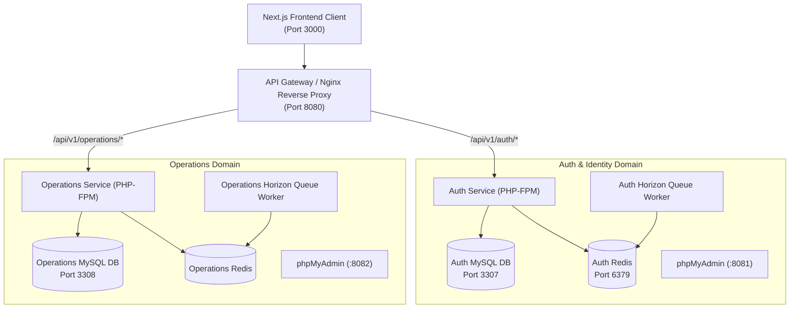

# 🛠️ CodeBridges Services — Backend Microservices Architecture

[](https://laravel.com/)
[](https://php.net/)
[](https://www.docker.com/)
[](https://mysql.com/)
[](https://redis.io/)
[](https://github.com/Codebridge404/codebridge-services/actions/workflows/laravel.yml)

The distributed backend microservices powering the **CodeBridges Multi-Tenant SaaS Retail & POS platform**. Built with Laravel 11, running in a containerized Docker cluster with dedicated database and queue per service domain.

---

## 🏗️ Architecture Overview



---

## 🔌 Container & Port Reference

| Service Container | Role / Description | Host Port | Internal Port |
| :--- | :--- | :--- | :--- |
| **`codebridge-api-gateway`** | Nginx Reverse Proxy & Entrypoint | **`8080`** | `80` |
| **`codebridge-auth-service`** | Authentication, Tenants, Roles, Outlets | *Network only* | `9000` |
| **`codebridge-auth-horizon`** | Background queue worker (Auth) | *Worker* | — |
| **`codebridge-auth-mysql`** | Dedicated Auth MySQL database | **`3307`** | `3306` |
| **`codebridge-auth-redis`** | Dedicated Auth cache & queue store | **`6379`** | `6379` |
| **`codebridge-auth-phpmyadmin`** | Database Web GUI (Auth DB) | **`8081`** | `80` |
| **`codebridge-operations-service`** | Catalog, Inventory, POS, Orders, Shifts | *Network only* | `9000` |
| **`codebridge-operations-horizon`** | Background queue worker (Operations) | *Worker* | — |
| **`codebridge-operations-mysql`** | Dedicated Operations MySQL database | **`3308`** | `3306` |
| **`codebridge-operations-redis`** | Dedicated Operations cache & queue store | *Network only* | `6379` |
| **`codebridge-operations-phpmyadmin`**| Database Web GUI (Operations DB) | **`8082`** | `80` |

---

## 🚀 Quickstart & Setup

### Prerequisites
- [Docker Desktop](https://www.docker.com/) (with Docker Compose v2)
- Git

### 1. Clone & Setup Network
```bash
git clone https://github.com/Codebridge404/codebridge-services.git
cd codebridge-services

# Create the shared docker network (if not existing)
docker network create codebridge-network
```

### 2. Configure Environment Files
Copy the example environment files for both microservices:
```bash
cp auth-service/.env.example auth-service/.env
cp operations-service/.env.example operations-service/.env
```

### 3. Spin Up Containers
```bash
docker compose up -d --build
```

Verify all 11 containers are healthy:
```bash
docker compose ps
```

### 4. Run Migrations & Seeders
```bash
# Auth Service migrations
docker compose exec auth-service php artisan migrate --seed

# Operations Service migrations
docker compose exec operations-service php artisan migrate --seed
```

---

## 🌿 GitFlow & Branching Guidelines

- **`master` (Production)**: Protected. Only merged via approved Pull Requests from `demo`.
- **`demo` (Staging / Integration)**: Protected. The integration branch for testing before release.
- **`feature/*`**: All team members branch from and PR to **`demo`**.

```bash
# Branching off demo
git checkout demo
git pull origin demo
git checkout -b feature/your-feature-name

# Pushing feature work
git push -u origin feature/your-feature-name
# Then open PR on GitHub: feature/your-feature-name -> demo
```

---

## 👥 Organization
- **Owner**: [@VibolSen](https://github.com/VibolSen)
- **Team**: [@Codebridge404/developers](https://github.com/orgs/Codebridge404/teams/developers)
