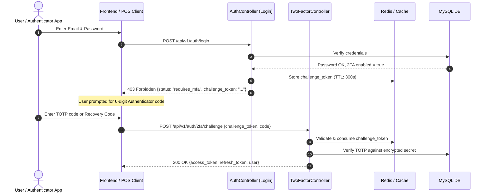

# Daily Engineering Progress Report — October 30, 2026

**Project:** Codebridge Microservices Architecture  
**Active Service:** `codebridge-services/auth-service`  
**Git Branch:** `feature/auth-service-requests-resources-architecture`  
**Test Suite Status:** 112 Tests Passed (544 Assertions, 0 Failures)  

---

## 1. Executive Summary

Today's engineering efforts focused on three critical architectural milestones for `auth-service`:
1. **MinIO S3 Object Storage & WebP Image Processing**: Transitioned avatar uploads to MinIO S3 object storage with on-the-fly conversion of all images (PNG, JPEG, GIF, SVG) into modern compressed `.webp` format with alpha channel transparency preservation.
2. **Dedicated Profile Image Upload Architecture**: Separated avatar uploads from user profile updates, producing an isolated endpoint (`/api/v1/auth/upload-profile`), custom form request, and clean OpenAPI docs that display only the file picker.
3. **Enterprise Authenticator-App Two-Factor Authentication (RFC 6238 TOTP)**: Implemented a complete 2FA lifecycle supporting Google Authenticator, QR code provisioning, temporary pre-auth login challenges, and emergency recovery codes.

---

## 2. Key Implementations & Enhancements

### A. MinIO S3 Storage & WebP Processing Pipeline
- **Filesystem Configuration**:
  - Configured `'minio'` disk in `config/filesystems.php` with `use_path_style_endpoint => true` and target bucket `codebridge-auth`.
  - Added URL builder producing public URLs: `http://localhost:9000/codebridge-auth/avatars/{filename}.webp`.
- **Image Conversion Service** (`app/Services/ImageService.php`):
  - Built pure PHP GD converter (`convertToWebp()`) at 85% compression quality.
  - Enabled full 8-bit alpha channel transparency preservation (`imagesavealpha` and `imagealphablending($image, false)`).
  - Handles multipart uploads, raw string files, and `data:image/...;base64` inputs.
  - Automatic garbage collection of replaced or removed avatars.
  - Fault-tolerant fallback to local public disk if MinIO S3 is temporarily unreachable.

### B. Dedicated Profile Avatar Endpoint
- **Request Class** (`app/Http/Requests/Auth/UploadProfileImageRequest.php`):
  - Form validation with `'avatar' => ['required', 'file', 'mimes:jpeg,png,jpg,webp,gif,svg', 'max:10240']`.
  - Clean Scalar UI presentation showing only: `avatar* : pick a file [Upload]`.
- **Decoupled Controller Action** (`AuthController::uploadProfile`):
  - Stripped heavy `UserResource` payload from response.
  - Response payload contains only necessary upload metadata:
    ```json
    {
      "status": "success",
      "message": "Profile image uploaded successfully.",
      "avatar_url": "http://localhost:9000/codebridge-auth/avatars/avatar_1_xxxx.webp"
    }
    ```

### C. Authenticator-App Two-Factor Authentication (2FA)
- **TOTP Engine** (`app/Services/TwoFactorService.php`):
  - RFC 6238 / RFC 4226 compliant HMAC-SHA1 algorithm with 30-second time steps and 6-digit codes.
  - $\pm 30$-second clock drift window ($T - 1, T, T + 1$).
  - Encrypted database storage of secret keys and recovery codes via `Crypt::encryptString`.
  - 8 emergency one-time recovery codes (`XXXX-XXXX`) with single-use consumption.
  - 5-minute cached pre-authentication challenge tokens (`auth:2fa_challenge:{token}`).
- **TwoFactor Controller & Routing** (`app/Http/Controllers/Api/V1/TwoFactorController.php`):
  - `POST /api/v1/auth/2fa/setup`: Generates Base32 secret, `otpauth://totp/...` URI, and QR code URL.
  - `POST /api/v1/auth/2fa/confirm`: Validates code, activates 2FA, generates recovery codes.
  - `POST /api/v1/auth/login`: Intercepts credentials for 2FA-enabled accounts, returning HTTP 403 and `challenge_token` (**no tokens leaked**).
  - `POST /api/v1/auth/2fa/challenge`: Validates challenge token + TOTP or recovery code; issues JWT and Sanctum tokens.
  - `POST /api/v1/auth/2fa/disable`: Disables 2FA and clears secrets after password verification.
  - `POST /api/v1/auth/2fa/toggle`: Backward compatibility for existing session management tests.



---

## 3. Files Created & Modified

| Type | Path | Status |
| :--- | :--- | :--- |
| **New Service** | `app/Services/ImageService.php` | Created |
| **New Service** | `app/Services/TwoFactorService.php` | Created |
| **New Controller** | `app/Http/Controllers/Api/V1/TwoFactorController.php` | Created |
| **New Form Request**| `app/Http/Requests/Auth/UploadProfileImageRequest.php` | Created |
| **New Form Request**| `app/Http/Requests/Auth/TwoFactorConfirmRequest.php` | Created |
| **New Form Request**| `app/Http/Requests/Auth/TwoFactorChallengeRequest.php` | Created |
| **New Form Request**| `app/Http/Requests/Auth/TwoFactorDisableRequest.php` | Created |
| **New Test** | `tests/Feature/AvatarUploadTest.php` | Created (7 tests) |
| **New Test** | `tests/Feature/TwoFactorAuthenticationTest.php` | Created (10 tests) |
| **New Docs** | `docs/DAILY_REPORT_2026_10_30.md` | Created |
| **Modified** | `app/Http/Controllers/Api/V1/AuthController.php` | Updated |
| **Modified** | `app/Models/User.php` | Updated |
| **Modified** | `routes/api/auth.php` | Updated |
| **Modified** | `routes/api/sessions.php` | Updated |
| **Modified** | `config/filesystems.php` | Updated |

---

## 4. Test Verification & Results

The entire automated test suite was executed inside Docker container `codebridge-auth-service`:

```bash
docker compose -f codebridge-services/docker-compose.yml exec auth-service php artisan test
```

### Results Summary:
```
   PASS  Tests\Unit\ApiResponseTest
   PASS  Tests\Unit\ExampleTest
   PASS  Tests\Unit\UserRelationshipsTest
   PASS  Tests\Feature\AdminTest
   PASS  Tests\Feature\ApiKeysTest
   PASS  Tests\Feature\AuthTest (11 passed)
   PASS  Tests\Feature\AvatarUploadTest (7 passed)
   PASS  Tests\Feature\CrmTest
   PASS  Tests\Feature\EmailVerificationTest (12 passed)
   PASS  Tests\Feature\ExampleTest
   PASS  Tests\Feature\JwtAuthenticationTest (6 passed)
   PASS  Tests\Feature\LoggingAndAuditSecurityTest (3 passed)
   PASS  Tests\Feature\MeetingsTest (3 passed)
   PASS  Tests\Feature\OrganizationTest (3 passed)
   PASS  Tests\Feature\RolesPermissionsTest (2 passed)
   PASS  Tests\Feature\Security\InputValidationSecurityTest (4 passed)
   PASS  Tests\Feature\Security\PrivilegeAndTenantIsolationSecurityTest (10 passed)
   PASS  Tests\Feature\SessionsSecurityTest (3 passed)
   PASS  Tests\Feature\StoreCreditInvoicingTest (5 passed)
   PASS  Tests\Feature\SuperAdminTest (2 passed)
   PASS  Tests\Feature\TenantsTest (2 passed)
   PASS  Tests\Feature\TwoFactorAuthenticationTest (10 passed)
   PASS  Tests\Feature\UsersTest (2 passed)

  Tests:    112 passed (544 assertions)
  Duration: 18.54s
```
