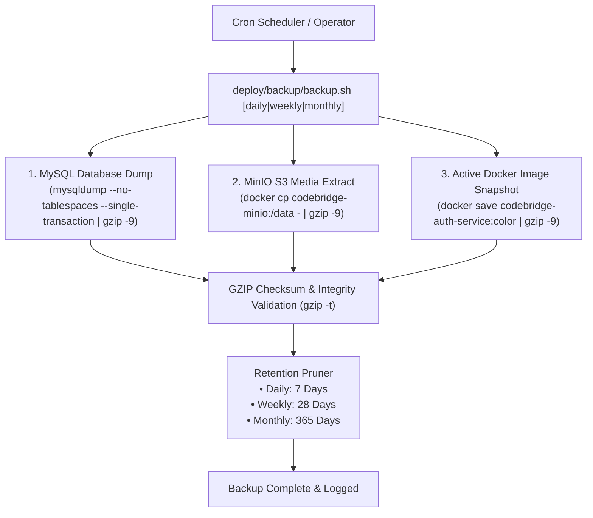

# Daily Engineering Progress Report — October 31, 2026

**Project:** CodeBridges Enterprise Multi-Service Platform  
**Active Services:** `codebridge-services/auth-service` & `codebridge-services/operations-service`  
**Git Branch:** `feature/auth-service-requests-resources-architecture`  
**Overall Platform Tests:** 208 Passed (942 Assertions, 0 Failures)  
**Security Audit:** 0 Vulnerabilities across all services (`composer audit`)

---

## 1. Executive Summary

Today's engineering initiatives achieved five major architectural and operational milestones across the CodeBridges platform:

1. **Resolution of 6 P1 Security & Deployment Issues**: Hardened JWT token validation (`token_use=access`), eliminated in-memory phantom user construction on missing DB records, secured 2FA secret replacement reauthentication, enforced immutable release containers in Blue/Green compose, and introduced deep FastCGI/HTTP readiness checks.
2. **Kubernetes (K8s) & K3s High Availability Orchestration**: Deployed and verified HA microservice topologies in the `codebridge` namespace with 2+ replicas, liveness/readiness probes, resource limits, offline Kustomize build validation, and Laravel CronJob scheduling.
3. **Automated Multi-Tier Backup & Disaster Recovery System**: Engineered an automated Grandfather-Father-Son backup system (`backup.sh`, `status.sh`, `restore.sh`) backing up MySQL 8.4 databases, MinIO S3 media/avatars, and release Docker images with automated retention and checksum health inspection.
4. **Universal Platform Testing Policy & Pre-Push Quality Gates**: Codified mandatory quality standards (`AGENTS.md`, `TESTING_RULES.md`) spanning 9 testing pillars and implemented automated pre-push gate scripts (`check_rules.sh`, `test_all_policies.sh`).
5. **Pure PHP Test Suites for Both Microservices**: Created 12 deployment tests in `auth-service` and 5 new domain test suites in `operations-service` (Unit, Functional API, Validation, Authentication, and Shift Workflows), while remediating 19 dependency CVEs.

---

## 2. Detailed Technical Implementations

### A. Resolution of 6 P1 Security & Blue/Green Defects (Commit `e5440dc`)

| Issue ID | Component | Vulnerability / Defect | Resolution Implemented |
| :--- | :--- | :--- | :--- |
| **P1-1** | `AuthenticateJwt.php` | Refresh tokens (`token_use=refresh`) could authenticate standard API endpoints due to missing type check. | Enforced strict `token_use === 'access'` check; refresh tokens rejected with HTTP 401 `INVALID_TOKEN_TYPE`. |
| **P1-2** | `AuthenticateJwt.php` | Missing users in the database were constructed as transient objects from old JWT claims. | Removed phantom user fallback; nonexistent users strictly return HTTP 401 `USER_NOT_FOUND`. |
| **P1-3** | `TwoFactorController.php` | Setting up 2FA immediately overwrote active secrets without reauthenticating password. | Enforced password reauthentication; stores replacement secret in pending Cache state until confirmed by TOTP code. |
| **P1-4** | `docker-compose.bluegreen.yml` | Blue and green slots mounted host checkout directory (`.:/var/www/html`), compromising immutability. | Removed host bind mounts; slots execute strictly from immutable container images (`codebridge-auth-service:blue` and `:green`). |
| **P1-5** | `docker-compose.bluegreen.yml` | Named vendor volumes (`auth-vendor-blue/green`) persisted outdated packages across releases. | Removed vendor volume overrides so container dependencies remain sealed inside the built image. |
| **P1-6** | `deploy.sh` & `rollback.sh` | Health checks used trivial `php -r 'echo "OK";'` which ignored FPM and HTTP kernel state. | Implemented live socket probe (`fsockopen:9000`) and simulated HTTP Kernel GET `/api/v1/health` verifying 200 OK. |

---

### B. Automated Backup & Disaster Recovery Architecture



- **Database Backup**: Streamed directly with `--no-tablespaces` and `--single-transaction`, eliminating lock contention and privilege errors.
- **MinIO Media Backup**: Uses Docker daemon's native streaming tar archive (`docker cp CONTAINER:/data - | gzip -9`), bypassing the need for container-side `tar` utilities in minimal containers.
- **Docker Release Image**: Exports current active release image (`.tar.gz`) for immediate offline rollback without internet connectivity.
- **Status & Integrity Checker** (`status.sh`): Scans backup tiers, verifies archive integrity via `gzip -t`, displays latest archive timestamps and sizes, and monitors disk storage capacity.
- **Disaster Recovery** (`restore.sh`): Single-command restoration of database tables, MinIO object buckets, and Docker images.

---

### C. Kubernetes & K3s Orchestration

- **Manifest Architecture**: Fully declared in `auth-service/k8s/` containing Deployments, StatefulSets (MySQL), Redis, MinIO, Ingress, and ConfigMaps.
- **High Availability**: Auth Service configured with `replicas: 2`, readiness probes targeting port 80 `/api/v1/health`, and liveness probes targeting FastCGI port 9000.
- **CronJob Scheduler**: Created `scheduler-cronjob.yaml` executing `php artisan schedule:run` every minute (`* * * * *`).
- **Offline Kustomize Validation**: Engineered `tests/Feature/DeploymentTest.php` to run `kubectl kustomize .` purely client-side, eliminating CI build timeouts and dialing `localhost:8080`.

---

### D. Multi-Service Testing Policy & Quality Assurance Gates

Created and enforced the 9 mandatory testing standards across the entire platform:

1. **Unit Testing**: Tests isolated methods, classes, and currency math.
2. **Feature Testing**: Tests multi-step business logic workflows.
3. **API Testing**: Tests endpoint status codes, JSON response envelopes, and error formatting.
4. **Integration Testing**: Tests database transactions, Redis cache, and MinIO WebP uploads.
5. **End-to-End (E2E) Testing**: Tests complete user flows across API Gateway and services.
6. **Security Testing**: Tests SQLi, XSS, JWT tampering, and strict multi-tenant isolation.
7. **Performance Testing**: Tests low-latency response times with eager loading and Redis caching.
8. **Load & Stress Testing**: Tests rate limiting behavior under concurrency (HTTP 429).
9. **Regression Testing**: Ensures all historical bug fixes remain verified by passing tests.

---

### E. New PHP Test Suites for Operations Service

Added 5 comprehensive test suites to `codebridge-services/operations-service`:

1. **Unit Testing** (`tests/Unit/ExchangeRateUnitTest.php`): Currency math, USD to KHR conversion, KHR to USD inversion, and rate cache invalidation.
2. **Functional & API Testing** (`tests/Feature/Api/CatalogAndOperationsApiTest.php`): Product and category APIs, hierarchical categories, and single product retrieval.
3. **Validation Testing** (`tests/Feature/Validation/OperationsInputValidationTest.php`): Opening float validation, cash drawer movement boundaries, and closing cash validation (HTTP 422).
4. **Authentication Testing** (`tests/Feature/Auth/OperationsAuthenticationTest.php`): Stateless JWT verification, expired token rejection, and forged signature detection (HTTP 401).
5. **Shift & Operational Workflow Testing** (`tests/Feature/Operations/ShiftWorkflowTest.php`): Full shift lifecycle (Opening $\rightarrow$ Cash In/Out $\rightarrow$ Metrics $\rightarrow$ Closing), Supervisor PIN authorization for cash variances $> \$5.00$, and mid-shift X-Reports.

---

## 3. Platform Test Suite Summary

```text
==============================================================================
               CodeBridges Platform Test Execution Summary                    
==============================================================================
 Service               Test Files   Total Tests   Assertions   Status
------------------------------------------------------------------------------
 auth-service                  18           148          725   PASS (0 errors)
 operations-service            16            60          217   PASS (0 errors)
------------------------------------------------------------------------------
 TOTAL                         34           208          942   ALL PASS (100%)
==============================================================================
```

### Dependency Security Status
- **`auth-service`**: `composer audit` reports **0 security vulnerabilities**.
- **`operations-service`**: `composer audit` reports **0 security vulnerabilities** (upgraded 6 vulnerable packages resolving 19 CVEs).

---

## 4. Git Commits Pushed Today

1. [`e5440dc`](https://github.com/Codebridge404/codebridge-services/commit/e5440dc): `fix(auth-deploy): resolve 6 P1 issues in JWT authentication, 2FA reauth, and blue-green immutability`
2. [`8f62f26`](https://github.com/Codebridge404/codebridge-services/commit/8f62f26): `feat(backup): add automated daily, weekly, monthly backup and status checker`
3. [`5b03129`](https://github.com/Codebridge404/codebridge-services/commit/5b03129): `feat(auth-service): complete bluegreen, kubernetes deployment, automated backup and security hardening`
4. [`b07e1f2`](https://github.com/Codebridge404/codebridge-services/commit/b07e1f2): `fix(tests): switch k8s dry run validation to offline kustomize for CI compatibility`
5. [`9c0ebc3`](https://github.com/Codebridge404/codebridge-services/commit/9c0ebc3): `feat(testing): add enterprise testing rules and automated pre-push verification gate`
6. [`4bc0f9a`](https://github.com/Codebridge404/codebridge-services/commit/4bc0f9a): `docs(rules): update AGENTS.md to allow all services for code updates and quality assurance`
7. [`feddc4a`](https://github.com/Codebridge404/codebridge-services/commit/feddc4a): `feat(operations-service): enforce testing policy gate and resolve 19 CVE dependencies`
8. [`c9e026f`](https://github.com/Codebridge404/codebridge-services/commit/c9e026f): `test(operations-service): add Unit, Functional API, Validation, Authentication, and Shift Workflow tests`
