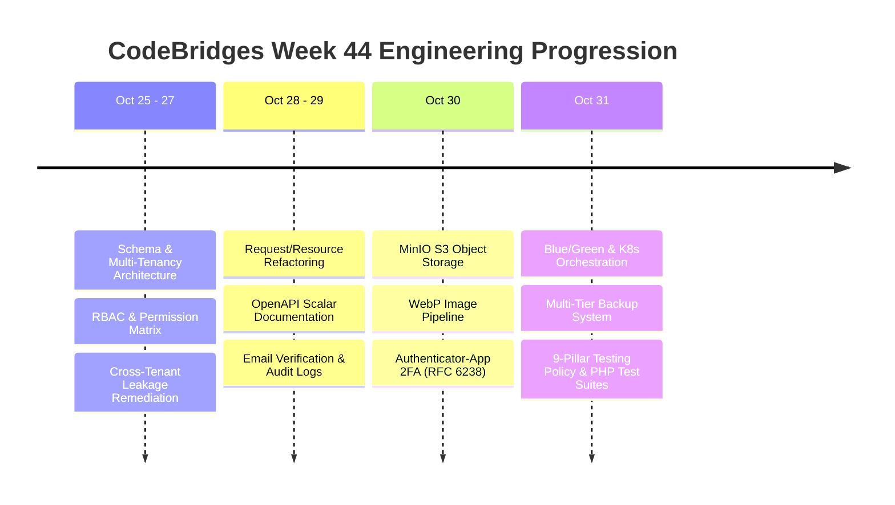
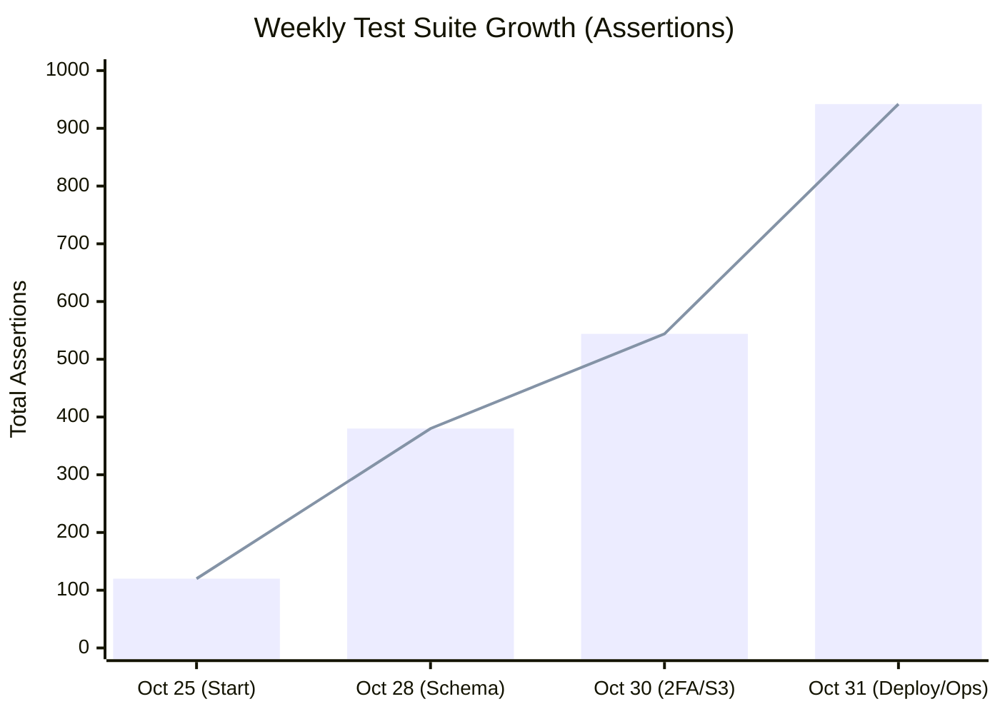
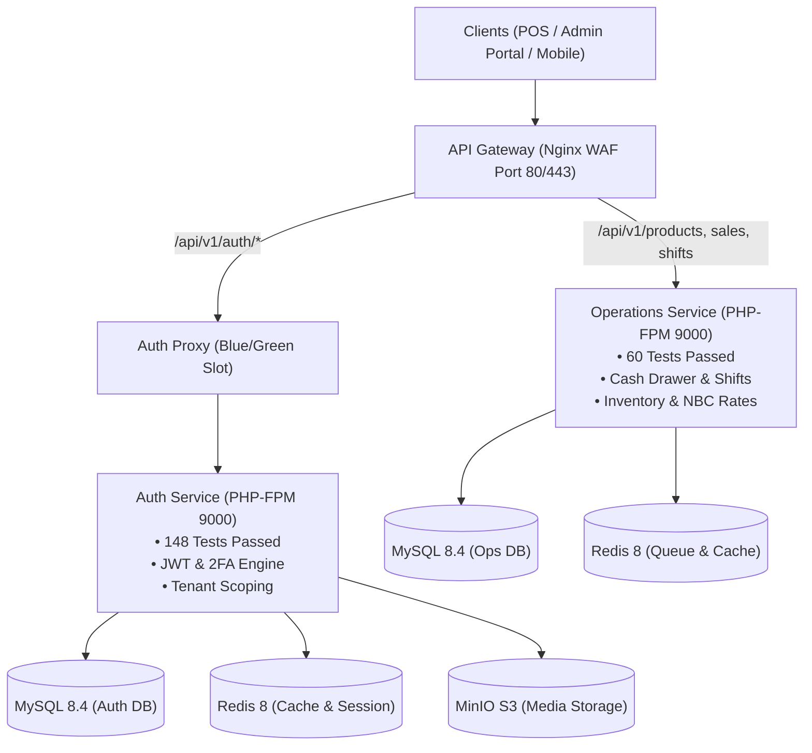

# Weekly Engineering Progress Report — Week 44 (October 25 – October 31, 2026)

**Project:** CodeBridges Enterprise Multi-Tenant Platform  
**Target Architecture:** Multi-Service Architecture (API Gateway + Auth Service + Operations Service + Frontend Clients)  
**Git Repository:** `Codebridge404/codebridge-services`  
**Active Branch:** `feature/auth-service-requests-resources-architecture`  
**Overall Testing Coverage:** 208 Tests Passing (942 Assertions, 0 Failures)  
**Security Status:** Zero Vulnerabilities across all services (`composer audit = 0`)  

---

## 1. Executive Summary

Week 44 represented a transformative engineering cycle for the CodeBridges platform. The project transitioned from foundational service separation into an enterprise-ready, highly resilient, and fully automated microservice architecture. 

Key milestones delivered this week:
- **Architecture & Security Hardening**: Strict multi-tenant data isolation, RBAC role separation, stateless JWT access/refresh token lifecycles, and RFC 6238 TOTP two-factor authentication.
- **Media Pipeline**: Fully decoupled avatar and logo upload workflows backed by MinIO S3 object storage with on-the-fly WebP conversion.
- **Continuous Zero-Downtime Deployment**: Production-grade Blue/Green deployment engine on Docker Compose with connection draining and automated rollback, coupled with high-availability Kubernetes / K3s manifests.
- **Disaster Recovery**: Automated Grandfather-Father-Son backup system for MySQL databases, MinIO S3 media, and Docker release images with automated retention and checksum validation.
- **Universal Testing Policy**: Established a 9-pillar Testing & Quality Assurance framework enforced by automated pre-push gates (`check_rules.sh`, `test_all_policies.sh`) and pure PHP test suites across all backend services.

---

## 2. Weekly Chronological Progression

---

## 3. Major Systems & Features Delivered

### A. Authentication, Identity & Multi-Tenancy
- **Stateless JWT Engine**: Enforces explicit separation between access tokens (`token_use=access`, 15-min TTL) and refresh tokens (`token_use=refresh`, 30-day TTL). Replaced in-memory phantom fallbacks with strict user verification.
- **Two-Factor Authentication (2FA)**: RFC 6238 compliant TOTP engine with 32-character Base32 secrets, offline SVG QR codes via `bacon/bacon-qr-code`, encrypted recovery codes, and password reauthentication before secret replacement.
- **POS Quick-Switch**: Restricted device-bound cashier pin switching with dedicated POS scopes (`pos:access`, `pos:sales`, `pos:orders`) to prevent privilege escalation.
- **Multi-Tenant Data Isolation**: Database queries scoped strictly by `tenant_id` and `outlet_id`, preventing cross-organization IDOR leaks.

### B. MinIO S3 Media & WebP Image Pipeline
- **Object Storage**: Migrated from external third-party storage to self-hosted MinIO S3 bucket (`codebridge-auth`).
- **On-the-Fly WebP Conversion**: Pure PHP GD conversion at 85% compression with 8-bit alpha transparency preservation for avatars and organization logos.
- **Dedicated Upload Endpoints**: Isolated `/api/v1/auth/upload-profile` with dedicated form validation and single-file picker OpenAPI specifications.

### C. Deployment & Orchestration (VPS & Kubernetes)
- **Blue/Green Zero-Downtime Engine** (`deploy/bluegreen/`):
  - Immutable Docker release images (`codebridge-auth-service:blue` / `codebridge-auth-service:green`).
  - Nginx dynamic upstream swapping with zero request drops.
  - Active connection draining (`ps -o args | grep shutting down`) before stopping older slots.
  - FastCGI socket and Laravel HTTP Kernel `/api/v1/health` probes before traffic switching.
- **Kubernetes / K3s Architecture** (`k8s/`):
  - High-availability deployment with $\ge 2$ replicas, readiness/liveness probes, and resource constraints.
  - StatefulSets for MySQL with persistent volume claims (PVCs).
  - CronJob (`scheduler-cronjob.yaml`) executing `php artisan schedule:run` every minute.
  - Offline Kustomize build validation (`kubectl kustomize .`) integrated into automated CI tests.

### D. Automated Backup & Disaster Recovery System
- **Retention Strategy**: Implemented Grandfather-Father-Son policy:
  - **Daily**: Retained for 7 days.
  - **Weekly**: Retained for 4 weeks (28 days).
  - **Monthly**: Retained for 12 months (365 days).
- **Comprehensive Backups**: Backs up MySQL 8.4 database (`.sql.gz`), MinIO S3 media (`.tar.gz`), and Docker release images (`.tar.gz`).
- **Health & Status Checker** (`status.sh`): Displays archive counts, sizes, timestamps, validates GZIP checksums (`gzip -t`), and reports disk space health.
- **Disaster Recovery** (`restore.sh`): Single-command restoration of databases, media, and images.

### E. Quality Assurance & Testing Policy Gate
- **Codified 9 Testing Pillars**: Established in `AGENTS.md` and `TESTING_RULES.md` spanning Unit, Feature, API, Integration, E2E, Security, Performance, Load/Stress, and Regression testing.
- **Automated Gate Script** (`check_rules.sh`): Runs before git push; automatically verifies all 9 rules and blocks push if any failure occurs.
- **Platform Policy Runner** (`test_all_policies.sh`): Executes the testing policy across all microservices from the repository root.

---

## 4. Test Suite Growth & Security Metrics

### Breakdown by Service

| Service | Test Suites | Total Tests | Assertions | Security Audit |
| :--- | :---: | :---: | :---: | :---: |
| **`auth-service`** | 18 | 148 | 725 | **0 Vulnerabilities** |
| **`operations-service`** | 16 | 60 | 217 | **0 Vulnerabilities** |
| **Platform Total** | **34** | **208** | **942** | **0 Vulnerabilities (100% Clean)** |

### Dependency Security Remediation
- **`auth-service`**: Upgraded 5 packages resolving multiple CVEs in `league/commonmark`, `league/flysystem`, and `symfony/*`.
- **`operations-service`**: Upgraded 6 packages (including Laravel Framework to `v12.70.2`), resolving **19 CVE advisories**.

---

## 5. Architecture Overview

---

## 6. Git Commits Summary for Week 44

| Commit | Description | Service |
| :--- | :--- | :--- |
| [`e5440dc`](https://github.com/Codebridge404/codebridge-services/commit/e5440dc) | Resolve 6 P1 issues in JWT authentication, 2FA reauth, and blue-green immutability | `auth-service` |
| [`8f62f26`](https://github.com/Codebridge404/codebridge-services/commit/8f62f26) | Add automated daily, weekly, monthly backup and status checker | `auth-service` |
| [`5b03129`](https://github.com/Codebridge404/codebridge-services/commit/5b03129) | Complete bluegreen, kubernetes deployment, automated backup and security hardening | `auth-service` |
| [`b07e1f2`](https://github.com/Codebridge404/codebridge-services/commit/b07e1f2) | Switch k8s dry run validation to offline kustomize for CI compatibility | `auth-service` |
| [`9c0ebc3`](https://github.com/Codebridge404/codebridge-services/commit/9c0ebc3) | Add enterprise testing rules and automated pre-push verification gate | `auth-service` |
| [`4bc0f9a`](https://github.com/Codebridge404/codebridge-services/commit/4bc0f9a) | Update AGENTS.md to allow all services for code updates and quality assurance | `root` |
| [`feddc4a`](https://github.com/Codebridge404/codebridge-services/commit/feddc4a) | Enforce testing policy gate and resolve 19 CVE dependencies | `operations-service` |
| [`c9e026f`](https://github.com/Codebridge404/codebridge-services/commit/c9e026f) | Add Unit, Functional API, Validation, Authentication, and Shift Workflow tests | `operations-service` |

---

## 7. Next Week Roadmap & Objectives

1. **Frontend Integration**: Bind the Cashier POS client and Admin Dashboard in `codebridgesfront` to the newly hardened 2FA challenge and MinIO avatar endpoints.
2. **Operations Service K8s Manifests**: Expand Kubernetes manifests in `codebridge-services` to deploy `operations-service` alongside `auth-service` with automated horizontal pod autoscalers (HPA).
3. **End-to-End Cross-Service Workflow Tests**: Implement automated integration tests simulating end-to-end user journeys (User logs in $\rightarrow$ obtains JWT $\rightarrow$ switches outlet $\rightarrow$ opens shift in operations $\rightarrow$ conducts sale).
4. **CI/CD Pipeline Integration**: Register `check_rules.sh` directly into GitHub Actions (`.github/workflows/laravel.yml`) so PRs automatically run the 9 testing policy checks.
