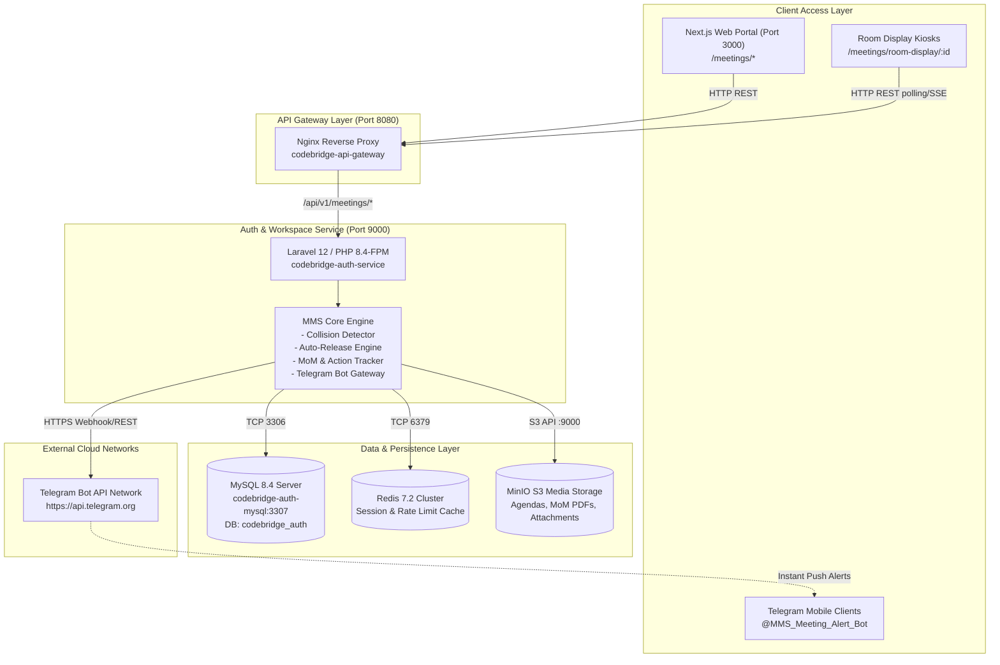
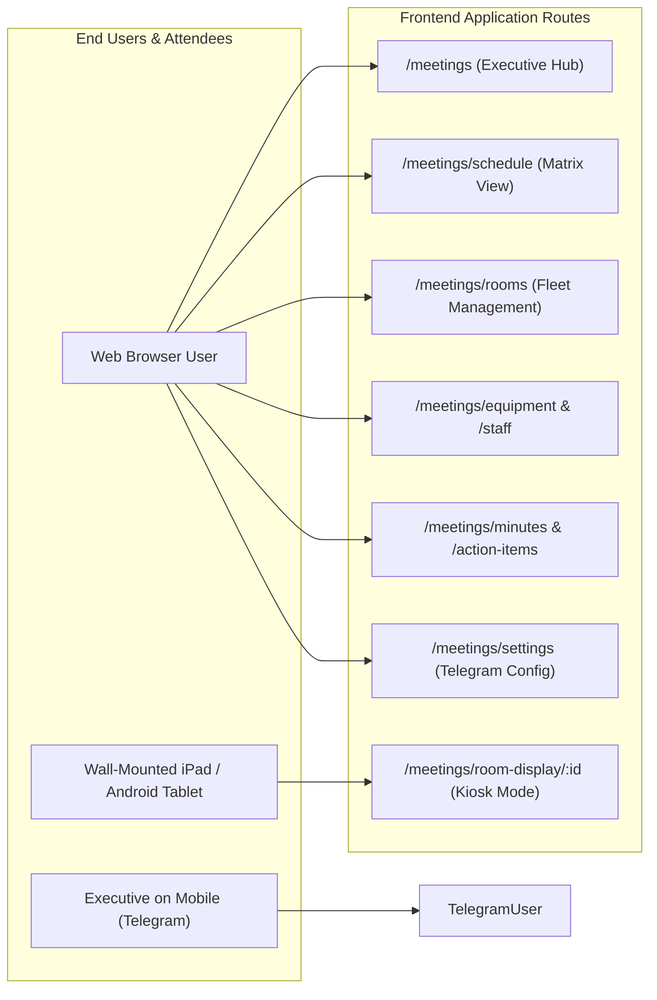

# Volume 1: System Overview & Architecture Topology
## CodeBridge Meeting Management System (MMS)

> **Document ID**: `MMS-ARCH-VOL-01`  
> **Status**: Approved for Production  
> **Target Audience**: Solution Architects, DevOps Engineers, Backend & Frontend Developers  
> **Last Updated**: November 2026  

---

## 1. Executive Summary & Domain Scope

The **CodeBridge Meeting Management System (MMS)** is an enterprise workspace resource management solution engineered to solve common corporate meeting challenges:
* **Meeting Room Contention & Double-Booking**: Overlapping reservations caused by disjointed calendar clients.
* **"Ghost Meetings" (Unattended Reservations)**: Blocked boardrooms remaining vacant when organizers fail to show up or cancel.
* **AV & Logistics Bottlenecks**: High-stakes meetings delayed by missing presentation hardware, lack of adapters, or unassigned AV specialists.
* **Governance & Follow-up Breakdown**: Lost action items, delayed Minutes of Meeting (MoM) distribution, and unaccountable decision tracking.
* **Real-Time Notification Latency**: Missed cancellations and schedule shifts leading to wasted employee time.

MMS addresses these challenges by consolidating **room reservation logic**, **tablet door displays (Kiosk Mode)**, **hardware/logistics scheduling**, **MoM governance**, and **instant Telegram alerts** into a cohesive, multi-tenant cloud service.

---

## 2. Platform Architecture & Microservice Topology

MMS operates as a domain subsystem inside **`codebridge-auth-service`**, interacting across the CodeBridge microservice ecosystem:



---

## 3. Microservice Boundary & Infrastructure Specifications

| Component | Container Name | Port(s) | Role & Operational Responsibility |
| :--- | :--- | :--- | :--- |
| **API Gateway** | `codebridge-api-gateway` | `8080` (HTTP) | Central entry point; enforces CORS headers, routes `/api/v1/meetings/*` to the auth service upstream, terminates SSL/TLS. |
| **Backend Core** | `codebridge-auth-service` | `9000` (FastCGI) | Runs Laravel 12 on PHP 8.4-FPM. Houses the MMS domain controllers, collision engine, recurring schedule generators, and security policies. |
| **Database** | `codebridge-auth-mysql` | `3307` (Host) / `3306` (Internal) | Dedicated MySQL 8.4 relational database engine. Enforces transactional room locking, foreign key integrity, and audit logging. |
| **Async Queues** | `codebridge-auth-horizon` | N/A (Background) | Executes asynchronous jobs (ICS calendar file generation, bulk email dispatch, background Telegram notifications). |
| **Frontend UI** | `codebridgesfront` | `3000` (HTTP) | Built with Next.js 16, React 19, and Tailwind CSS. Delivers the meeting calendar matrix, room cards, and tablet kiosk interfaces. |
| **Media Store** | `codebridge-minio` | `9000` / `9001` | S3-compatible object store hosting meeting document attachments, presentation slide decks, and MoM transcripts. |

---

## 4. Subsystem Component Hierarchy

MMS is partitioned into 7 functional modules:

```
Meeting Management System (MMS)
│
├── 1. Room Fleet & Facility Manager
│   ├── Room Profiles (capacity, location, floor, layout)
│   ├── Amenities & Hardware Capabilities (VC, Whiteboard, TV)
│   └── Operational Status (Available, Maintenance, Offline)
│
├── 2. Scheduling & Collision Engine
│   ├── Conflict Detection with Turnover Buffers
│   ├── Recurring Meeting Series Engine (Daily, Weekly, Monthly)
│   └── Attendee RSVP & Participation Tracker
│
├── 3. Tablet Door Signage (Kiosk Mode)
│   ├── Full-Screen High-Contrast Display
│   ├── Instant 1-Tap Ad-Hoc Booking
│   ├── QR Code / 1-Click Attendee Check-In
│   └── Visual Status Countdown (Free / Busy / Ending Soon)
│
├── 4. Logistics & Specialist Allocation
│   ├── AV Hardware Asset Tracking (Projectors, Mics, Dongles)
│   └── Support Staff Assignments (AV Techs, Interpreters, Scribes)
│
├── 5. Governance: Minutes & Action Items
│   ├── Agenda Definition & Timeboxing
│   ├── Minutes of Meeting (MoM) Drafting & Executive Sign-off
│   └── Action Item Tracker (Assignee, Due Date, Status)
│
├── 6. Incident & Issue Reporting
│   ├── Room Defect Logging (Broken Display, AC Malfunction)
│   └── Maintenance Workflow (Reported -> In Progress -> Resolved)
│
└── 7. Real-Time Notification & Telegram Gateway
    ├── Automated Lifecycle Alerts (Created, Changed, Reminders, Cancelled)
    ├── Dynamic Mustache Template Engine
    └── Secure Bot Token & Chat ID Management
```

---

## 5. Security Architecture & Multi-Tenant Isolation

MMS enforces a multi-tiered security model to guarantee data confidentiality across corporate tenants:

1. **Strict Tenant Scoping (`tenant_id`)**:
   Every database query filters by the authenticated user's `tenant_id`. Cross-tenant data leakage is structurally impossible at the repository and query-builder levels.

2. **Role-Based Access Control (RBAC)**:
   * `super_admin`: Full administrative control across all corporate tenants and global system configurations.
   * `organization` / `admin`: Manage corporate boardroom fleet, view all organizational schedules, override bookings, and configure Telegram bots.
   * `staff`: Book rooms, invite colleagues, view public agendas, manage owned action items, and record MoM notes.
   * `cashier` / `guest`: View-only access or room-specific access if granted.

3. **Audit Trail & Threat Telemetry**:
   * Every booking creation, status modification, or room cancellation generates an immutable entry in `audit_logs`.
   * Any unauthorized booking attempt, rate-limit violation, or parameter tampering triggers an event in `security_events`.
   * End-to-end request latencies and payload signatures are tracked in `api_request_logs`.

---

## 6. Client Application Interfaces



---

## Next Steps & Cross-References
* For the exhaustive database schema, indexes, and Mermaid ERD, see **[Volume 2: Database Schema & ERD](../02_database_schema_and_erd/02_mms_database_schema_and_erd.md)**.
* For complete API endpoint definitions, request parameters, and response structures, see **[Volume 3: API Specifications & Integration](../03_api_specifications/03_mms_api_specifications_and_integration.md)**.
* For operational lifecycle state-machines, collision prevention algorithms, and Telegram bot setup, see **[Volume 4: Workflows, Security & Notifications](../04_workflows_security_notifications/04_mms_workflows_security_and_notifications.md)**.
