# Volume 2: Database Schema & Entity-Relationship Diagrams (ERD)
## CodeBridge Meeting Management System (MMS)

> **Document ID**: `MMS-ARCH-VOL-02`  
> **Status**: Approved Architecture & Consolidated Design  
> **Target Audience**: Database Administrators, Backend Engineers, System Architects  
> **Database Engine**: MySQL 8.4 (`codebridge_auth`)  
> **Architecture Reference**: Cloud Platform Architecture (Page 5: Meetings & Resource Allocation)  
> **Last Updated**: 2026-11-16  

---

## 1. Complete Entity-Relationship Diagram (Mermaid ERD)

The Consolidated MMS architecture spans **20 base tables + 1 optional routing table** grouped into 3 coherent functional sections:
1. **MEETINGS & RESOURCE ALLOCATION** (10 tables)
2. **MEETINGS · ISSUES, STAFF & RESOURCES** (5 tables)
3. **MEETINGS · TELEGRAM & NOTIFICATIONS** (6 tables)

```mermaid
erDiagram
    TENANTS ||--o{ MEETING_ROOMS : owns
    TENANTS ||--o{ MEETING_SERIES : configures
    TENANTS ||--o{ MEETINGS : manages
    TENANTS ||--o{ MEETING_MATERIALS : inventory
    TENANTS ||--o{ MEETING_STAFF : employs
    TENANTS ||--o{ MEETING_TELEGRAM_CONFIGS : integrates
    TENANTS ||--o{ MEETING_SYSTEM_SETTINGS : defines

    MEETING_ROOMS ||--o{ MEETINGS : hosts
    MEETING_ROOMS ||--o{ MEETING_ROOM_DISPLAYS : controls
    MEETING_ROOMS ||--o{ MEETING_ROOM_ISSUES : suffers
    MEETING_ROOMS ||--o{ MEETING_MATERIALS : houses

    MEETING_SERIES ||--o{ MEETINGS : generates

    MEETINGS ||--o{ MEETING_ATTENDEES : has
    MEETINGS ||--o{ MEETING_ACTION_ITEMS : yields
    MEETINGS ||--o{ MEETING_MINUTES : records
    MEETINGS ||--o{ MEETING_MATERIAL_ALLOCATIONS : requests
    MEETINGS ||--o{ MEETING_STAFF_ALLOCATIONS : assigns
    MEETINGS ||--o{ MEETING_FEEDBACK : receives
    MEETINGS ||--o{ MEETING_ATTACHMENTS : stores
    MEETINGS ||--o{ MEETING_NOTIFICATIONS : dispatches
    MEETINGS ||--o{ MEETING_CATERING_ORDERS : orders
    MEETINGS ||--o{ MEETING_ROOM_ISSUES : triggers

    MEETING_MATERIALS ||--o{ MEETING_MATERIAL_ALLOCATIONS : allocated_to
    MEETING_STAFF ||--o{ MEETING_STAFF_ALLOCATIONS : performs

    USERS ||--o{ MEETINGS : organizes
    USERS ||--o{ MEETING_ATTENDEES : participates
    USERS ||--o{ MEETING_ACTION_ITEMS : assigned_to
    USERS ||--o{ MEETING_MINUTES : authors
    USERS ||--o{ MEETING_ROOM_ISSUES : reports
    USERS ||--o{ MEETING_STAFF : profiles

    NOTIFICATION_PROVIDERS ||--o{ MEETING_TELEGRAM_CONFIGS : credentials
    NOTIFICATION_PROVIDERS ||--o{ MEETING_TELEGRAM_GROUPS : discovers
    MEETING_TELEGRAM_CONFIGS ||--o{ MEETING_TELEGRAM_ROUTES : routes
    MEETING_TELEGRAM_GROUPS ||--o{ MEETING_TELEGRAM_ROUTES : receives
    MEETING_NOTIFICATION_TEMPLATES ||--o{ MEETING_NOTIFICATIONS : formats
```



---

## 2. Section Breakdown & Table Dictionaries

### Section A: MEETINGS & RESOURCE ALLOCATION (10 Tables)

Core scheduling engine, room fleet, attendees, minutes, action items, attachments, feedback, and catering.

| Table | Purpose | Primary Keys & Foreign Keys | Key Constraints & Rules |
| :--- | :--- | :--- | :--- |
| **`meetings`** | Core booking occurrences and session lifecycle | `PK: id`, `FK: tenant_id`, `FK: room_id`, `FK: organizer_id`, `FK: series_id` (null) | `CHECK (end_time > start_time)`, stored in UTC. Transactional room collision lock. |
| **`meeting_series`** | Recurrence rules and scheduled generators | `PK: id`, `FK: tenant_id`, `FK: organizer_id` | Stores IANA timezone & RFC 5545 recurrence rule. Generates explicit `meetings` rows. |
| **`meeting_rooms`** | Facility room catalog and capacity | `PK: id`, `FK: tenant_id`, `REF: outlet_uuid` | `UQ (tenant_id, code)`. `CHECK (hourly_rate >= 0)`. Amenities stored as JSON. |
| **`meeting_room_displays`** | Tablet door kiosks and status signs | `PK: id`, `FK: tenant_id`, `FK: room_id` | `UNIQUE (device_token_hash)`. Screen PIN hash, ping telemetry, and lockout counter. |
| **`meeting_attendees`** | Presence, RSVP, and guest roster | `PK: id`, `FK: meeting_id`, `FK: user_id` (null) | `UQ (meeting_id, user_id)`. NULL `user_id` permits external guest emails. |
| **`meeting_attachments`** | Document repository with deduplication | `PK: id`, `FK: tenant_id`, `FK: meeting_id` | **Duplicate Prevention**: Case-insensitive filename collision check per meeting. |
| **`meeting_minutes`** | Official minutes, notes, and decisions | `PK: id`, `FK: meeting_id` (UNIQUE), `FK: author_id` | Exactly one published minutes record per meeting. Markdown content. |
| **`meeting_action_items`** | Assigned post-meeting tasks | `PK: id`, `FK: meeting_id`, `FK: assignee_id` (null) | Due dates, priority levels (`low`, `medium`, `high`, `critical`), completion tracking. |
| **`meeting_feedback`** | Post-session star ratings & comments | `PK: id`, `FK: meeting_id`, `FK: attendee_id` (UNIQUE) | `CHECK (rating_stars BETWEEN 1 AND 5)`. One review per attendee. |
| **`meeting_catering_orders`** | Refreshments, coffee, and meal orders | `PK: id`, `FK: meeting_id` | Quantity, unit cost, total cost, and delivery window tracking. |

---

### Section B: MEETINGS · ISSUES, STAFF & RESOURCES (5 Tables)

Logistics management, AV equipment inventory, staff duty allocations, and facility defect reporting.

| Table | Purpose | Primary Keys & Foreign Keys | Key Constraints & Rules |
| :--- | :--- | :--- | :--- |
| **`meeting_materials`** | AV equipment & consumable inventory | `PK: id`, `FK: tenant_id`, `FK: room_id` (null) | `tracking_type`: `reusable` or `consumable`. Row lock on consumable deductions. |
| **`meeting_material_allocations`** | Equipment loans and usage tracking | `PK: id`, `FK: meeting_id`, `FK: material_id` | `UQ (meeting_id, material_id)`. Returned + consumed cannot exceed allocation. |
| **`meeting_staff`** | Support technician & coordinator roster | `PK: id`, `FK: tenant_id`, `FK: user_id` | `UQ (tenant_id, user_id)`. Profiles existing user without duplicate HR data. |
| **`meeting_staff_allocations`** | Staff duty assignment to sessions | `PK: id`, `FK: tenant_id`, `FK: meeting_id`, `FK: staff_id` | `UQ (meeting_id, staff_id)`. Checks overlapping staff shifts in one transaction. |
| **`meeting_room_issues`** | Unified facility & defect reporting | `PK: id`, `FK: tenant_id`, `FK: room_id`, `FK: meeting_id` | Lifecycle: `open` $\to$ `assigned` $\to$ `in_progress` $\to$ `resolved`. Dispatches events. |

---

### Section C: MEETINGS · TELEGRAM & NOTIFICATIONS (6 Tables)

This section contains six tables managing messaging integrations, multi-group Telegram routing, and outbox delivery:

| Table | Purpose | Useful Index Candidates | Implementation & Schema Notes |
| :--- | :--- | :--- | :--- |
| **`meeting_telegram_configs`** | Organization’s bot provider and preferences | `UNIQUE (tenant_id)` | One meeting bot selection per tenant. Reuses encrypted provider credentials from shared `notification_providers` table. |
| **`meeting_telegram_groups`** | Connected groups and verified organization ownership | `UNIQUE (notification_provider_id, telegram_chat_id)`<br>`INDEX (tenant_id, link_status)` | Discovered via webhook; requires one-use link code verification. Signed `BIGINT` preserves negative group IDs. |
| **`meeting_telegram_routes`** *(optional)* | Events routed to particular groups | `UNIQUE (telegram_config_id, telegram_group_id, event_type)`<br>`INDEX (telegram_config_id, event_type, is_enabled)` | Routes specific events (e.g. `meeting.reminder` $\to$ Updates group, `room.issue_reported` $\to$ Maintenance group). |
| **`meeting_notification_templates`** | Reusable message templates | `UNIQUE (tenant_id, event_type, channel, locale)` | Parameterized markdown templates (`{title}`, `{room}`, `{time}`). Dynamic formatting escaped. |
| **`meeting_notifications`** | Scheduled messages, delivery status, retries | `UNIQUE (tenant_id, dedup_key)`<br>`INDEX (status, next_attempt_at)`<br>`INDEX (tenant_id, meeting_id, created_at)` | Durable Outbox: queue after commit, leases, bounded retries, and deduplication snapshot. |
| **`meeting_system_settings`** | Meeting preferences and defaults | For existing key-value design: `UNIQUE (tenant_id, setting_key)` | Key-value settings row store. Default duration, buffer minutes, approval rules, and IANA timezone. |

---

## 3. High-Performance Indexing Strategy & Operational Rules

### 3.1. Settings Structure Integrity
> [!IMPORTANT]
> **Keep your existing settings structure.**
> `UNIQUE (tenant_id)` would suit a single-row settings design, but would prevent multiple setting rows in your current key-value table. 
> Therefore, for the active key-value schema, use:
> ```sql
> ALTER TABLE meeting_system_settings 
> ADD UNIQUE KEY uq_settings_tenant_key (tenant_id, setting_key);
> ```

### 3.2. Notification Worker Indexing
> [!TIP]
> **Match worker indexes to actual scheduling queries:**
> - `(status, next_attempt_at)` optimizes worker polls searching for failed/retryable tasks awaiting redelivery.
> - Initial message dispatch through `scheduled_at` benefits from an index on `(status, scheduled_at)`:
> ```sql
> -- Optimized Outbox Dispatch Index
> CREATE INDEX idx_notifications_dispatch 
> ON meeting_notifications (status, scheduled_at, next_attempt_at);
> 
> -- Deduplication & Audit Index
> CREATE UNIQUE INDEX uq_notifications_dedup 
> ON meeting_notifications (tenant_id, dedup_key);
> ```

### 3.3. Encrypted Credentials Separation
> [!NOTE]
> The shared `notification_providers` table stores encrypted bot credentials (AES-256-GCM) and is outside these six tables.
> Neither `meeting_telegram_configs` nor `meeting_telegram_groups` stores plaintext bot tokens.

### 3.4. Index Verification Checklist
Before running additive index migrations, inspect existing keys:
```sql
SHOW INDEX FROM meeting_telegram_configs;
SHOW INDEX FROM meeting_notification_templates;
SHOW INDEX FROM meeting_notifications;
SHOW INDEX FROM meeting_system_settings;
```

---

## 4. Summary of Table Relationships

```text
meetings → meeting_rooms, users (organizer), optional meeting_series
meeting_attendees → meetings, optional users
meeting_attachments → meetings, users (uploader) [Duplicate-checked]
meeting_minutes → meetings, users (author)
meeting_action_items → meetings, optional users (assignee)
meeting_feedback → meetings, meeting_attendees
meeting_catering_orders → meetings
meeting_room_displays → meeting_rooms
meeting_room_issues → meeting_rooms, optional meetings, users, optional meeting_staff
meeting_material_allocations → meetings, meeting_materials
meeting_staff → users
meeting_staff_allocations → meetings, meeting_staff, users (assigner)
meeting_system_settings → tenants
meeting_telegram_configs → tenants, notification_providers
meeting_telegram_groups → notification_providers, optional verified tenant/config
meeting_telegram_routes → meeting_telegram_configs, meeting_telegram_groups
meeting_notifications → optional meeting/template/provider/group/recipient
```
