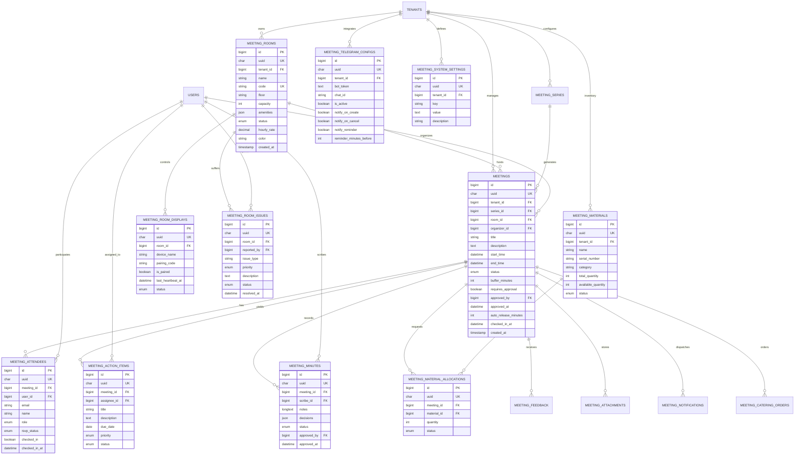

# Volume 2: Database Schema & Entity-Relationship Diagrams (ERD)
## CodeBridge Meeting Management System (MMS)

> **Document ID**: `MMS-ARCH-VOL-02`  
> **Status**: Approved for Production  
> **Target Audience**: Database Administrators, Backend Engineers, System Analysts  
> **Database Engine**: MySQL 8.4 (`codebridge_auth`)  
> **Last Updated**: November 2026  

---

## 1. Complete Entity-Relationship Diagram (Mermaid ERD)

The MMS database architecture consists of **17 normalized tables** engineered for high-concurrency room bookings, low-latency collision detection, and comprehensive auditability:



---

## 2. Comprehensive Table Data Dictionaries

### 2.1. `meeting_rooms` (Facility Fleet)
Stores physical conference rooms, boardrooms, and huddle spaces.

| Column | Type | Constraints | Description |
| :--- | :--- | :--- | :--- |
| `id` | `BIGINT UNSIGNED` | Primary Key, Auto Increment | Internal unique room identifier. |
| `uuid` | `CHAR(36)` | Unique, Not Null | Public immutable UUIDv4. |
| `tenant_id` | `BIGINT UNSIGNED` | Foreign Key &rarr; `tenants.id` | Multi-tenant organization ownership. |
| `name` | `VARCHAR(100)` | Not Null | Display name (e.g., "Grand Boardroom A"). |
| `code` | `VARCHAR(50)` | Index | Facility short code (e.g., "BD-301"). |
| `floor` | `VARCHAR(20)` | Nullable | Floor or wing location. |
| `capacity` | `INT` | Not Null, Default `10` | Maximum seated room occupancy. |
| `amenities` | `JSON` | Nullable | Features: `["video_conferencing", "whiteboard", "tv", "hdmi"]`. |
| `status` | `ENUM` | Default `'available'` | Enum: `'available'`, `'maintenance'`, `'offline'`. |
| `hourly_rate` | `DECIMAL(10,2)` | Default `0.00` | Optional internal cross-charging billing rate. |
| `color` | `VARCHAR(20)` | Default `'#3B82F6'` | Calendar display color palette hex code. |

---

### 2.2. `meetings` (Core Booking Engine)
Stores individual reservation events, time boundaries, and operational lifecycles.

| Column | Type | Constraints | Description |
| :--- | :--- | :--- | :--- |
| `id` | `BIGINT UNSIGNED` | Primary Key, Auto Increment | Internal booking identifier. |
| `uuid` | `CHAR(36)` | Unique, Not Null | Public immutable UUIDv4. |
| `tenant_id` | `BIGINT UNSIGNED` | Foreign Key &rarr; `tenants.id` | Multi-tenant isolation anchor. |
| `series_id` | `BIGINT UNSIGNED` | Nullable, FK &rarr; `meeting_series.id` | Link to recurring series if generated from a recurring rule. |
| `room_id` | `BIGINT UNSIGNED` | Foreign Key &rarr; `meeting_rooms.id` | Reserved physical room. |
| `organizer_id` | `BIGINT UNSIGNED` | Foreign Key &rarr; `users.id` | User accountable for the reservation. |
| `title` | `VARCHAR(255)` | Not Null | Meeting topic/agenda title. |
| `description` | `TEXT` | Nullable | Extended objective, agenda details, or instructions. |
| `start_time` | `DATETIME` | Not Null, Index | Scheduled meeting start timestamp. |
| `end_time` | `DATETIME` | Not Null, Index | Scheduled meeting completion timestamp. |
| `status` | `ENUM` | Default `'scheduled'` | `'scheduled'`, `'in_progress'`, `'completed'`, `'cancelled'`. |
| `buffer_minutes` | `INT` | Default `5` | Post-meeting turnover/sanitation buffer to prevent collisions. |
| `requires_approval`| `BOOLEAN` | Default `false` | Indicates if executive/facility manager approval is required. |
| `approved_by` | `BIGINT UNSIGNED` | Nullable, FK &rarr; `users.id` | Manager user ID who approved reservation. |
| `approved_at` | `DATETIME` | Nullable | Timestamp of approval decision. |
| `auto_release_minutes` | `INT` | Default `15` | Window before an unattended room is auto-released. |
| `checked_in_at` | `DATETIME` | Nullable | Actual timestamp when first attendee checked in. |

---

### 2.3. `meeting_attendees` (RSVP & Presence)
Tracks required and optional participants, their RSVP decisions, and physical attendance.

| Column | Type | Constraints | Description |
| :--- | :--- | :--- | :--- |
| `id` | `BIGINT UNSIGNED` | Primary Key, Auto Increment | Identifier. |
| `uuid` | `CHAR(36)` | Unique, Not Null | Unique attendee record UUID. |
| `meeting_id` | `BIGINT UNSIGNED` | FK &rarr; `meetings.id` (Cascade) | Target meeting. |
| `user_id` | `BIGINT UNSIGNED` | Nullable, FK &rarr; `users.id` | Registered platform user (if internal staff). |
| `email` | `VARCHAR(255)` | Not Null | Participant email address. |
| `name` | `VARCHAR(150)` | Not Null | Full name of participant. |
| `role` | `ENUM` | Default `'attendee'` | `'organizer'`, `'presenter'`, `'attendee'`, `'observer'`. |
| `rsvp_status` | `ENUM` | Default `'pending'` | `'pending'`, `'accepted'`, `'declined'`, `'tentative'`. |
| `checked_in` | `BOOLEAN` | Default `false` | True when attendee registers presence at room kiosk. |
| `checked_in_at` | `DATETIME` | Nullable | Exact check-in timestamp. |

---

### 2.4. `meeting_minutes` (MoM & Decision Governance)
Official record of decisions made, discussions, and executive approvals.

| Column | Type | Constraints | Description |
| :--- | :--- | :--- | :--- |
| `id` | `BIGINT UNSIGNED` | Primary Key, Auto Increment | Identifier. |
| `uuid` | `CHAR(36)` | Unique, Not Null | Minutes UUID. |
| `meeting_id` | `BIGINT UNSIGNED` | Unique, FK &rarr; `meetings.id` | 1-to-1 relationship with meeting. |
| `scribe_id` | `BIGINT UNSIGNED` | FK &rarr; `users.id` | User designated as minute-taker. |
| `notes` | `LONGTEXT` | Nullable | Full markdown/HTML transcript and meeting summary. |
| `decisions` | `JSON` | Nullable | Structured array of formal decisions agreed upon. |
| `status` | `ENUM` | Default `'draft'` | `'draft'`, `'submitted'`, `'approved'`, `'published'`. |
| `approved_by` | `BIGINT UNSIGNED` | Nullable, FK &rarr; `users.id` | Approving executive/chairperson. |
| `approved_at` | `DATETIME` | Nullable | Formal sign-off timestamp. |

---

### 2.5. `meeting_action_items` (Post-Meeting Follow-ups)
Accountability tasks created during or after a meeting.

| Column | Type | Constraints | Description |
| :--- | :--- | :--- | :--- |
| `id` | `BIGINT UNSIGNED` | Primary Key, Auto Increment | Task ID. |
| `uuid` | `CHAR(36)` | Unique, Not Null | Task UUID. |
| `meeting_id` | `BIGINT UNSIGNED` | FK &rarr; `meetings.id` | Source meeting where task was assigned. |
| `assignee_id` | `BIGINT UNSIGNED` | FK &rarr; `users.id` | Accountable owner for completing task. |
| `title` | `VARCHAR(255)` | Not Null | Concise action item summary. |
| `description` | `TEXT` | Nullable | Detailed specifications or deliverables. |
| `due_date` | `DATE` | Nullable | Completion deadline. |
| `priority` | `ENUM` | Default `'medium'` | `'low'`, `'medium'`, `'high'`, `'urgent'`. |
| `status` | `ENUM` | Default `'pending'` | `'pending'`, `'in_progress'`, `'completed'`, `'cancelled'`. |

---

### 2.6. `meeting_room_displays` (Tablet Kiosk Hardware)
Registers and synchronizes physical wall-mounted tablets placed outside boardrooms.

| Column | Type | Constraints | Description |
| :--- | :--- | :--- | :--- |
| `id` | `BIGINT UNSIGNED` | Primary Key, Auto Increment | Kiosk hardware ID. |
| `uuid` | `CHAR(36)` | Unique, Not Null | Public display UUID. |
| `room_id` | `BIGINT UNSIGNED` | FK &rarr; `meeting_rooms.id` | Room associated with this tablet display. |
| `device_name` | `VARCHAR(100)` | Not Null | Hardware nickname (e.g., "iPad Mini Wallmount East"). |
| `pairing_code` | `VARCHAR(20)` | Nullable | 6-digit one-time code to link tablet to room. |
| `is_paired` | `BOOLEAN` | Default `false` | Active link state. |
| `paired_at` | `DATETIME` | Nullable | When pairing was completed. |
| `last_heartbeat_at`| `DATETIME` | Nullable | Ping timestamp for tablet health telemetry. |
| `brightness` | `INT` | Default `100` | Remote screen brightness control (0-100%). |
| `status` | `ENUM` | Default `'offline'` | `'online'`, `'offline'`, `'screen_off'`. |

---

### 2.7. `meeting_materials` & `meeting_material_allocations` (AV Logistics)
Inventory and reservation of shared conference equipment.

| Column | Type | Table | Description |
| :--- | :--- | :--- | :--- |
| `id` | `BIGINT UNSIGNED` | `meeting_materials` | Asset ID. |
| `name` | `VARCHAR(150)` | `meeting_materials` | Asset name (e.g. "Jabra Speak 710 Speakerphone"). |
| `category` | `VARCHAR(50)` | `meeting_materials` | `'audio'`, `'video'`, `'display'`, `'adapter'`, `'board'`. |
| `total_quantity` | `INT` | `meeting_materials` | Physical units owned. |
| `available_quantity`| `INT` | `meeting_materials` | Currently unreserved units. |
| `material_id` | `BIGINT UNSIGNED` | `meeting_material_allocations` | FK &rarr; `meeting_materials.id`. |
| `meeting_id` | `BIGINT UNSIGNED` | `meeting_material_allocations` | FK &rarr; `meetings.id`. |
| `quantity` | `INT` | `meeting_material_allocations` | Units reserved for the duration of the meeting. |

---

### 2.8. `meeting_room_issues` (Facility Defect Tracker)
Enables organizers and attendees to report broken equipment or room maintenance needs.

| Column | Type | Constraints | Description |
| :--- | :--- | :--- | :--- |
| `id` | `BIGINT UNSIGNED` | Primary Key, Auto Increment | Defect ticket ID. |
| `uuid` | `CHAR(36)` | Unique, Not Null | Defect ticket UUID. |
| `room_id` | `BIGINT UNSIGNED` | FK &rarr; `meeting_rooms.id` | Defective room facility. |
| `reported_by` | `BIGINT UNSIGNED` | FK &rarr; `users.id` | User submitting the incident report. |
| `issue_type` | `VARCHAR(50)` | Not Null | `'projector_failure'`, `'audio_noise'`, `'ac_broken'`, `'cleanliness'`. |
| `priority` | `ENUM` | Default `'medium'` | `'low'`, `'medium'`, `'high'`, `'critical'`. |
| `description` | `TEXT` | Not Null | Detailed description of the defect. |
| `status` | `ENUM` | Default `'reported'` | `'reported'`, `'investigating'`, `'in_progress'`, `'resolved'`. |
| `resolved_at` | `DATETIME` | Nullable | Timestamp when issue was repaired. |

---

### 2.9. `meeting_telegram_configs` & `meeting_notification_templates`
Manages the automated Telegram alerting bot engine.

| Column | Type | Table | Description |
| :--- | :--- | :--- | :--- |
| `tenant_id` | `BIGINT UNSIGNED` | `meeting_telegram_configs` | Tenant ownership. |
| `bot_token` | `TEXT` | `meeting_telegram_configs` | Encrypted Telegram Bot API Token. |
| `chat_id` | `VARCHAR(100)` | `meeting_telegram_configs` | Target channel or group chat ID. |
| `notify_on_create` | `BOOLEAN` | `meeting_telegram_configs` | Send alert when new meeting is booked. |
| `notify_on_cancel` | `BOOLEAN` | `meeting_telegram_configs` | Send alert when meeting is cancelled. |
| `notify_reminder` | `BOOLEAN` | `meeting_telegram_configs` | Send automated 15-minute start reminder. |
| `template_type` | `VARCHAR(50)` | `meeting_notification_templates`| `'meeting_created'`, `'meeting_cancelled'`, `'meeting_reminder'`. |
| `content_template`| `TEXT` | `meeting_notification_templates`| Markdown template with `{title}`, `{room}`, `{time}` variables. |

---

## 3. High-Performance Indexing Strategy

To guarantee sub-50ms collision detection under heavy multi-tenant concurrency, the following composite indexes are implemented:

```sql
-- 1. Rapid Meeting Collision Index
CREATE INDEX idx_meetings_room_time_range 
ON meetings (tenant_id, room_id, status, start_time, end_time);

-- 2. Attendee Schedule Overlap Index
CREATE INDEX idx_attendees_user_schedule 
ON meeting_attendees (user_id, rsvp_status);

-- 3. Kiosk Tablet Heartbeat Status Index
CREATE INDEX idx_displays_room_status 
ON meeting_room_displays (room_id, status, last_heartbeat_at);

-- 4. Action Item Due Date Index
CREATE INDEX idx_action_items_assignee_status 
ON meeting_action_items (tenant_id, assignee_id, status, due_date);
```

---

## Next Steps & Cross-References
* For API requests, payload structures, and response samples, see **[Volume 3: API Specifications & Integration](../03_api_specifications/03_mms_api_specifications_and_integration.md)**.
* For collision formulas, ghost-meeting release crons, and Telegram dispatch logic, see **[Volume 4: Workflows, Security & Notifications](../04_workflows_security_notifications/04_mms_workflows_security_and_notifications.md)**.
