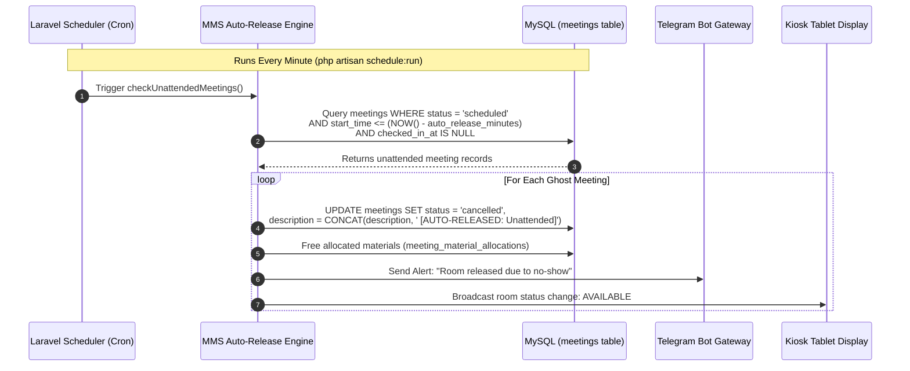
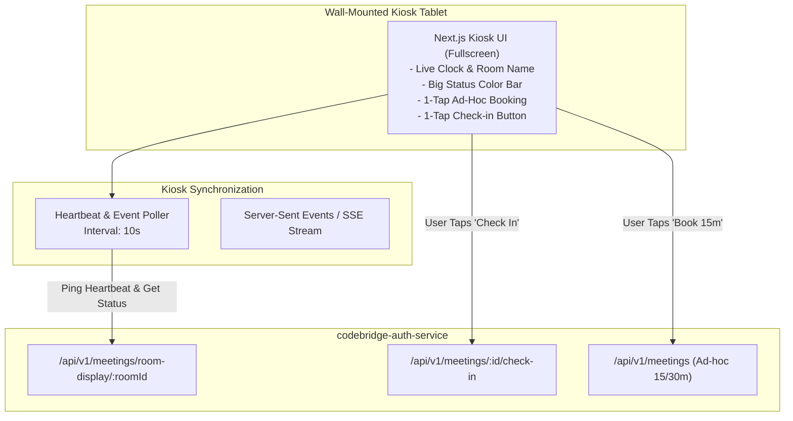
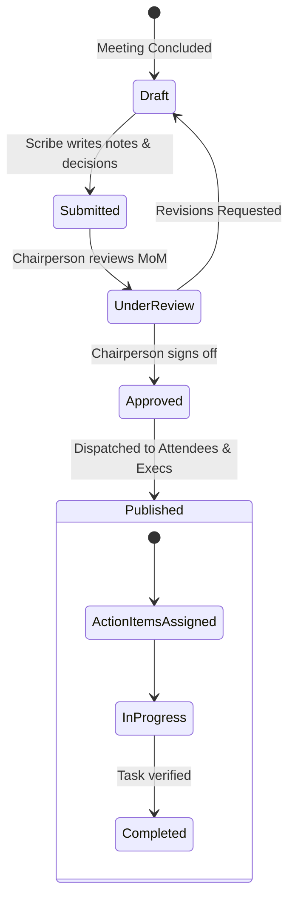
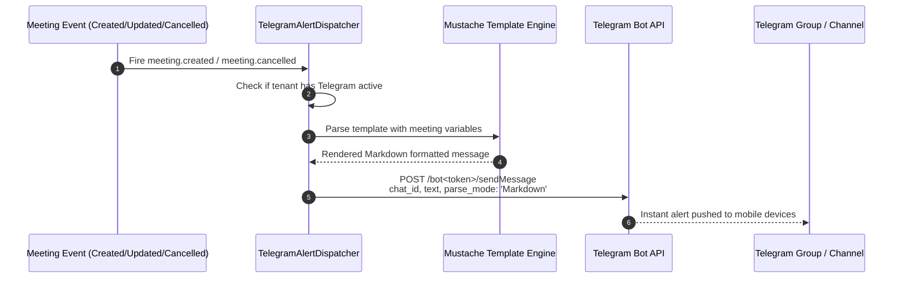

# Volume 4: Workflows, Security & Notifications
## CodeBridge Meeting Management System (MMS)

> **Document ID**: `MMS-ARCH-VOL-04`  
> **Status**: Approved for Production  
> **Target Audience**: Backend Engineers, Security Architects, DevOps Engineers  
> **Last Updated**: November 2026  

---

## 1. Zero Double-Booking & Collision Prevention Engine

Meeting room contention is prevented by an atomic, server-side collision validation algorithm implemented in `MeetingController::hasCollision()`.

### Collision Formula with Turnover Buffer
A candidate booking $[S_c, E_c]$ on room $R$ collides with an existing booking $[S_e, E_e]$ with turnover buffer $B_e$ if and only if:

$$\max(S_c, S_e) < \min(E_c + B_c, E_e + B_e)$$

Where:
* $S_c$: Candidate meeting `start_time`
* $E_c$: Candidate meeting `end_time`
* $B_c$: Candidate `buffer_minutes` (default 5 minutes)
* $S_e$: Existing active meeting `start_time`
* $E_e$: Existing active meeting `end_time`
* $B_e$: Existing meeting `buffer_minutes`

### Optimized SQL Collision Query
```sql
SELECT id, title, start_time, end_time, buffer_minutes
FROM meetings
WHERE tenant_id = :tenant_id
  AND room_id = :room_id
  AND status IN ('scheduled', 'in_progress')
  AND id != :current_meeting_id
  AND (
    -- Candidate starts during an existing meeting (including buffer)
    (:candidate_start < DATE_ADD(end_time, INTERVAL buffer_minutes MINUTE) 
     AND :candidate_end > start_time)
  )
LIMIT 1 FOR UPDATE;
```

> [!IMPORTANT]
> The query executes within a database transaction using pessimistic row locking (`FOR UPDATE`) to eliminate race conditions when two users attempt to book the same room at the exact same millisecond.

---

## 2. Ghost-Meeting Auto-Release Lifecycle

When organizers schedule boardrooms but fail to show up, the room remains hostage ("ghost meeting"). MMS resolves this using an automated cron-based auto-release engine.



### Auto-Release Rules
1. **Grace Period**: Default is `15 minutes` after scheduled `start_time` (configurable per tenant in `meeting_system_settings`).
2. **Check-In Triggers**: Check-in can occur via:
   * Tablet Kiosk 1-Tap Check-In button.
   * Mobile QR Code Scan outside the room.
   * Web Portal meeting check-in action.
3. **Action on Expiration**:
   * Status updated to `'cancelled'`.
   * Reserved AV equipment immediately unallocated.
   * Room marked green (`AVAILABLE`) on tablet door display.
   * Organizer receives Telegram notification detailing auto-release.

---

## 3. Tablet Door Signage (Kiosk Mode) Architecture

Wall-mounted tablets running outside meeting rooms operate in **Kiosk Mode** (`/meetings/room-display/[roomId]`).



### Dynamic Screen State Transitions
* **Green (AVAILABLE)**:
  * Shows "Free for next X hours".
  * Fast-action buttons: `[Quick Book 15 min]`, `[Quick Book 30 min]`.
* **Red (OCCUPIED / IN PROGRESS)**:
  * Shows current meeting title, organizer name, and countdown timer.
  * Fast-action button: `[End Meeting Early]`.
* **Amber (STARTING SOON / CHECK-IN PENDING)**:
  * Shows "Meeting Starting in 5 Minutes".
  * Prominent button: `[Tap Here to Check In]`.

---

## 4. Minutes of Meeting (MoM) & Action Items Governance

Post-meeting governance transforms conversations into accountable execution:



### Automated Action Item Tracking
* When an action item is created in a meeting, MMS automatically creates an entry in `meeting_action_items` and assigns it to `assignee_id`.
* Assignee receives an instant in-app notification and an optional Telegram alert with the due date.
* Assignees can update status directly via `PATCH /api/v1/meetings/actions/{id}/status`.

---

## 5. Automated Telegram Alert Bot Gateway (`@MMS_Meeting_Alert_Bot`)

MMS features a high-throughput notification gateway communicating with the official Telegram Bot API (`https://api.telegram.org/bot<token>/sendMessage`).



### Supported Notification Triggers
1. **Meeting Created (`meeting_created`)**: Sent immediately when a new reservation is confirmed.
2. **Meeting Cancelled (`meeting_cancelled`)**: Sent when cancelled by user or auto-released by cron.
3. **Meeting Reminder (`meeting_reminder`)**: Dispatched 15 minutes before meeting start.
4. **Room Changed / Rescheduled (`meeting_updated`)**: Sent when room, date, or time boundaries change.

### Dynamic Variable Placeholders
Templates in `meeting_notification_templates` support the following variables:
* `{title}`: Meeting title.
* `{room}`: Name and floor of the conference room.
* `{date}`: Formatted meeting date (`Nov 20, 2026`).
* `{time}`: Formatted start and end time (`10:00 AM - 11:30 AM`).
* `{organizer}`: Full name of the organizer.
* `{attendees_count}`: Number of confirmed participants.

### Sample Rendered Telegram Alert
```text
📅 NEW MEETING SCHEDULED
━━━━━━━━━━━━━━━━━━━━━━━━━
📌 Title: Board of Directors Strategy Session
🏢 Room: Grand Mekong Boardroom (4th Floor)
⏰ Time: Friday, Nov 20, 2026 (10:00 AM - 12:00 PM)
👤 Organizer: Sophea Chan
👥 Attendees: 12 participants
━━━━━━━━━━━━━━━━━━━━━━━━━
Please arrive 5 minutes early for AV preparation.
```

---

## 6. Security Architecture & Multi-Tenant Isolation

### 6.1 Database Isolation
Every query in the MMS controller stack incorporates tenant constraints:
```php
$meetings = Meeting::where('tenant_id', auth()->user()->tenant_id)
    ->where('room_id', $roomId)
    ->get();
```

### 6.2 Role-Based Access Control (RBAC)
| Action | `super_admin` | `organization` | `admin` | `staff` | `kiosk_tablet` |
| :--- | :---: | :---: | :---: | :---: | :---: |
| Create Room / Edit Fleet | ✅ | ✅ | ✅ | ❌ | ❌ |
| Book Meeting | ✅ | ✅ | ✅ | ✅ | ✅ (Ad-hoc only) |
| Check In / Presence | ✅ | ✅ | ✅ | ✅ | ✅ |
| Override Any Reservation | ✅ | ✅ | ✅ | ❌ | ❌ |
| View System Settings | ✅ | ✅ | ✅ | ❌ | ❌ |
| Configure Telegram Bot | ✅ | ✅ | ✅ | ❌ | ❌ |
| Sign-off / Approve MoM | ✅ | ✅ | ✅ | ❌ | ❌ |

### 6.3 Audit & Forensic Telemetry Integration
* Every meeting booking, cancellation, or modification automatically writes to **`audit_logs`** with client IP, user agent, and payload.
* Any brute-force rate-limit breach, unauthorized token, or double-booking spoof triggers an immediate record in **`security_events`**.
* End-to-end latency is monitored in **`api_request_logs`**.

---

## Document Index & Summary

| Folder / Volume | Document Path | Core Focus |
| :--- | :--- | :--- |
| **Folder 1** | [01_system_architecture/01_mms_system_overview_and_topology.md](../01_system_architecture/01_mms_system_overview_and_topology.md) | High-level architecture, microservice topology, and layers. |
| **Folder 2** | [02_database_schema_and_erd/02_mms_database_schema_and_erd.md](../02_database_schema_and_erd/02_mms_database_schema_and_erd.md) | 17 database tables, Mermaid ERD, column types, and indexes. |
| **Folder 3** | [03_api_specifications/03_mms_api_specifications_and_integration.md](../03_api_specifications/03_mms_api_specifications_and_integration.md) | 9 Open Group tags, 38 REST endpoints, requests, and errors. |
| **Folder 4** | [04_workflows_security_notifications/04_mms_workflows_security_and_notifications.md](../04_workflows_security_notifications/04_mms_workflows_security_and_notifications.md) | Collision algorithms, auto-release cron, kiosk display, and Telegram bot. |
