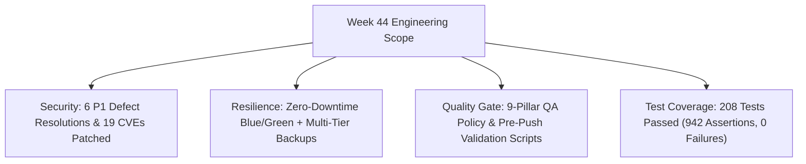

# Engineering Reports — Week 44 (October 25 – October 31, 2026)

This folder contains all daily engineering logs and the weekly rollup report for **Week 44, 2026**.

---

## 📑 Reports in this Folder

| Document | Type | Date / Scope | Key Deliverables |
| :--- | :--- | :--- | :--- |
| **[`WEEKLY_REPORT_2026_W44.md`](WEEKLY_REPORT_2026_W44.md)** | **Weekly Rollup** | Oct 25 – Oct 31, 2026 | Full architectural summary: Blue/Green engine, K8s manifests, MinIO S3 WebP pipeline, 6 P1 defect resolutions, 9-pillar testing policy gate, 208 PHP tests (942 assertions, 0 vulnerabilities). |
| **[`DAILY_REPORT_2026_10_31.md`](DAILY_REPORT_2026_10_31.md)** | **Daily Log** | October 31, 2026 | 6 P1 security fixes, Blue/Green deployer, Grandfather-Father-Son automated backup, Operations Service pure PHP tests, 19 CVE dependencies updated. |
| **[`DAILY_REPORT_2026_10_30.md`](DAILY_REPORT_2026_10_30.md)** | **Daily Log** | October 30, 2026 | MinIO S3 object storage migration, pure PHP GD WebP image converter with 8-bit alpha transparency, dedicated `/upload-profile` endpoint, RFC 6238 TOTP 2FA engine. |

---

## 📊 Summary Metrics for Week 44

---

## 🔗 Quick Navigation
- ⬆️ [Return to October 2026 Archive](../README.md)
- 📅 [Return to 2026 Archive](../../README.md)
- 🏠 [Return to Reports Hub](../../../README.md)
