# Daily Engineering & Security Progress Report — November 11, 2026

**Project:** CodeBridges Enterprise Multi-Tenant Platform  
**Active Service:** `codebridge-services/auth-service` (Strict Write Boundary Enforced per `AGENTS.md`)  
**Git Branch:** `demo`  
**Verified Test Suite Status:** **377 passed**, 1 skipped (live cluster offline), **0 failed** (**2,380 assertions**)  
**Quality & Security Gate (`check_rules.sh`):** **All 10 Rules PASSED (0 Failures)**  
**Security Audit:** `composer audit --ignore-unreachable = 0 vulnerabilities`  

---

## 1. Executive Summary

Engineering initiatives on **November 11, 2026** completed enterprise API, authorization policy, container, Kubernetes, monitoring/incident-response, and disaster-recovery hardening across `auth-service`:

1. **Global WAF, Scanner Verification & Safe Error Handling**:
   - Prepended [`ProtectAttackMiddleware`](../../../../../app/Http/Middleware/ProtectAttackMiddleware.php) globally in [`bootstrap/app.php`](../../../../../bootstrap/app.php) so attack probes and scanners are blocked across *every* route prior to dispatch, with HTML-escaped Telegram alert payloads.
   - Tested all **10 blocked scanners** (`sqlmap`, `nikto`, `masscan`, `wpscan`, `gobuster`, `dirbuster`, `acunetix`, `havij`, `zgrab`, `nmap`) across live endpoints (`HTTP 403` + Telegram dispatch).
   - Enforced `users.phone` uniqueness validation in [`StoreUserRequest.php`](../../../../../app/Http/Requests/User/StoreUserRequest.php) and [`UpdateUserRequest.php`](../../../../../app/Http/Requests/User/UpdateUserRequest.php) and added JSON error masking for database/internal exceptions.
2. **Laravel Authorization Policies, Tenant Isolation & Financial Guards**:
   - Implemented, registered ([`AppServiceProvider.php`](../../../../../app/Providers/AppServiceProvider.php)), and hardened domain policies ([`UserPolicy.php`](../../../../../app/Policies/UserPolicy.php), [`RolePolicy.php`](../../../../../app/Policies/RolePolicy.php), [`OutletPolicy.php`](../../../../../app/Policies/OutletPolicy.php), [`TenantPolicy.php`](../../../../../app/Policies/TenantPolicy.php), [`SecurityEventPolicy.php`](../../../../../app/Policies/SecurityEventPolicy.php)).
   - Enforced `$this->authorize(...)` in [`Controller.php`](../../../../../app/Http/Controllers/Controller.php) and core controllers, closing cross-tenant `roles/{id}` IDOR and empty/`null` `tenant_id` equality bypasses.
   - Hardened negative/zero validation, overdraft/cross-tenant isolation, and CSPRNG gift-card generation across customer store credit, loyalty, voucher, and gift-card workflows.
3. **Container, Kubernetes & Secret Hygiene**:
   - Hardened [`Dockerfile`](../../../../../Dockerfile) and [`.dockerignore`](../../../../../.dockerignore) (non-root `USER 33:33`, production stripping of `composer`/`git`/`unzip`/`.env*`/`tests/`, read-only app permissions, non-root `HEALTHCHECK`).
   - Removed tracked plaintext `k8s/secret.yaml`, added [`k8s/secret.example.yaml`](../../../../../k8s/secret.example.yaml) + `.gitignore` exclusion + fail-closed validation in [`k8s/deploy.sh`](../../../../../k8s/deploy.sh).
   - Added [`k8s/networkpolicy.yaml`](../../../../../k8s/networkpolicy.yaml) and least-privilege `securityContext` specs across all `k8s/` workloads.
4. **Incident Runbook, Backup Integrity & Pre-Push Gate Fix**:
   - Created [`SECURITY_INCIDENT_AND_RECOVERY_RUNBOOK.md`](../../../../SECURITY_INCIDENT_AND_RECOVERY_RUNBOOK.md).
   - Added SHA-256 verification and `--verify` mode to [`backup.sh`](../../../../../deploy/backup/backup.sh) / [`restore.sh`](../../../../../deploy/backup/restore.sh), validated via isolated SQLite recovery and rollback tests in [`RecoveryAndBackupTest.php`](../../../../../tests/Feature/Security/RecoveryAndBackupTest.php).
   - Fixed comma-separated `--filter` bugs in [`check_rules.sh`](../../../../../check_rules.sh) so all 10 CI/pre-push rules execute real tests and fail if any filter matches zero tests.
5. **P1/P2 Follow-Up Remediations & Seeder Secret Hygiene**:
   - Enforced custom `session_expires_at` validation and Sanctum `$user->withAccessToken()` binding in [`AuthenticateJwt.php`](../../../../../app/Http/Middleware/AuthenticateJwt.php) (tested in [`RejectExpiredSanctumTokenTest.php`](../../../../../tests/Feature/Security/RejectExpiredSanctumTokenTest.php)).
   - Hardened strict tenant isolation and `/bot[REDACTED]` exception scrubbing across [`MeetingTelegramController.php`](../../../../../app/Http/Controllers/Api/V1/MeetingTelegramController.php), [`TelegramAlertController.php`](../../../../../app/Http/Controllers/Api/V1/TelegramAlertController.php), and [`SendMeetingTelegramAlertJob.php`](../../../../../app/Jobs/SendMeetingTelegramAlertJob.php) (tested in [`MeetingTelegramEncryptionAndRetryTest.php`](../../../../../tests/Feature/Security/MeetingTelegramEncryptionAndRetryTest.php)).
   - Moved Telegram security alert bot credentials out of [`NotificationProviderSeeder.php`](../../../../../database/seeders/NotificationProviderSeeder.php) into [`config/services.php`](../../../../../config/services.php) and `.env` (documented in [`.env.example`](../../../../../.env.example)), skipping gracefully when unset.

---

## 2. Hardening Coverage Architecture

```mermaid
flowchart LR
    subgraph App["Laravel API & Auth"]
        A1["Global ProtectAttackMiddleware + Scanners"]
        A2["5 Model Policies + $this->authorize()"]
        A3["Rate Limits + Financial / CSPRNG Guards"]
        A4["Safe Error Envelopes + 2FA Tests"]
    end
    subgraph Infra["Docker & Kubernetes"]
        I1["Non-Root Dockerfile (USER 33:33 + HEALTHCHECK)"]
        I2["Secret Template (No Plaintext in Git)"]
        I3["K8s NetworkPolicy + drop ALL Capabilities"]
    end
    subgraph ObsRec["Monitoring & Recovery"]
        O1["X-Request-ID / X-Trace-ID + LogRedactor"]
        O2["Telegram Security Alerts + Auto-Ban"]
        O3["AES-256 Backup + SHA-256 + SQLite Replay Drill"]
    end

    App --> Infra --> ObsRec
```

---

## 3. Detailed Implementation Summary (`auth-service/`)

### A. APIs, Authorization Policies, Authentication & Financial Controls

- **Model Policies & Controller Enforcement**:
  - [`UserPolicy.php`](../../../../../app/Policies/UserPolicy.php), [`RolePolicy.php`](../../../../../app/Policies/RolePolicy.php), [`OutletPolicy.php`](../../../../../app/Policies/OutletPolicy.php), [`TenantPolicy.php`](../../../../../app/Policies/TenantPolicy.php), [`SecurityEventPolicy.php`](../../../../../app/Policies/SecurityEventPolicy.php) enforced across `RoleController`, `UserController`, `OutletController`, `TenantController`, and `SecurityEventController`.
  - Fixed cross-tenant `roles/{id}` access and prevented empty/`null` `tenant_id` equality collisions.
- **Safe Error Envelopes & Rate Limiting**:
  - Masked `QueryException`, SQLSTATE, paths, and non-debug stack traces behind `request_id` JSON error envelopes in [`bootstrap/app.php`](../../../../../bootstrap/app.php) (without runtime `env()` calls).
  - Enforced strict throttles on `/auth/verify-invite`, `/auth/accept-invite`, `/auth/password`, `/auth/register`, `/auth/refresh` ([`routes/api/auth.php`](../../../../../routes/api/auth.php)), and financial mutations ([`routes/api/organization.php`](../../../../../routes/api/organization.php)).
  - Enforced positive non-zero amounts and tenant isolation in [`CustomerLoyaltyController.php`](../../../../../app/Http/Controllers/Api/V1/CustomerLoyaltyController.php), [`GiftCardController.php`](../../../../../app/Http/Controllers/Api/V1/GiftCardController.php), and [`StoreCreditService.php`](../../../../../app/Services/StoreCreditService.php).
- **Automated Security & 2FA Tests**:
  - Extended [`TwoFactorAuthenticationTest.php`](../../../../../tests/Feature/TwoFactorAuthenticationTest.php) (5-attempt lockout, single-use recovery codes, fresh reauthentication).
  - Added [`PolicySecurityEnforcementTest.php`](../../../../../tests/Feature/Security/PolicySecurityEnforcementTest.php) (`9 tests`), [`ModelPoliciesTest.php`](../../../../../tests/Unit/Policies/ModelPoliciesTest.php) (`6 tests`), and [`FinancialAndApiHardeningTest.php`](../../../../../tests/Feature/Security/FinancialAndApiHardeningTest.php) (`5 tests`).

### B. Container, Kubernetes & Backup/Recovery Hardening

- **Docker**: [`Dockerfile`](../../../../../Dockerfile) & [`.dockerignore`](../../../../../.dockerignore) drop build tools and secrets in production images, enforce non-root `USER 33:33`, lock app source read-only (`storage/` and `bootstrap/cache/` writable by `33:33`), and add dual-mode `HEALTHCHECK`.
- **Kubernetes**:
  - Untracked & removed plaintext `k8s/secret.yaml`; introduced [`k8s/secret.example.yaml`](../../../../../k8s/secret.example.yaml), updated [`.gitignore`](../../../../../.gitignore), [`k8s/deploy.sh`](../../../../../k8s/deploy.sh), and [`KUBERNETES_DEPLOYMENT_GUIDE.md`](../../../../KUBERNETES_DEPLOYMENT_GUIDE.md).
  - Added [`k8s/networkpolicy.yaml`](../../../../../k8s/networkpolicy.yaml) (default-deny ingress, strict `auth-mysql:3306`, `auth-redis:6379`, and `minio:9000` allow-lists) in [`k8s/kustomization.yaml`](../../../../../k8s/kustomization.yaml).
  - Added `automountServiceAccountToken: false`, `seccompProfile: RuntimeDefault`, `allowPrivilegeEscalation: false`, `capabilities.drop: [ALL]`, and non-root `runAsUser` across [`auth-deployment.yaml`](../../../../../k8s/auth-deployment.yaml), [`horizon-deployment.yaml`](../../../../../k8s/horizon-deployment.yaml), [`scheduler-cronjob.yaml`](../../../../../k8s/scheduler-cronjob.yaml), [`migration-job.yaml`](../../../../../k8s/migration-job.yaml), [`mysql.yaml`](../../../../../k8s/mysql.yaml), [`redis.yaml`](../../../../../k8s/redis.yaml), [`minio.yaml`](../../../../../k8s/minio.yaml), and [`gateway.yaml`](../../../../../k8s/gateway.yaml).
- **Monitoring & Recovery**:
  - Created [`SECURITY_INCIDENT_AND_RECOVERY_RUNBOOK.md`](../../../../SECURITY_INCIDENT_AND_RECOVERY_RUNBOOK.md).
  - Upgraded [`backup.sh`](../../../../../deploy/backup/backup.sh) and [`restore.sh`](../../../../../deploy/backup/restore.sh) with SHA-256 checksum generation/verification and `--verify` mode, verified end-to-end by [`RecoveryAndBackupTest.php`](../../../../../tests/Feature/Security/RecoveryAndBackupTest.php).

---

## 4. Verification Results (`auth-service/`)

| Check | Outcome | Details |
| :--- | :--- | :--- |
| **`php artisan test`** | **PASS** | **377 passed (2,380 assertions)**, 1 skipped (live K8s cluster offline), 0 failures |
| **`bash check_rules.sh`** | **PASS** | All **10** quality/security rules passed with `0` failures |
| **`composer audit --ignore-unreachable`** | **PASS** | **0 security vulnerability advisories** |
| **`kubectl kustomize .`** (via [`DeploymentTest.php`](../../../../../tests/Feature/DeploymentTest.php)) | **PASS** | Validated Kustomize bundle including `NetworkPolicy` and hardened `securityContext` specs |
| **`bash -n`** | **PASS** | Clean syntax across `deploy/backup/*.sh`, `deploy/bluegreen/*.sh`, `k8s/deploy.sh`, `check_rules.sh` |

---

## 5. Remaining Read-Only Scope Gaps (Outside `auth-service/`)

Per `AGENTS.md`, read-only directories were audited but **not modified** without explicit permission:
1. **`codebridgesfront/`**: `npm audit` advisories, `localStorage` token storage, CSP/security header middleware, and frontend security/dependency checks.
2. **`codebridge-services/.github/workflows/`**: CI dependency/secret/SAST scanning (`composer audit`, Gitleaks, Larastan/Semgrep), container image scan/SBOM/provenance, and digest-pinned deployment (`deploy-staging.yml`).
3. **`codebridge-services/k8s/staging/`, `infrastructure/ansible/`, `operations-service/`, `gateway/`**: Staging K8s `NetworkPolicy`, Ansible host/SSH/UFW/fail2ban hardening, and sibling service hardening.

