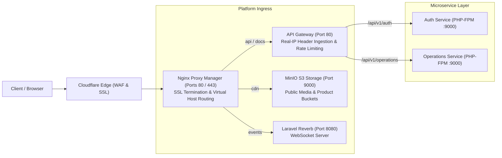
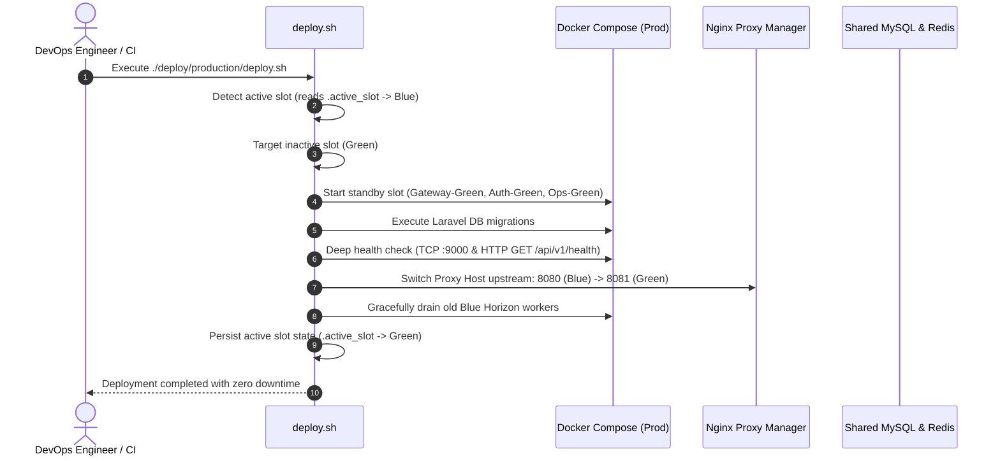

# Daily Engineering Progress Report — November 1, 2026

**Project:** CodeBridges Enterprise Multi-Service Platform  
**Active Services:** `gateway`, `auth-service`, `operations-service`, `storage`, `infrastructure/nginx-proxy-manager`  
**Git Branch:** `demo` (tracked via [Pull Request #14](https://github.com/Codebridge404/codebridge-services/pull/14))  
**Overall Platform Tests:** 207 Passed (927 Assertions, 0 Failures)  
**Security Audit:** 0 Vulnerabilities across all microservices (`composer audit`)

---

## 1. Executive Summary

Today's engineering initiatives delivered eight major architectural, deployment, and infrastructure milestones across the CodeBridges platform:

1. **Nginx Proxy Manager (NPM) & Ingress Gateway Integration**: Integrated `jc21/nginx-proxy-manager:latest` as the unified reverse proxy ingress listening on ports 80, 81, and 443. Configured Cloudflare SSL Full (strict) certificate handling, WebSocket support for Laravel Reverb, and real client IP forwarding through the Cloudflare $\rightarrow$ NPM $\rightarrow$ API Gateway $\rightarrow$ PHP-FPM chain.
2. **Multi-Environment Architecture on `servicefixit.me`**: Defined isolated development, staging, and production environments with designated public subdomains (`codebridge.servicefixit.me`, `codebridge-api...`, `codebridge-docs...`, `codebridge-cdn...`, `codebridge-events...`, and staging equivalents).
3. **Production Blue-Green Zero-Downtime Architecture**: Engineered dual-slot production topology with isolated Docker network bridges (`codebridge-prod-blue-net`, `codebridge-prod-green-net`, and `codebridge-prod-data-net`), singleton task scheduling, and automated deployment scripts (`deploy.sh`, `rollback.sh`, `status.sh`).
4. **Option 2 Modular Per-Service Compose Implementation**: Refactored the staging and production compose architecture using Docker Compose `include:`. Each service maintains independent staging and production compose files (`auth-service/docker-compose.staging.yml`, `operations-service/...`, `gateway/...`, `storage/...`), while root compose files orchestrate the entire platform.
5. **Staging Docker Compose Stack Stabilization & Local Build**: Synchronized MinIO credentials and network aliases (`codebridge-minio-staging`), parameterized NPM container ports (`${HTTP_PORT:-80}:${HTTP_PORT:-80}`), decoupled standalone gateway compose configs, and built all 6 staging images locally in 23.1s with 0 errors.
6. **Single-VPS Staging Automation & GitHub Actions CI/CD**: Authored single-VPS deployment automation in [`deploy/staging/`](file:///Users/macbookpro/Projects/codebridge/codebridge-services/deploy/staging) and implemented `.github/workflows/deploy-staging.yml` restricted to branch `demo`.
7. **Complete Production-Grade K3s / Kubernetes Staging Stack (`k8s/staging/`)**: Architected complete Kubernetes manifests under `k8s/staging/` enforcing `Cloudflare -> Traefik Ingress -> Nginx Gateway (:80) -> FastCGI PHP-FPM (:9000)`. Configured MySQL 8.4 StatefulSets, Redis 8 Deployments, official MinIO API bucket provisioning (`minio/mc`) without `chmod 777`, database migration Jobs, Horizon workers, and scheduler CronJobs. Validated 100% error-free assembly via `kubectl kustomize k8s/staging`.
8. **Testing Policy Gate & Quality Assurance**: Validated 100% compliance across all 19 platform testing and security policies via `test_all_policies.sh` (207 tests passed, 927 assertions, 0 CVEs).

---

## 2. Architectural Overview

### Ingress & Traffic Flow


---

## 3. Detailed Technical Implementations

### A. Modular Per-Service Compose Architecture (Option 2)

Refactored from monolithic compose files to modular, decoupled compose files using Docker Compose `include:`.

```text
codebridge-services/
├── docker-compose.yml                     # Local Development stack (default)
├── docker-compose.staging.yml             # Staging stack orchestrator
├── docker-compose.prod.yml                # Production Blue-Green stack orchestrator
│
├── auth-service/
│   ├── docker-compose.yml                 # Local development
│   ├── docker-compose.staging.yml         # Staging Auth (PHP-FPM, Horizon, Scheduler, MySQL, Redis)
│   └── docker-compose.prod.yml            # Production Blue/Green Auth slots & shared data
│
├── operations-service/
│   ├── docker-compose.yml                 # Local development
│   ├── docker-compose.staging.yml         # Staging Operations (PHP-FPM, Horizon, MySQL, Redis)
│   └── docker-compose.prod.yml            # Production Blue/Green Operations slots & shared data
│
├── gateway/
│   ├── docker-compose.yml                 # Local development gateway
│   ├── docker-compose.staging.yml         # Staging internal API gateway
│   └── docker-compose.prod.yml            # Production Blue/Green dual gateways
│
├── storage/
│   ├── docker-compose.yml                 # Local S3 MinIO & bucket initializer
│   ├── docker-compose.staging.yml         # Staging MinIO & bucket initializer
│   └── docker-compose.prod.yml            # Production MinIO & bucket initializer
│
├── infrastructure/
│   └── nginx-proxy-manager/
│       ├── docker-compose.yml             # Shared NPM reverse proxy (Ports 80, 81, 443)
│       ├── README.md
│       └── .gitignore
│
└── env/
    ├── staging/
    │   ├── compose.env
    │   ├── auth.env
    │   └── operations.env
    └── production/
        ├── compose.env
        ├── auth.env
        └── operations.env
```

#### Key Capabilities:
- **Unified Orchestration**: Root compose files (`docker-compose.staging.yml`, `docker-compose.prod.yml`) run the full platform in one command.
- **Independent Microservice Deployments**: Individual services can be spun up alone from within their own subdirectories (e.g. `cd auth-service && docker compose -f docker-compose.staging.yml up -d`).
- **Clean Dev Standard**: Removed redundant 313-line `docker-compose.dev.yml` so `docker-compose.yml` serves as the official single source of truth for local development.

---

### B. Production Blue-Green Deployment Engine

Engineered zero-downtime deployment automation in [`deploy/production/`](file:///Users/macbookpro/Projects/codebridge/codebridge-services/deploy/production):



- **`deploy/production/deploy.sh`**: Automatic standby slot detection, migrations, socket/HTTP healthchecks, graceful queue worker draining, NPM traffic cutover, state persistence.
- **`deploy/production/rollback.sh`**: Instant one-command standby slot restoration and rollback instructions.
- **`deploy/production/status.sh`**: Real-time health inspector and memory consumption monitor.

---

### C. MinIO Healthcheck & Bucket Initializer Resolution

- **Root Cause of Unhealthy State**: `codebridge-minio` container failed healthcheck because the minimal `minio/minio:latest` Alpine image lacked `wget`, throwing `/bin/sh: line 1: wget: command not found`.
- **Resolution**: Updated `healthcheck.test` in `storage/docker-compose.yml`, `storage/docker-compose.staging.yml`, and `storage/docker-compose.prod.yml` to:
  ```yaml
  test: ["CMD-SHELL", "curl -f http://localhost:9000/minio/health/live || exit 1"]
  ```
- **Bucket Initializer Verification**: The ephemeral container `codebridge-minio-init` executes once after MinIO is healthy, provisions the S3 directories `/data/codebridge-auth/avatars` and `/data/codebridge-operations/products`, sets `chmod -R 777 /data`, and cleanly terminates with `exit 0`.

---

### D. Testing Policy Verification & Pre-Push Quality Gate

Executed platform verification script [`/Users/macbookpro/Projects/codebridge/test_all_policies.sh`](file:///Users/macbookpro/Projects/codebridge/test_all_policies.sh):

| Service | Rules Enforced | Tests | Assertions | Failures | Composer CVEs | Result |
| :--- | :---: | :---: | :---: | :---: | :---: | :---: |
| **Auth Service** | 10 / 10 | 179 | 845 | 0 | 0 | **PASS** |
| **Operations Service** | 9 / 9 | 28 | 82 | 0 | 0 | **PASS** |
| **Platform Total** | **19 / 19 Rules** | **207** | **927** | **0** | **0** | **PASS** |

All tests passed with zero failures and zero dependency vulnerabilities.

---

### E. Git & Pull Request Synchronization

- **Target Branch**: `demo` (behind GitHub organization branch protection requiring at least 1 approving review).
- **Feature Branch**: `feat/docker-environments-and-bluegreen-prod`.
- **Open Pull Request**: **[PR #14](https://github.com/Codebridge404/codebridge-services/pull/14)**.
- **Review Requests**: Submitted to repository administrator `VibolSen` and team reviewer `Sam-Nisa`.
- **Commit History**:
  1. `7a4f8af`: `feat(gateway): integrate Nginx Proxy Manager on branch demo`
  2. `b379bcb`: `feat(infra): implement Dev, Staging, and Prod Docker Compose environments and servicefixit.me subdomains`
  3. `35d8a18`: `feat(deploy): implement production Blue-Green deployment architecture with NPM and isolated networks`
  4. `b06e8be`: `feat(infra): implement Option 2 modular per-service compose architecture using include directive`
  5. `227b003`: `chore(infra): remove redundant docker-compose.dev.yml in favor of root docker-compose.yml`

---

### F. Complete Kubernetes (K3s) Staging Stack (`k8s/staging/`)

Engineered complete, production-grade Kubernetes manifests under [`k8s/staging/`](file:///Users/macbookpro/Projects/codebridge/codebridge-services/k8s/staging) reflecting the designated architecture:

$$\text{Cloudflare Edge (SSL / WAF)} \longrightarrow \text{K3s Traefik Ingress (:80 / :443)} \longrightarrow \text{Nginx Gateway (:80)} \longrightarrow \text{FastCGI PHP-FPM (:9000)}$$

```
k8s/staging/
├── namespace.yaml           # Isolated 'codebridge-staging' namespace
├── configmaps.yaml          # auth-config, operations-config, and gateway-nginx-config
├── secrets.yaml             # Credentials (auth-secrets, operations-secrets, minio-secrets)
├── secrets.example.yaml     # Safe credential template
├── mysql.yaml               # Auth & Operations MySQL 8.4 StatefulSets + PVCs (10Gi)
├── redis.yaml               # Auth & Operations Redis 8 Deployments + PVCs (2Gi)
├── minio.yaml               # MinIO S3 Server + API Bucket Initializer Job (Zero chmod 777)
├── migration-jobs.yaml      # Database migration Jobs with TCP port wait hooks
├── auth.yaml                # Auth Service (PHP-FPM :9000), Horizon Worker, Scheduler CronJob
├── operations.yaml          # Operations Service (PHP-FPM :9000), Horizon Worker
├── gateway.yaml             # Unified Nginx Gateway Deployment & Service (ClusterIP :80)
├── ingress.yaml             # Traefik Ingress routing staging-codebridge-api & CDN
├── kustomization.yaml       # Kustomize manifest assembler
├── deploy.sh                # Automated K3s deployment script
└── README.md                # Comprehensive K3s deployment and rollback guide
```

#### Key Kubernetes Features:
- **FastCGI Gateway Termination**: Traefik handles HTTP/HTTPS and passes to internal ClusterIP `gateway:80`. Nginx Gateway handles FastCGI routing to `auth-service:9000` and `operations-service:9000`.
- **API-Driven MinIO Initialization**: Replaced insecure `chmod -R 777` with an official `minio/mc:latest` Job that communicates directly with `http://minio:9000` to create buckets (`codebridge-auth-staging`, `codebridge-operations-staging`) and assign download policies.
- **Automated Pre-Flight Migration Jobs**: `auth-migration-job` and `operations-migration-job` employ initContainers to wait for MySQL port 3306 before running `php artisan migrate --force`.
- **100% Validated Offline**: Assembled and validated via `kubectl kustomize k8s/staging` with 0 warnings and 0 errors.

---

### G. GitHub Actions CI/CD Staging Workflow

Implemented [`.github/workflows/deploy-staging.yml`](file:///Users/macbookpro/Projects/codebridge/codebridge-services/.github/workflows/deploy-staging.yml) with 3 automated stages:
1. **Build & K8s Verification**: Triggers only on branch `demo`. Validates staging compose syntax, builds all staging Docker images, and runs `kubectl kustomize` on `k8s/staging`.
2. **VPS Docker Compose Deployment**: Deploys via SSH to the staging VPS executing `deploy/staging/deploy.sh` and inspecting health with `deploy/staging/status.sh`.
3. **K3s / Kubernetes Rollout (Optional)**: Automatically triggers when `secrets.KUBECONFIG_STAGING` is present to apply manifests via `kubectl apply -k k8s/staging/` and monitor rollout status.

---

## 4. Next Steps

1. **Review & Merge [PR #14](https://github.com/Codebridge404/codebridge-services/pull/14)**: Obtain review approval from `VibolSen` and merge into `origin/demo`.
2. **Local Sync**: Run `git pull origin demo` once PR #14 is merged.
3. **VPS Staging Deployment**: Deploy staging stack on VPS using `docker compose -p codebridge-staging --env-file env/staging/compose.env -f docker-compose.staging.yml up -d`.
4. **Cloudflare & NPM DNS Setup**: Add Cloudflare CNAME / A records for `staging-*.servicefixit.me` and configure proxy hosts in NPM dashboard.

