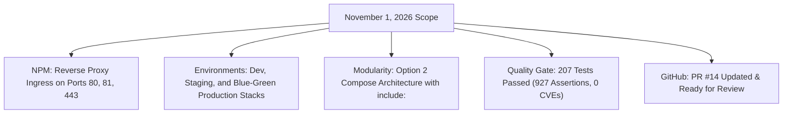

# Engineering Reports — Week 44 (November 1, 2026)

This folder contains the daily engineering log for **November 1, 2026** (Week 44).

---

## 📑 Reports in this Folder

| Document | Type | Date / Scope | Key Deliverables |
| :--- | :--- | :--- | :--- |
| **[`DAILY_REPORT_2026_11_01.md`](DAILY_REPORT_2026_11_01.md)** | **Daily Log** | November 1, 2026 | Nginx Proxy Manager integration, multi-environment subdomains (`servicefixit.me`), Production Blue-Green deployment engine, Option 2 modular compose architecture (`include:`), MinIO S3 healthcheck repair, 207 tests passed (0 vulnerabilities), PR #14 pushed. |

---

## 📊 Summary Metrics

---

## 🔗 Quick Navigation
- ⬆️ [Return to November 2026 Archive](../README.md)
- 📅 [Return to 2026 Archive](../../README.md)
- 🏠 [Return to Reports Hub](../../../README.md)
