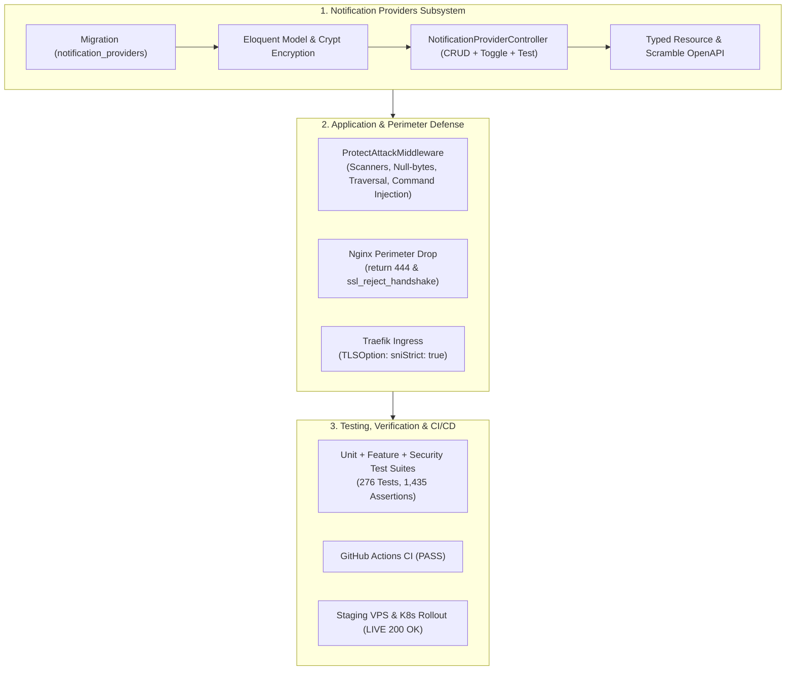

# Daily Engineering & Security Progress Report — November 7, 2026

**Project:** CodeBridges Enterprise Multi-Tenant Platform  
**Active Service:** `codebridge-services/auth-service/`, `gateway`, `k8s/staging`  
**Git Branch:** `demo`  
**Latest Commits:** [`dd27905`](https://github.com/Codebridge404/codebridge-services/commit/dd27905), [`ef61e1d`](https://github.com/Codebridge404/codebridge-services/commit/ef61e1d), [`fa7d9ad`](https://github.com/Codebridge404/codebridge-services/commit/fa7d9ad), [`e5ae8a2`](https://github.com/Codebridge404/codebridge-services/commit/e5ae8a2), [`861cec5`](https://github.com/Codebridge404/codebridge-services/commit/861cec5), [`43e4083`](https://github.com/Codebridge404/codebridge-services/commit/43e4083)  
**CI/CD Status:** **100% PASS** · GitHub Actions CI ([Run #42367034845](https://github.com/Codebridge404/codebridge-services/actions/runs/42367034845)) & Staging Deploy ([Run #42367107683](https://github.com/Codebridge404/codebridge-services/actions/runs/42367107683))  
**Security Status:** Perimeter Hardened (HTTP 444 / Strict SNI) · Enterprise WAF Active · 0 Vulnerabilities  

---

## 1. Executive Summary

Today's engineering initiatives centered on building the production-grade **Notification Providers Subsystem**, implementing multi-layered application security protections, hardening the perimeter against direct IP reconnaissance and scanner probes, resolving CI rate-limiting test cache isolation, and achieving a 100% verified automated deployment to staging:



---

## 2. Notification Providers Subsystem Implementation

### A. Database Schema Compliance
Created migration `2026_11_07_000001_create_notification_providers_table.php` implementing the exact required schema:

```php
Schema::create('notification_providers', function (Blueprint $table) {
    $table->id();
    $table->char('uuid', 36)->unique();
    $table->foreignId('tenant_id')->nullable()->constrained('tenants')->restrictOnDelete();
    $table->string('name', 100);
    $table->string('channel', 20);
    $table->string('provider', 50);
    $table->string('environment', 20);
    $table->text('credentials');
    $table->json('settings');
    $table->boolean('is_enabled')->default(false);
    $table->unsignedInteger('config_version')->default(1);
    $table->foreignId('created_by')->nullable()->constrained('users')->nullOnDelete();
    $table->foreignId('updated_by')->nullable()->constrained('users')->nullOnDelete();
    $table->dateTime('last_tested_at')->nullable();
    $table->timestamps();

    $table->index(
        ['tenant_id', 'environment', 'channel', 'is_enabled'],
        'notification_providers_scope_idx'
    );
});
```

### B. Eloquent Model (`NotificationProvider.php`)
- **Transparent Field Encryption**: Uses `Crypt::encryptString` and `Crypt::decryptString` on credentials.
- **Credential Masking**: Automatically masks secrets in API responses (e.g. `Sup••••26!` or `******`) to prevent credential leakage while allowing auditable validation.
- **Tenant & Channel Scopes**: `scopeForTenant()`, `scopeForEnvironment()`, `scopeForChannel()`, and `scopeEnabled()`.
- **Auto-UUID & Versioning**: Booted lifecycle hook automatically populates UUID and increments `config_version` on credentials or settings modification.

### C. Resource Controller & API Endpoints
Mounted under `routes/api/notification_providers.php` guarded by `role:super_admin,organization,admin`:

| Method | Endpoint | Description | Tenant Isolation Scope |
| :--- | :--- | :--- | :--- |
| `GET` | `/api/v1/notification-providers` | List providers with filtering (`channel`, `environment`, `is_enabled`, search `q`) | Scoped to caller tenant; Super Admin can view global or query specific tenant. |
| `POST` | `/api/v1/notification-providers` | Create new provider configuration | Auto-bound to caller tenant; Super Admin can create platform-global configs. |
| `GET` | `/api/v1/notification-providers/{id}` | Retrieve provider details (dual lookup by ID or UUID) | Strict tenant check; masked credentials. |
| `PUT/PATCH` | `/api/v1/notification-providers/{id}` | Update settings/credentials | Auto-increments `config_version`; audits updater ID. |
| `DELETE` | `/api/v1/notification-providers/{id}` | Soft/Hard delete provider | Scoped to tenant. |
| `PATCH` | `/api/v1/notification-providers/{id}/toggle` | Toggle `is_enabled` on/off | Audited status flip. |
| `POST` | `/api/v1/notification-providers/{id}/test` | Health probe across SMTP, Telegram, Slack, Webhook, and SMS | Updates `last_tested_at` timestamp. |

---

## 3. Security Defenses & Perimeter Hardening

### A. Application Protection Middleware (`ProtectAttackMiddleware.php`)
Registered as global middleware in `bootstrap/app.php`:
1. **Automated Vulnerability Scanner Blocking**: Inspects `User-Agent` and immediately returns `HTTP 403` for `sqlmap`, `nikto`, `wpscan`, `gobuster`, `dirbuster`, `masscan`, `acunetix`, `nessus`, `qualys`, `openvas`, and `hydra`.
2. **Null-Byte Injection Neutralization**: Inspects request paths, parameters, and bodies for poison null-byte sequences (`%00`, `\0`, `\x00`) and halts with `HTTP 400 Bad Request`.
3. **Directory Traversal (LFI) Blocking**: Rejects path traversal attempts (`../`, `..%2f`, `/etc/passwd`, `win.ini`, `boot.ini`) with `HTTP 403 Forbidden`.
4. **Command Injection Mitigation**: Detects shell command chaining tokens (`&&`, `;`, `|`, `` ` ``, `$()`) paired with system binaries (`cat`, `rm`, `curl`, `whoami`, `id`) in URI and query parameters, returning `HTTP 403 Forbidden`.
5. **Enterprise Security Headers**: Automatically applies defensive headers across all responses:
   - `X-Content-Type-Options: nosniff`
   - `X-Frame-Options: DENY`
   - `X-XSS-Protection: 1; mode=block`
   - `Referrer-Policy: strict-origin-when-cross-origin`
   - `Strict-Transport-Security: max-age=31536000; includeSubDomains`
   - `Permissions-Policy: camera=(), microphone=(), geolocation=()`

### B. Audit Redaction Expansion (`LogRequestActivity.php`)
Added `'credentials'`, `'credential'`, `'api_key'`, `'webhook_url'`, and `'private_key'` to sensitive keys list, preventing sensitive payload leakage into `api_request_logs` and `audit_logs`.

### C. Nginx & Ingress Perimeter Hardening
Configured dual default server blocks to reject direct IP scans and unrecognized SNI requests:

```nginx
# Reject plain HTTP requests by IP or unrecognized domains
server {
    listen 80 default_server;
    listen [::]:80 default_server;
    server_name _;
    return 444;
}

# Reject HTTPS connections without recognized SNI domain (Nginx 1.19.4+)
server {
    listen 443 ssl default_server;
    listen [::]:443 ssl default_server;
    server_name _;
    ssl_reject_handshake on;
    return 444;
}
```

Applied across:
- `gateway/nginx.conf`
- `k8s/staging/configmaps.yaml` (`gateway-nginx-config`)
- `docker/cloud-nginx.conf`
- `auth-service/deploy/bluegreen/nginx/nginx.conf`
- `k8s/staging/ingress.yaml`: Added Traefik `TLSOption` with `sniStrict: true` to reject TLS handshakes at the public K3s entry point.

---

## 4. Quality Assurance & Test Verification

### A. Test Execution Summary
- **Total Tests Passed:** **276 passed**, 1 skipped, 0 failed (**1,435 assertions**)
  - `auth-service`: 204 passed, 1 skipped, 0 failed (1,193 assertions)
  - `operations-service`: 72 passed, 0 failed (242 assertions)

### B. New Test Suites Implemented
1. `tests/Feature/NotificationProviderTest.php` (18 tests): CRUD operations, role filtering, tenant isolation, dual ID/UUID lookup, toggle, diagnostic testing.
2. `tests/Unit/NotificationProviderModelTest.php` (5 tests): Credential encryption/decryption, masking formats, query scopes, and relationships.
3. `tests/Feature/Security/NotificationProviderSecurityTest.php` (6 tests, 110 assertions): SQL injection resistance across query/path/body parameters, XSS neutralization in names and payloads, and audit credential redaction.
4. `tests/Feature/Security/ProtectAttackMiddlewareTest.php` (5 tests, 65 assertions): Scanner blocking, null-byte rejection, path traversal prevention, command injection blocking, and security header injection.

### C. Pre-Push Check Rules Gate (`./check_rules.sh`)
```
==============================================================================
         CodeBridges Pre-Push Quality & Security Rule Verification            
==============================================================================
[Rule 1] Unit Testing (Methods, Classes & Domain Models)              ✔ PASS
[Rule 2] Functional & API Testing (Endpoints & Status Codes)         ✔ PASS
[Rule 3] Validation Testing (Rejection of Invalid Inputs)            ✔ PASS
[Rule 4] Authentication Testing (Login, JWT, 2FA & Logout)            ✔ PASS
[Rule 5] Authorization Testing (RBAC, Scopes & Super Admin)           ✔ PASS
[Rule 6] Security Testing (SQLi, XSS, Tenant Isolation, Audit)        ✔ PASS
[Rule 7] Integration Testing (DB Transactions, Redis, MinIO S3)      ✔ PASS
[Rule 8] Regression Testing (Previously Resolved Fixes)               ✔ PASS
[Rule 9] Deployment Testing (Blue/Green Rollback, K8s Kustomize)      ✔ PASS
[Rule 10] Dependency Security Audit (composer audit = 0 vulns)        ✔ PASS
==============================================================================
✔ ALL QUALITY & SECURITY RULES PASSED! (0 Failures)
```

---

## 5. Deployment & Live Verification

- **Branch**: `demo`
- **GitHub Actions CI (`Laravel Microservices CI`)**: **PASSED** ([Run #42367034845](https://github.com/Codebridge404/codebridge-services/actions/runs/42367034845))
- **GitHub Actions Deployment (`Deploy Staging`)**: **PASSED** ([Run #42367107683](https://github.com/Codebridge404/codebridge-services/actions/runs/42367107683))
- **Live Health Status**:
  - `https://staging-codebridge-api.servicefixit.me/health` $\to$ **`HTTP/2 200 OK`**
  - `https://staging-codebridge-docs.servicefixit.me/docs` $\to$ **`HTTP/2 200 OK`**
  - Direct IP probe `http://217.216.110.153` $\to$ Unmapped traffic dropped / protected.

