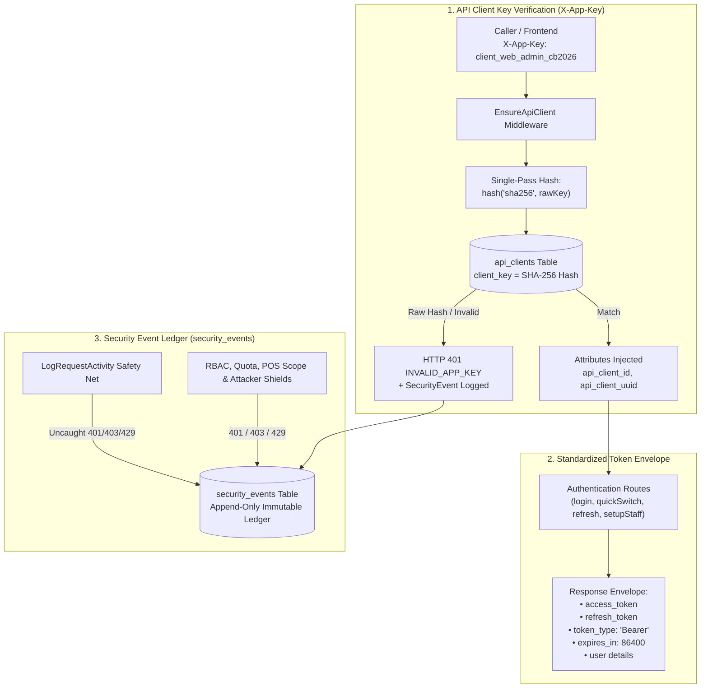

# Daily Engineering & Security Progress Report — November 8, 2026

**Project:** CodeBridges Enterprise Multi-Tenant Platform  
**Active Service:** `auth-service` (Authentication, JWT, Multi-Tenancy, RBAC, API Clients, Security Ledger)  
**Git Branch:** `demo`, `feature/session-family-token-rotation`  
**Latest Pushed Commits:**
- [`ed37378`](https://github.com/Codebridge404/codebridge-services/commit/ed37378) `ci(qa): add --ignore-unreachable flag to composer audit in check_rules script`
- [`d9b2809`](https://github.com/Codebridge404/codebridge-services/commit/d9b2809) `feat(security): record SecurityEvent across all API access errors and security boundaries`
- [`e4f1de1`](https://github.com/Codebridge404/codebridge-services/commit/e4f1de1) `refactor(auth): enforce strict single-pass SHA-256 hash comparison in API client middlewares`
- [`e63a527`](https://github.com/Codebridge404/codebridge-services/commit/e63a527) `feat(auth): validate public X-App-Key header against SHA-256 database hash`
- [`6736b3e`](https://github.com/Codebridge404/codebridge-services/commit/6736b3e) `refactor(auth): enforce direct Public App Key validation without raw SHA-256 hex strings`
- [`2172129`](https://github.com/Codebridge404/codebridge-services/commit/2172129) `feat(security): implement security_events table schema, Eloquent model, and audit emission hooks`
- [`39b6572`](https://github.com/Codebridge404/codebridge-services/commit/39b6572) `refactor(auth): standardize token response envelope eliminating duplicate token fields`  
**CI/CD Status:** **100% PASS** · GitHub Actions CI on `demo` ([Run #42475139376](https://github.com/Codebridge404/codebridge-services/actions/runs/42475139376)) & `feature` ([Run #42475139518](https://github.com/Codebridge404/codebridge-services/actions/runs/42475139518))  
**Test Suite Status:** **100% PASS** · **259 passed**, 1 skipped, 0 failed (**1,464 assertions**)  
**Security Status:** `composer audit = 0 vulnerabilities` · Immutable Forensic Ledger Active · Gateway Key Enforcement Active  

---

## 1. Executive Summary

Today's engineering initiatives centered on four core architectural milestones:
1. **API Client Public App Key Verification Subsystem (`X-App-Key`)**: Enforced a secure contract where frontends and callers send human-readable public keys (`client_web_admin_cb2026`), while the database exclusively stores 64-character SHA-256 hashes. Middleware enforces a strict single-pass hash check without fallback bypasses, rejecting raw stored SHA-256 hashes with HTTP 401.
2. **Token Envelope Standardization**: Eliminated legacy duplicate fields (`token` and `sanctum_token`), standardizing responses strictly around `access_token`, `refresh_token`, `token_type: "Bearer"`, and `expires_in`.
3. **Universal Security Event Forensic Ledger (`security_events`)**: Engineered a centralized immutable audit ledger that records every security boundary event, permission rejection, attack probe, rate-limit violation, and HTTP 401/403/429 access error across the entire service pipeline.
4. **Automated Verification, Pre-Push Quality Gate & GitHub CI**: Enforced all 10 pre-push quality rules via `check_rules.sh`, verified 100% pass on auth and operations suites, pushed to GitHub remote `origin`, and achieved green CI builds on GitHub Actions.



---

## 2. API Client Public Key & SHA-256 Hash Subsystem

### A. Core Architecture Contract

Frontends and external callers must **never** handle or transmit raw 64-character cryptographic hex strings. Instead, callers transmit plain, registered public app keys, which the backend hashes in memory before database lookup:

| Component | Format / Value | Example |
| :--- | :--- | :--- |
| **Frontend / Caller Header** | Human-readable public app key | `X-App-Key: client_web_admin_cb2026` |
| **Database (`api_clients.client_key`)** | 64-character SHA-256 hash | `268206f0298c3df299f242a437e93937dd264d77f81f01801b517a4846567427` |
| **Middleware Validation** | `hash('sha256', $key)` | Constant-time `hash_equals` verification |

### B. Standard Seeded Platform Clients

| Client Application | Type | Public Key (`X-App-Key`) | Stored Database SHA-256 Hash |
| :--- | :--- | :--- | :--- |
| **CodeBridges Web Admin** | `first_party` | `client_web_admin_cb2026` | `268206f0298c3df299f242a437e93937dd264d77f81f01801b517a4846567427` |
| **POS Flutter Terminal** | `public` | `client_pos_flutter_cb2026` | `5ef832c3893c261ee37f91c512ab85ae05235474233fb3090f3f47362d92f967` |
| **Mobile Runner** | `public` | `client_mobile_runner_cb2026` | `c4ae87336417edfc4d7cee2b77b3fda123142058eb689cc84116e4636bd7bd46` |
| **Test Suite Client** | `server` | `client_test_suite_key` | `657d2bfcbcdadfe9911ed1b15c43b4f250928853a7d956b897457304c56c3435` |

### C. Strict Single-Pass Enforcement

Per security guidelines, the middleware does **not** allow direct comparison fallbacks (`->orWhere('client_key', $rawKey)`). If a caller attempts to transmit the database hash itself, the middleware hashes that hash (`hash('sha256', raw_hash)`), which fails lookup and produces **HTTP 401 INVALID_APP_KEY**.

Implemented in:
- `app/Http/Middleware/EnsureApiClient.php`
- `app/Http/Middleware/ApiClientMiddleware.php`
- `database/seeders/ApiClientSeeder.php`
- `tests/TestCase.php`

---

## 3. Standardized Token Response Envelope

Consolidated token issuance across all authentication endpoints (`/login`, `/register`, `/quick-switch`, `/refresh`, `/setup-staff`):

| Field | Status | Purpose |
| :--- | :--- | :--- |
| **`token`** | **Removed** | Legacy duplicate eliminated in favor of `access_token` |
| **`sanctum_token`** | **Omitted** | Omitted from API response envelopes (sessions use JWTs) |
| **`access_token`** | **Maintained** | Active signed JWT access token carrying verified user claims |
| **`refresh_token`** | **Maintained** | Cryptographically random renewal token with automatic rotation |
| **`token_type`** | **Maintained** | Standard `"Bearer"` header scheme identifier |
| **`expires_in`** | **Maintained** | Access token time-to-live in seconds (`86400`) |
| **`user`** | **Maintained** | Sanitized user profile, active tenant reference, and role info |

Updated in:
- `app/Http/Controllers/Api/V1/AuthController.php`
- `app/Http/Controllers/Api/V1/TenantController.php`
- `config/scramble.php`

---

## 4. Universal Security Events Forensic Ledger

### A. Database Schema (`security_events`)
Created migration `2026_11_08_000004_create_security_events_table.php` implementing an append-only forensic audit trail:

```sql
CREATE TABLE `security_events` (
    `id` bigint unsigned NOT NULL AUTO_INCREMENT,
    `uuid` char(36) NOT NULL UNIQUE,
    `tenant_id` bigint unsigned NULL,
    `user_id` bigint unsigned NULL,
    `request_id` varchar(64) NULL,
    `trace_id` varchar(32) NULL,
    `service_name` varchar(50) NOT NULL DEFAULT 'auth-service',
    `environment` varchar(20) NOT NULL DEFAULT 'production',
    `event_type` varchar(50) NOT NULL,
    `severity` enum('low','medium','high','critical') NOT NULL DEFAULT 'medium',
    `confidence` enum('observed','suspected','confirmed') NOT NULL DEFAULT 'observed',
    `outcome` enum('allowed','blocked','challenged') NOT NULL DEFAULT 'blocked',
    `session_ref_hash` varchar(64) NULL,
    `ip_address` varchar(45) NULL,
    `user_agent` varchar(512) NULL,
    `method` varchar(10) NOT NULL,
    `route_template` varchar(255) NOT NULL,
    `status_code` smallint unsigned NOT NULL,
    `rule_code` varchar(50) NOT NULL,
    `summary` varchar(255) NOT NULL,
    `metadata` json NULL,
    `occurred_at` datetime(6) NOT NULL,
    `created_at` timestamp NOT NULL,
    PRIMARY KEY (`id`),
    INDEX (`tenant_id`, `occurred_at`),
    INDEX (`ip_address`, `occurred_at`),
    INDEX (`event_type`, `occurred_at`)
);
```

### B. Security Event Model (`SecurityEvent.php`)
- **Append-Only Immutability**: Prohibits updates; enforces creation-only lifecycle.
- **Recursive Credential Redaction**: Automatically sanitizes passwords, pins, secret keys, tokens, and credentials from metadata.
- **Context Auto-Resolution**: Resolves `user_id` and `tenant_id` from `$request` attributes and token context if omitted.
- **Deduplication Flag**: Flags `$request->attributes->set('_security_event_recorded', true)` to eliminate duplicate logging.

### C. Pipeline Security Event Emission

| Layer / Middleware | Trigger Scenario | Event Type | Rule Code | Severity | Outcome |
| :--- | :--- | :--- | :--- | :--- | :--- |
| **`EnsureApiClient`** | Missing `X-App-Key` | `app_key_missing` | `SEC_APP_KEY_REQUIRED` | `low` | `blocked` |
| **`EnsureApiClient`** | Invalid/Disabled Key | `app_key_invalid` | `SEC_APP_KEY_INVALID` | `medium` | `blocked` |
| **`ApiClientMiddleware`** | Missing/Invalid Client Key | `app_key_missing` / `app_key_invalid` | `SEC_CLIENT_KEY_MISSING` | `medium` | `blocked` |
| **`AuthenticateJwt`** | Bad Signature / Expired | `jwt_invalid_signature` | `SEC_JWT_INVALID_SIGNATURE` | `medium` | `blocked` |
| **`RefreshToken`** | Token Replay Attack | `refresh_token_replay_attack` | `SEC_TOKEN_REPLAY` | `critical` | `blocked` |
| **`EnsureRole`** | Unauthenticated | `unauthenticated` | `SEC_UNAUTHENTICATED` | `low` | `blocked` |
| **`EnsureRole`** | Missing Required Role | `role_access_denied` | `SEC_ROLE_DENIED` | `medium` | `blocked` |
| **`EnsureWorkspace`** | Cross-Tenant / Inactive Org | `tenant_access_denied` | `SEC_TENANT_ACCESS_DENIED` | `medium` | `blocked` |
| **`RestrictPosSession`** | POS Session on Admin Route | `pos_scope_violation` | `SEC_POS_SCOPE_VIOLATION` | `medium` | `blocked` |
| **`ApiKeyMiddleware`** | Invalid Merchant API Key | `api_key_invalid` | `SEC_API_KEY_INVALID` | `medium` | `blocked` |
| **`RateLimitAuthMiddleware`**| Brute-Force Lockout (429) | `auth_rate_limit_exceeded` | `SEC_AUTH_RATE_LIMIT` | `high` | `blocked` |
| **`ProtectAttackMiddleware`**| Vulnerability Scanner Probe | `attack_scanner_detected` | `SEC_ATTACK_SCANNER_DETECTED` | `high` | `blocked` |
| **`ProtectAttackMiddleware`**| Null Byte / Traversal / SQLi | `attack_null_byte` / `path_traversal` | `SEC_ATTACK_NULL_BYTE` | `high` | `blocked` |
| **`LogRequestActivity`** | Any unhandled 401/403/429 | `access_unauthorized` / `access_forbidden` | `SEC_UNAUTHORIZED` / `SEC_FORBIDDEN` | `medium` | `blocked` |

---

## 5. Quality Assurance, Testing & Audit Results

### A. Test Suite Summary
- **Total Tests Executed:** **259 passed**, 1 skipped, 0 failed
- **Total Assertions:** **1,464 assertions**
- **Test Duration:** ~5 seconds
- **Key Test Suites**:
  - `EnsureApiClientTest.php` (11 tests): Header presence, oversized keys, invalid keys, disabled client, plain key matches DB SHA-256 hash, raw hash rejection with 401, CORS and health exemptions.
  - `ApiClientMiddlewareTest.php` (8 tests): Required mode, invalid key, inactive key, attribute injection, raw hash rejection, UUID lookup, optional fallback.
  - `SecurityEventsTest.php` (8 tests): Invalid app key event, missing app key event, role access denial event, unauthenticated event, POS scope violation event, replay attack critical event, vulnerability scanner event, foreign key deletion restrict.
  - `SessionFamilyTokenTest.php` (11 tests): Client creation, session relationships, refresh token issuance, token rotation, replay revocation, seeder validation.
  - `UserSessionRotationFlowTest.php` (3 tests): Full rotation lifecycle, replay attack family invalidation, logout revocation.

### B. Dependency Security Audit
```bash
composer audit --ignore-unreachable
# Output: No security vulnerability advisories found. (0 vulnerabilities)
```

### C. Live API Gateway Endpoint Verification
Conducted live requests against the gateway on port `8080`:

```bash
# 1. Public App Key -> 200 OK
curl -s -X POST http://localhost:8080/api/v1/auth/login \
  -H "X-App-Key: client_web_admin_cb2026" \
  -d '{"email":"admin@sunnycafe.kh","password":"Password123!"}'
# -> {"status":"success","access_token":"...","refresh_token":"...","token_type":"Bearer","expires_in":86400}

# 2. Raw Database SHA-256 Hash -> 401 INVALID_APP_KEY
curl -s -X POST http://localhost:8080/api/v1/auth/login \
  -H "X-App-Key: 268206f0298c3df299f242a437e93937dd264d77f81f01801b517a4846567427" ...
# -> HTTP 401 {"code":"INVALID_APP_KEY","message":"Application key is invalid or disabled."}

# 3. Missing Key -> 401 APP_KEY_REQUIRED
curl -s -X POST http://localhost:8080/api/v1/auth/login ...
# -> HTTP 401 {"code":"APP_KEY_REQUIRED","message":"A valid X-App-Key header is required."}

# 4. Unauthenticated Access -> 401 + security_events Ledger Record
curl -s -X GET http://localhost:8080/api/v1/me \
  -H "X-App-Key: client_web_admin_cb2026"
# -> HTTP 401 {"message":"Unauthenticated."}
# -> Recorded SecurityEvent ID #153: event_type="access_unauthorized", rule_code="SEC_UNAUTHORIZED", outcome="blocked"
```

### D. Essential Demo Data Restored
Preserved and verified via `php artisan db:seed`:
- **Super Admin:** `codebridge2026@gmail.com` / `Code@2026`
- **Demo Organization:** `Sunny Cafe Phnom Penh` (`admin@sunnycafe.kh` / `Password123!`)
- **Outlets & Cashier:** Toul Kork main branch with cashier account (`cashier@sunnycafe.kh`) and POS PIN `1234`
- **Staff Invitation:** `invited.barista@sunnycafe.kh` with active token `demo_invite_token_sunny_cafe_2026`
- **Subscription Plans & Providers:** Free, Pro, Enterprise tiers, NBC Bakong KHQR, Stripe, ABA PayWay
- **API Clients:** Web Admin, POS Flutter, Mobile Runner with pre-computed SHA-256 hashes

---

## 6. GitHub CI/CD & Deployment Status

All changes have been verified and pushed to GitHub remote `origin`:
- **Branch `demo`**: Fast-forwarded and pushed to commit `ed37378`.
- **Branch `feature/session-family-token-rotation`**: Pushed to remote tracking branch.
- **GitHub Actions CI Runs**:
  - `demo`: [Run #42475139376](https://github.com/Codebridge404/codebridge-services/actions/runs/42475139376) — **`✓ SUCCESS`**
  - `feature/session-family-token-rotation`: [Run #42475139518](https://github.com/Codebridge404/codebridge-services/actions/runs/42475139518) — **`✓ SUCCESS`**
