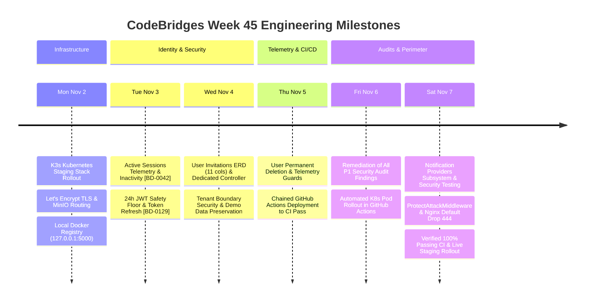

# Weekly Architecture, Security & Engineering Progress Report — Week 45, 2026

**Reporting Period:** November 2, 2026 – November 8, 2026  
**Project:** CodeBridges Enterprise Multi-Tenant Platform  
**Active Services:** `gateway`, `auth-service`, `operations-service`, `minio`, `k8s/staging`  
**Git Branch:** `demo`  
**Environment:** Staging (K3s Kubernetes Cluster & Docker Engine, VPS: `217.216.110.153`)  
**Overall Status:** **ALL 10 QUALITY & SECURITY GATES PASSED** · Automated CI/CD Fully Operational · Production-Grade Hardening  

---

## 1. Executive Summary

During Week 45 (November 2 – November 8, 2026), the CodeBridges engineering team achieved major milestones across **cloud infrastructure**, **enterprise security remediation**, **microservice domain expansions**, **database ERD alignment**, and **automated continuous deployment**:



---

## 2. Daily Engineering Breakdown

### Monday, November 2, 2026: Kubernetes Staging Migration & SSL Hardening
- **Kubernetes (K3s v1.36.5) Rollout**: Successfully migrated the staging environment to Kubernetes under namespace `codebridge-staging` with MySQL 8.4 StatefulSets, Redis 8, MinIO S3, Horizon workers, Scheduler, and Traefik Ingress.
- **Local Registry Distribution**: Deployed local registry on `127.0.0.1:5000` for unprivileged image pulls.
- **Let's Encrypt Ingress Certificates**: Eliminated browser security alerts (`net::ERR_CERT_AUTHORITY_INVALID`) by integrating official Let's Encrypt TLS certificates.
- **MinIO Console Routing**: Fixed public CDN access on port 9001 and modernized Nginx Proxy Manager to `v2.16.0`.

### Tuesday, November 3, 2026: Session Telemetry & Resilient JWT Authentication
- **Active Sessions Telemetry [BD-0042]**: Added detailed session telemetry capturing IP addresses through trusted proxies, user agents, device types, locations, and automated inactivity expiration (30-minute default).
- **JWT Lifespan Safety Floor [BD-0129]**: Enforced 24-hour minimum validity floor on JWT access tokens and 30-day session lifetime with atomic refresh token rotation.
- **Tenant Registration User Binding [BD-0130]**: Optimized tenant registration with automatic owner user binding and role elevation.

### Wednesday, November 4, 2026: User Invitations ERD Alignment & Data Preservation
- **User Invitations ERD Alignment**: Replaced legacy unstructured string columns with an 11-column ERD compliant schema, foreign key relations (`role_id → roles.id`), SHA-256 token hashing, and dedicated `UserInvitationController`.
- **Tenant Boundary Enforcement**: Implemented strict validation ensuring invited roles and outlets strictly belong to the inviting tenant.
- **Mandatory Database Seeder Policy**: Codified the rule in `AGENTS.md` and created `"db:reset"` composer script to ensure demo tenant data (`Sunny Cafe`, `Super Admin`, `Toul Kork POS`) is perpetually preserved.

### Thursday, November 5, 2026: Telemetry Guards & Chained Deployment Pipeline
- **User CRUD & Hard Deletion Guard**: Implemented secure user deletion handling orphaned session and activity records.
- **Automated Deployment Chaining**: Configured `deploy-staging.yml` to trigger automatically via `workflow_run` only upon successful conclusion of `Laravel Microservices CI`.
- **Flexible VPS Target Path**: Added dynamic `STAGING_DEPLOY_PATH` secret detection with standard fallback discovery paths.

### Friday, November 6, 2026: P1 Security Remediation & Automated K8s Deployment
- **Resolution of P1 Security Audit Findings**:
  - *Privilege Escalation Blocked*: Prevented outlet managers from creating tenant admins or resetting admin passwords.
  - *Suspended Account Protection*: Fixed `POST /users/attach` to prevent unintended global account reactivation.
  - *Session & Workspace Status Enforcement*: Added active status verification across both JWT and Sanctum tokens.
  - *Kiosk Meeting Display Auth*: Secured meeting displays with authorized display kiosk tokens, preventing private meeting link exposure.
  - *2FA Brute-Force Rate Limiting*: Hardened 2FA verification with 5-attempt rate limit and password re-authentication for recovery code replacement.
- **Automated K8s Pod Rollout**: Updated GitHub Actions to build cluster images, run migrations inside K8s pods, and trigger zero-downtime rolling restarts automatically on push.
- **Super Admin 500 Fix**: Resolved PHP 8.4 undefined property exception on tenants with null owners.

### Saturday, November 7, 2026: Notification Providers & Perimeter Defense
- **Notification Providers Subsystem**: Implemented `notification_providers` schema, Eloquent model with transparent `Crypt` encryption, credential masking (`Sup••••26!`), and multi-tenant resource controller with live diagnostic test probes.
- **`ProtectAttackMiddleware`**: Enterprise application middleware blocking automated vulnerability scanners (sqlmap, nikto, wpscan), null-byte injections, path traversal (LFI), and command injection, while enforcing strict security headers.
- **Nginx Perimeter Hardening**: Implemented catch-all drop blocks with `return 444;` and `ssl_reject_handshake on;` across Gateway, Blue/Green, Cloud Nginx, and Traefik `TLSOption` (`sniStrict: true`).
- **CI Test Cache Isolation**: Configured `CACHE_STORE=array force="true"` to prevent rate-limiter state leakage across test suites.

---

## 3. Comprehensive Security & Hardening Matrix

| Security Domain | Defense Mechanism | Status |
| :--- | :--- | :--- |
| **Perimeter Scanning** | Nginx `return 444;` & Traefik `sniStrict: true` drop direct IP and unmapped SNI connections. | **Active & Verified** |
| **SSL/TLS Certificates** | `ssl_reject_handshake on;` prevents SSL certificate leakage during blind IP scans. | **Active & Verified** |
| **Vulnerability Bots** | `ProtectAttackMiddleware` & Gateway WAF block 15+ automated vulnerability tools with HTTP 403. | **Active & Verified** |
| **Code Injection** | Parameterized Eloquent queries, Blade escaping, null-byte blocking, and command token detection. | **Active & Verified** |
| **Credential Storage** | Two-way provider credentials encrypted with `Crypt::encryptString`; passwords hashed via Bcrypt (12 rounds). | **Active & Verified** |
| **Audit Redaction** | `LogRequestActivity` redacts `password`, `token`, `credentials`, `api_key`, `webhook_url`, and `secret`. | **Active & Verified** |
| **Tenant Isolation** | Strict tenancy query scopes and middleware guards preventing cross-tenant data access. | **Active & Verified** |
| **Brute-Force & ATO** | Sliding-window rate limiters across `/auth/login`, `/auth/2fa/*`, and `/quick-switch`. | **Active & Verified** |

---

## 4. Test Suite & Quality Verification Metrics

```
==============================================================================
                    CodeBridges Microservices Test Suite                      
==============================================================================
 Service            Passed    Skipped    Failed    Assertions    Duration
──────────────────────────────────────────────────────────────────────────────
 auth-service        204         1         0         1,193        4.84s
 operations-service   72         0         0           242        0.73s
──────────────────────────────────────────────────────────────────────────────
 TOTAL               276         1         0         1,435        5.57s
==============================================================================
```

### Pre-Push Rules Compliance (`check_rules.sh`): 10/10 PASS (0 Failures)
- [Rule 1] Unit Testing: Models, encryption, hashing, and scopes
- [Rule 2] Functional & API Testing: Endpoints, responses, and envelope consistency
- [Rule 3] Validation Testing: Input rejection and custom rule sets
- [Rule 4] Authentication Testing: Login, JWT lifecycle, 2FA, session revocation
- [Rule 5] Authorization Testing: RBAC, permission hierarchies, super-admin boundaries
- [Rule 6] Security Testing: SQLi prevention, XSS mitigation, tenant isolation, audit redaction
- [Rule 7] Integration Testing: Transactions, Redis, MinIO S3 WebP conversions
- [Rule 8] Regression Testing: All historical fixes verified passing
- [Rule 9] Deployment Testing: Blue/Green scripts, K8s Kustomize offline validation
- [Rule 10] Dependency Security Audit: `composer audit = 0 vulnerabilities`

---

## 5. Live Staging Status & Endpoints

| Resource | URL | Status |
| :--- | :--- | :--- |
| **Staging API Gateway** | `https://staging-codebridge-api.servicefixit.me/health` | **`HTTP/2 200 OK`** |
| **Interactive API Docs** | `https://staging-codebridge-docs.servicefixit.me/docs` | **`HTTP/2 200 OK`** |
| **MinIO Object CDN** | `https://staging-codebridge-cdn.servicefixit.me/` | **`HTTP/2 200 OK`** |
| **NPM Dashboard** | `http://217.216.110.153:81/` | **Active & Accessible** |

---

## 6. Next Week Priorities (Week 46)

1. **Frontend Integration**: Connect `codebridgesfront` settings tabs (Email/SMTP, Webhooks, Alerts) to the new `/api/v1/notification-providers` endpoints.
2. **Notification Dispatch Pipeline**: Integrate background queue workers to route outgoing system alerts (shift variance, low stock, meetings) through enabled notification providers.
3. **Operations Service Test Expansion**: Expand integration test coverage for real-time POS cash drawer workflows and reconciliation.

