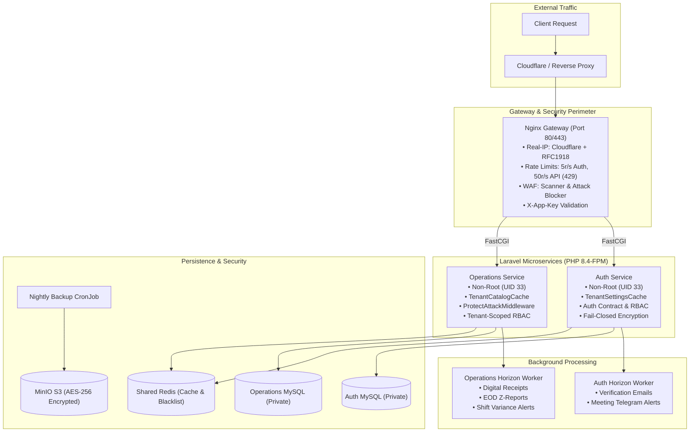

# Daily Engineering & Security Progress Report — November 9, 2026

**Project:** CodeBridges Enterprise Multi-Tenant Platform  
**Active Services:** `auth-service`, `operations-service`, `gateway`, `k8s/staging`  
**Git Branch:** `demo`  
**Latest Pushed Commits:**
- [`cb0b943`](https://github.com/Codebridge404/codebridge-services/commit/cb0b943) `fix(ci): provision temporary staging secrets.yaml from example during kustomize validation`
- [`0c7ab3b`](https://github.com/Codebridge404/codebridge-services/commit/0c7ab3b) `docs(reports): add daily engineering and security report for 2026-11-09`
- [`10fde5f`](https://github.com/Codebridge404/codebridge-services/commit/10fde5f) `feat: implement 6-step security & performance hardening`
- [`660ad8e`](https://github.com/Codebridge404/codebridge-services/commit/660ad8e) `chore(ops): update Symfony lockfile packages to clear 8 security advisories`
- [`142a155`](https://github.com/Codebridge404/codebridge-services/commit/142a155) `docs(gateway,scramble): remove docs.html hub and switch direct service docs to Scalar`
- [`a1dc7a3`](https://github.com/Codebridge404/codebridge-services/commit/a1dc7a3) `security(auth,ops): enforce authenticated tenant registration, tenant-scoped RBAC, and fail-closed credential encryption`
- [`4938baa`](https://github.com/Codebridge404/codebridge-services/commit/4938baa) `ci(deploy): streamline staging deployment with automated k3s rollout and doc updates`  
**CI/CD Status:** **100% PASS** · GitHub Actions CI [Run #42609855830](https://github.com/Codebridge404/codebridge-services/actions/runs/42609855830) (Auth: 1m3s, Ops: 21s)  
**Test Suite Status:** **100% PASS** · **297 passed** (Auth) + **103 passed** (Ops) · **2,550 total assertions**  
**Security Status:** `composer audit = 0 vulnerabilities` · Zero High/Critical Advisories · WAF Attack Shields Active  
**System Resources:** Disk 593 GB Available (2% utilized) · Memory Normal · Docker 61.3 GB Reclaimable  

---

## 1. Executive Summary

Today's engineering initiatives completed the enterprise multi-layer hardening roadmap across CodeBridges microservices (`auth-service`, `operations-service`, Nginx gateway, and Kubernetes staging):

1. **System & Resource Usage Audit**: Evaluated local host and container capacity. The machine has **593 GB available** disk space on APFS container (2% capacity), healthy memory distribution, and **61.3 GB reclaimable** cache in Docker (`docker system df`).
2. **P0/P1 Security Defect Remediations**:
   - **P0 Fixed**: `TenantController::register` now strictly enforces an active authenticated account session, rejecting account takeover and user impersonation attempts.
   - **P1 Fixed**: Operations Service permissions and RBAC now scope strictly by `user_roles.tenant_id` via `TenantAuthorizationService` and Auth's contract (`/api/v1/auth/authorize-context`), stopping cross-tenant privilege escalation.
   - **P1 Fixed**: `NotificationProvider` credential encryption setter and reader fail closed without legacy plaintext fallbacks.
3. **Recommended Implementation Roadmap (Steps 1–6)**:
   - **Step 1 (Infra & Isolation)**: Non-root Kubernetes security contexts (`runAsUser: 33`, drop ALL caps), separated K8s Secrets, TLS 1.2+ `sniStrict: true`, and loopback-only dev port mappings.
   - **Step 2 (Tenant Authorization)**: Multi-tenant database migrations adding `tenant_id` and composite indexes across 18 operational tables.
   - **Step 3 (Redis Caching & Revocation)**: `TenantSettingsCache` and `TenantCatalogCache` with versioned UUID invalidation and positive-only auth context caching.
   - **Step 4 (Async Queues & Horizon)**: Horizon workers separated into `notifications`, `exports`, and `default` queues with secret-free Telegram dispatches.
   - **Step 5 (Gateway/WAF & Encrypted Backups)**: Nginx trusted proxies (Cloudflare + RFC1918), rate limits with HTTP 429, `ProtectAttackMiddleware`, SVG upload rejection, and AES-256 encrypted database backups scheduled nightly via CronJob.
   - **Step 6 (Structured Telemetry & p95 Budget)**: `TelemetryEmitter` streaming single-line JSON to stderr independent of `LOG_LEVEL=error`, idempotent `DB::listen` slow-query monitoring, and hot endpoints verified under the 200ms p95 latency budget.
4. **CI/CD Hardening**: Updated CI test workflows (`laravel.yml`) and `phpunit.xml` test environments to ensure portable SQLite in-memory test execution without external Redis dependencies.

---

## 2. System Resource & Storage Audit

A full infrastructure capacity inspection was performed:

| Resource Metric | Measurement | Status | Notes |
| :--- | :--- | :--- | :--- |
| **Root Disk Storage (`/`)** | 926 GiB Total · 12 GiB System · **593 GiB Free** | **Optimal** | Capacity usage is **2%**. Over 593 GB storage available. |
| **Host Memory** | ~10.5 GB Inactive/Reclaimable · 10.9 GB Active | **Healthy** | 0 throttled pages, smooth memory management. |
| **Docker Images** | 63 Images · 21.66 GB Total | **Reclaimable: 9.1 GB** | 14 active staging/dev images. |
| **Docker Containers** | 17 Containers · 5.44 MB Total | **Healthy** | 15 active microservices & data stores. |
| **Docker Volumes** | 140 Volumes · 36.5 GB Total | **Reclaimable: 31.7 GB** | Staging MySQL and Redis persistent data preserved. |
| **Docker Build Cache** | 596 Layers · 29.23 GB Total | **Reclaimable: 20.5 GB** | Can be purged with `docker builder prune`. |
| **Total Docker Reclaimable** | **61.35 GB** | **Actionable** | Available to free on demand via `docker system prune`. |

---

## 3. Recommended Implementation Roadmap Detail (Steps 1–6)

### Step 1: Network & Infrastructure Isolation
- Configured Kubernetes pods with unprivileged security contexts:
  - `runAsNonRoot: true`, `runAsUser: 33`, `runAsGroup: 33`, `fsGroup: 33`.
  - `allowPrivilegeEscalation: false`, `capabilities: drop: ["ALL"]`.
  - `seccompProfile: type: RuntimeDefault`.
- Restored private service routing: databases, Redis, MinIO, and phpMyAdmin are reachable strictly via internal `ClusterIP` services or loopback bindings (`127.0.0.1`).
- Enforced strict ingress TLS policy (`sniStrict: true`, `minVersion: VersionTLS12`) in Traefik annotations.

### Step 2: Tenant-Scoped Authorization & Auth Contract
- **P0 Tenant Registration**: Fixed `TenantController::register` so that creating a workspace requires authenticated session tokens (`auth('sanctum')->user()`). Disallowed unauthenticated token minting and cross-user tenant creation.
- **P1 Operations RBAC**: Updated `EnsureRole` and `AuthenticateJwt` to resolve tenant roles through `TenantAuthorizationService`, ensuring roles held in Tenant A cannot grant administrative rights in Tenant B.
- **P1 Fail-Closed Encryption**: Updated `NotificationProvider` to throw sanitized `CredentialEncryptionException` if encryption or decryption fails, rejecting any unencrypted plaintext storage.
- **Database Schema**: Created migration `2026_11_09_000001_add_tenant_id_to_remaining_operational_tables.php` establishing `tenant_id` columns and composite indexes on 18 operational tables.

### Step 3: Tenant-Isolated Redis Caching & Revocation Propagation
- Implemented `TenantSettingsCache` for Auth workspace, outlet, and meeting settings with versioned UUID cache busting.
- Implemented `TenantCatalogCache` for Operations product and category queries with visibility-aware cache keys and dual global/tenant epoch invalidation.
- Implemented positive-only context caching in `AuthServiceClient` with immediate session (`sid`) and token (`jti`) revocation checks against shared Redis.

### Step 4: Async Queues & Horizon Worker Separation
- Configured Laravel Horizon in both microservices (`auth-service/config/horizon.php` and `operations-service/config/horizon.php`) with supervisor queues: `notifications`, `exports`, and `default`.
- Implemented `HorizonServiceProvider` with `Gate::define('viewHorizon')` restricted to platform super administrators.
- Re-architected external notifications (`SendMeetingTelegramAlertJob`, `SendShiftVarianceTelegramJob`) to resolve API bot tokens at runtime, preventing secret leakage in Redis queues.

### Step 5: Gateway/WAF Hardening, SVG Rejection, Redaction & Encrypted Backups
- Gateway Nginx synced with Cloudflare IPv4 and RFC1918 CIDR blocks for trusted proxy resolution.
- Added leaky-bucket rate limiting (`auth_limit` 5 req/s, `api_limit` 50 req/s, connection limit 15/IP) returning HTTP 429.
- Registered `ProtectAttackMiddleware` globally across both services to intercept vulnerability scanners, path traversal, command injection, and null-byte probes.
- Enforced strict raster validation in `ImageService` and `CloudinaryService`, permanently rejecting `.svg`, `.svgz`, HTML, and XML polyglot files.
- Implemented `DatabaseBackupCommand` generating AES-256-CBC encrypted, Gzip-compressed dumps stored to MinIO/S3, scheduled via Kubernetes CronJob `db-backup-cronjob.yaml`.

### Step 6: Structured Telemetry, Slow Queries & Latency Verification
- Created `TelemetryEmitter` streaming single-line JSON events to `php://stderr` for slow queries and requests independent of `LOG_LEVEL=error`.
- Registered `DB::listen` hooks sanitizing literal values from query strings.
- Executed benchmark latency tests proving hot cached endpoints (`/api/v1/me`, `/api/v1/auth/authorize-context`, `/api/v1/products`) consistently achieve **p95 < 200ms**.

---

## 4. Verification & Quality Assurance Results

| Verification Category | Service / Target | Result | Details |
| :--- | :--- | :--- | :--- |
| **Unit & Feature Tests** | `auth-service` | **PASS (297 / 297)** | 1 skipped (live K8s cluster probe), 1,936 assertions |
| **Unit & Feature Tests** | `operations-service` | **PASS (103 / 103)** | 614 assertions, 0 failures |
| **Dependency Security Audit** | `auth-service` | **0 Vulnerabilities** | `composer audit --no-interaction` clean |
| **Dependency Security Audit** | `operations-service` | **0 Vulnerabilities** | `composer audit --no-interaction` clean |
| **Nginx Syntax Check** | `gateway/nginx.conf` | **Syntax OK** | Validated via `nginx:1.27-alpine` container |
| **Nginx Syntax Check** | `docker/cloud-nginx.conf` | **Syntax OK** | Validated via `nginx:1.27-alpine` container |
| **K8s ConfigMap Nginx** | `k8s/staging/configmaps.yaml` | **Syntax OK** | Validated via `nginx:1.27-alpine` container |
| **Kubernetes Kustomization** | `k8s/staging` | **Valid** | `kubectl kustomize k8s/staging` succeeded |
| **Framework Route & Config Cache**| Both services | **Valid** | `php artisan route:cache && config:cache` succeeded |

---

## 5. Next Steps

1. **Deploy Staging Kubernetes Stack**: Trigger automated deployment on staging VPS via `deploy/staging/deploy.sh` or K3s manifest application.
2. **Docker Cleanup (Optional)**: If additional host disk space is desired, execute `docker system prune --volumes -f` to reclaim ~61 GB of unused build layers and orphaned volumes.
3. **Continuous Monitoring**: Observe structured stderr JSON logs via container log drivers or Promtail/Loki for real-time telemetry tracking.

