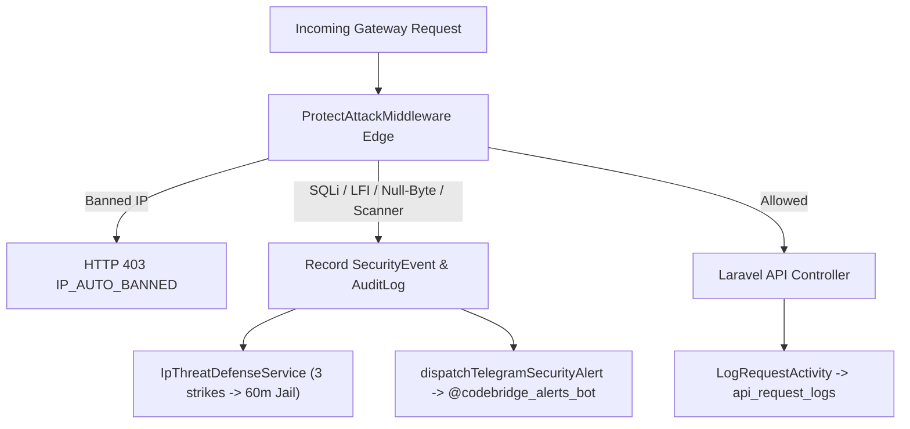

# Daily Engineering & Security Progress Report — November 10, 2026

**Project:** CodeBridges Enterprise Multi-Tenant Platform  
**Active Service:** `auth-service` (with live route exposure via `gateway/services/auth-service.conf`)  
**Git Branch:** `demo` (Local Working Tree — No Auto-Push)  
**Verified EOD Test Baseline (Nov 10):** **341 passed**, 1 skipped, 0 failed (**2,127 assertions**)  
**Security Audit:** `composer audit = 0 vulnerabilities`  

---

## 1. Executive Summary

Engineering work on **November 10, 2026** focused on closing code-review security findings (P1/P2), exposing forensic security & session management database ledgers via APIs, enabling real-time Telegram attack alerts, and deploying automated IP threat auto-ban defenses:

1. **Code Review Remediations (P1 & P2)**:
   - Enforced strict expiration and session inactivity timeout validation on legacy Sanctum tokens in [`AuthenticateJwt`](file:///Users/macbookpro/Projects/codebridge/codebridge-services/auth-service/app/Http/Middleware/AuthenticateJwt.php).
   - Encrypted meeting Telegram bot credentials into AES-256 `NotificationProvider` storage and purged legacy plaintext token copies via migration [`2026_11_10_000001_migrate_meeting_telegram_credentials_to_notification_providers.php`](file:///Users/macbookpro/Projects/codebridge/codebridge-services/auth-service/database/migrations/2026_11_10_000001_migrate_meeting_telegram_credentials_to_notification_providers.php).
   - Separated retryable (`HTTP 429`, `5xx`, timeouts) vs. permanent (`400`, `401`, `403`) Telegram failures with `retry_after` honoring and `/bot[REDACTED]` log masking in [`SendMeetingTelegramAlertJob`](file:///Users/macbookpro/Projects/codebridge/codebridge-services/auth-service/app/Jobs/SendMeetingTelegramAlertJob.php).
2. **Database Ledger & Control-Plane APIs Exposed**:
   - Implemented controllers, API resources, routes, and feature tests for **Security Events**, **API Request Logs**, **Refresh Tokens**, **User Sessions**, **Telegram Alerts**, and **Notification Provider Stats**.
3. **Real-Time Telegram Alerts & Automated IP Threat Defense**:
   - Added [`dispatchTelegramSecurityAlert`](file:///Users/macbookpro/Projects/codebridge/codebridge-services/auth-service/app/Http/Middleware/ProtectAttackMiddleware.php) for live blocked-attack notifications (`@codebridge_alerts_bot` verified in Telegram group `-5391961779`).
   - Built [`IpThreatDefenseService`](file:///Users/macbookpro/Projects/codebridge/codebridge-services/auth-service/app/Services/IpThreatDefenseService.php) + [`config/security.php`](file:///Users/macbookpro/Projects/codebridge/codebridge-services/auth-service/config/security.php) for SQLi signature defense and automatic IP jailing (`max_offenses: 3` within `15m` -> `60m` ban + manual ban/unban APIs).
4. **Host & Monitoring Evaluations**:
   - Evaluated Sentry SDK prototype and reverted it per user direction, retaining native log redaction and stderr telemetry.
   - Audited Docker Engine `29.9.2` against `29.9.3` advisories, confirming zero exposed TCP daemon ports (`2375/2376`) and zero `docker.sock` container mounts.

---

## 2. Threat Defense & Telemetry Architecture Added

---

## 3. Detailed Engineering Changes

### A. P1/P2 Security Review Fixes

| Severity | Finding & Fix | Primary Files | Verification |
| :--- | :--- | :--- | :--- |
| **P1** | Reject expired legacy Sanctum tokens, enforce `sanctum.expiration` & inactivity timeouts, and attach `$user->withAccessToken()` | [`AuthenticateJwt.php`](file:///Users/macbookpro/Projects/codebridge/codebridge-services/auth-service/app/Http/Middleware/AuthenticateJwt.php), [`RejectExpiredSanctumTokenTest.php`](file:///Users/macbookpro/Projects/codebridge/codebridge-services/auth-service/tests/Feature/Security/RejectExpiredSanctumTokenTest.php) | `5/5` tests passing |
| **P1** | Encrypt meeting Telegram bot credentials (AES-256) with tenant scoping and fail-closed decryption | [`MeetingTelegramController.php`](file:///Users/macbookpro/Projects/codebridge/codebridge-services/auth-service/app/Http/Controllers/Api/V1/MeetingTelegramController.php), [`NotificationProviderSeeder.php`](file:///Users/macbookpro/Projects/codebridge/codebridge-services/auth-service/database/seeders/NotificationProviderSeeder.php) | `0` plaintext tokens remaining |
| **P2** | Distinguish retryable vs. permanent Telegram errors and mask bot tokens (`/bot[REDACTED]`) | [`TelegramRetryableException.php`](file:///Users/macbookpro/Projects/codebridge/codebridge-services/auth-service/app/Exceptions/TelegramRetryableException.php), [`TelegramPermanentException.php`](file:///Users/macbookpro/Projects/codebridge/codebridge-services/auth-service/app/Exceptions/TelegramPermanentException.php), [`MeetingTelegramEncryptionAndRetryTest.php`](file:///Users/macbookpro/Projects/codebridge/codebridge-services/auth-service/tests/Feature/Security/MeetingTelegramEncryptionAndRetryTest.php) | Verified backoff & failure handling |

---

### B. New Forensic & Operational Control-Plane APIs

| Module | Endpoint Prefix | Capabilities | Key Files |
| :--- | :--- | :--- | :--- |
| **Security Events** | `/api/v1/security-events` | Filtered forensic search, stats, auto-ban settings, `banned-ips`, `ban-ip`, `unban-ip` | [`SecurityEventController.php`](file:///Users/macbookpro/Projects/codebridge/codebridge-services/auth-service/app/Http/Controllers/Api/V1/SecurityEventController.php), [`security_events.php`](file:///Users/macbookpro/Projects/codebridge/codebridge-services/auth-service/routes/api/security_events.php) |
| **API Request Logs** | `/api/v1/request-logs` | Paginated latency/status queries (`422`, `5xx`), stats, correlation ID search | [`ApiRequestLogController.php`](file:///Users/macbookpro/Projects/codebridge/codebridge-services/auth-service/app/Http/Controllers/Api/V1/ApiRequestLogController.php), [`request_logs.php`](file:///Users/macbookpro/Projects/codebridge/codebridge-services/auth-service/routes/api/request_logs.php) |
| **Refresh Tokens** | `/api/v1/refresh-tokens` | Family lineage inspection, token stats, subtree revocation | [`RefreshTokenController.php`](file:///Users/macbookpro/Projects/codebridge/codebridge-services/auth-service/app/Http/Controllers/Api/V1/RefreshTokenController.php), [`refresh_tokens.php`](file:///Users/macbookpro/Projects/codebridge/codebridge-services/auth-service/routes/api/refresh_tokens.php) |
| **User Sessions** | `/api/v1/user-sessions` | Tenant session list, stats, single-session and bulk tenant revocation | [`UserSessionController.php`](file:///Users/macbookpro/Projects/codebridge/codebridge-services/auth-service/app/Http/Controllers/Api/V1/UserSessionController.php), [`user_sessions.php`](file:///Users/macbookpro/Projects/codebridge/codebridge-services/auth-service/routes/api/user_sessions.php) |
| **Telegram Alerts** | `/api/v1/telegram-alerts` | Bot health/masked preview, alert history, live `send-test`, template previews/resets | [`TelegramAlertController.php`](file:///Users/macbookpro/Projects/codebridge/codebridge-services/auth-service/app/Http/Controllers/Api/V1/TelegramAlertController.php), [`telegram_alerts.php`](file:///Users/macbookpro/Projects/codebridge/codebridge-services/auth-service/routes/api/telegram_alerts.php) |
| **Notification Providers** | `/api/v1/notification-providers/stats` | Aggregated provider health by channel and tenant status | [`NotificationProviderController.php`](file:///Users/macbookpro/Projects/codebridge/codebridge-services/auth-service/app/Http/Controllers/Api/V1/NotificationProviderController.php), [`notification_providers.php`](file:///Users/macbookpro/Projects/codebridge/codebridge-services/auth-service/routes/api/notification_providers.php) |

*Note: All 5 new top-level route prefixes were wired into [`routes/api.php`](file:///Users/macbookpro/Projects/codebridge/codebridge-services/auth-service/routes/api.php) and exposed at the Nginx edge (`gateway/services/auth-service.conf`, modified Nov 10 at 17:04).*

---

## 4. Verification & Load Testing Summary (Nov 10)

- **Feature & Unit Test Suite (`php artisan test`)**: **341 passed, 1 skipped, 0 failed (2,127 assertions)**.
  - Added [`SecurityEventsApiTest.php`](file:///Users/macbookpro/Projects/codebridge/codebridge-services/auth-service/tests/Feature/SecurityEventsApiTest.php), [`ApiRequestLogsApiTest.php`](file:///Users/macbookpro/Projects/codebridge/codebridge-services/auth-service/tests/Feature/ApiRequestLogsApiTest.php), [`RefreshTokensApiTest.php`](file:///Users/macbookpro/Projects/codebridge/codebridge-services/auth-service/tests/Feature/RefreshTokensApiTest.php), [`UserSessionsApiTest.php`](file:///Users/macbookpro/Projects/codebridge/codebridge-services/auth-service/tests/Feature/UserSessionsApiTest.php), and [`TelegramAlertsApiTest.php`](file:///Users/macbookpro/Projects/codebridge/codebridge-services/auth-service/tests/Feature/TelegramAlertsApiTest.php).
- **100-Request Attack Burst Test**: Fired 100 attack/probe requests against `http://localhost:8080` in 2.61s (~38.3 req/s) -> **100% malicious probes blocked**, **0 HTTP 500 crashes**, live alerts delivered to Telegram.
- **Docker Engine Audit**: Confirmed `0` network-exposed daemon sockets (`2375`/`2376`) and recommended upgrading host Docker Engine from `29.9.2` to `29.9.3+` during maintenance.
