# Daily Engineering & Security Progress Report — November 11, 2026

**Project:** CodeBridges Enterprise Multi-Tenant Platform  
**Active Service:** `auth-service` (Strict Write Boundary Enforced per `AGENTS.md`)  
**Git Branch:** `demo` (Local Working Tree — No Auto-Push)  
**Verified Test Suite Status:** **371 passed**, 1 skipped (offline cluster probe), **0 failed** (**2,333 assertions**)  
**Quality & Security Gate (`check_rules.sh`):** **All 10 Rules PASSED (0 Failures)**  
**Security Audit:** `composer audit --ignore-unreachable = 0 vulnerabilities`  

---

## 1. Executive Summary

Engineering work on **November 11, 2026** completed full-stack API, authentication, authorization policy, container, Kubernetes, monitoring/incident-response, and disaster-recovery hardening across `auth-service`:

1. **Global WAF, JSON Body Inspection & Scanner Verification**:
   - Prepended [`ProtectAttackMiddleware`](file:///Users/macbookpro/Projects/codebridge/codebridge-services/auth-service/app/Http/Middleware/ProtectAttackMiddleware.php) globally in [`bootstrap/app.php`](file:///Users/macbookpro/Projects/codebridge/codebridge-services/auth-service/bootstrap/app.php) so exploit probes and blocked scanners are intercepted on *every* route before controller dispatch, HTML-escaping Telegram alert metadata.
   - Tested all **10 blocked scanners** (`sqlmap`, `nikto`, `masscan`, `wpscan`, `gobuster`, `dirbuster`, `acunetix`, `havij`, `zgrab`, `nmap`) across live endpoints (`HTTP 403` + Telegram dispatch).
   - Fixed `users.phone` uniqueness validation in [`StoreUserRequest`](file:///Users/macbookpro/Projects/codebridge/codebridge-services/auth-service/app/Http/Requests/User/StoreUserRequest.php) / [`UpdateUserRequest`](file:///Users/macbookpro/Projects/codebridge/codebridge-services/auth-service/app/Http/Requests/User/UpdateUserRequest.php) so duplicate phones return clean HTTP `422`/`409` instead of uncaught SQL crashes.
2. **Laravel Authorization Policies, Tenant Isolation & Safe Errors**:
   - Implemented & hardened model policies ([`UserPolicy`](file:///Users/macbookpro/Projects/codebridge/codebridge-services/auth-service/app/Policies/UserPolicy.php), [`RolePolicy`](file:///Users/macbookpro/Projects/codebridge/codebridge-services/auth-service/app/Policies/RolePolicy.php), [`OutletPolicy`](file:///Users/macbookpro/Projects/codebridge/codebridge-services/auth-service/app/Policies/OutletPolicy.php), [`TenantPolicy`](file:///Users/macbookpro/Projects/codebridge/codebridge-services/auth-service/app/Policies/TenantPolicy.php), [`SecurityEventPolicy`](file:///Users/macbookpro/Projects/codebridge/codebridge-services/auth-service/app/Policies/SecurityEventPolicy.php)), registered them in [`AppServiceProvider`](file:///Users/macbookpro/Projects/codebridge/codebridge-services/auth-service/app/Providers/AppServiceProvider.php), and enforced `$this->authorize(...)` across controllers.
   - Closed cross-tenant `roles/{id}` IDOR, prevented `(int) null === (int) null` tenantless bypasses, masked raw SQL/file paths/traces in JSON API error responses, and hardened financial validation + CSPRNG gift cards.
3. **Container, Kubernetes & Secret Hygiene**:
   - Hardened [`Dockerfile`](file:///Users/macbookpro/Projects/codebridge/codebridge-services/auth-service/Dockerfile) & [`.dockerignore`](file:///Users/macbookpro/Projects/codebridge/codebridge-services/auth-service/.dockerignore) (non-root `USER 33:33`, composer/git/test stripping for production builds, read-only app permissions, non-root `HEALTHCHECK`).
   - Removed tracked plaintext `k8s/secret.yaml`, introduced [`k8s/secret.example.yaml`](file:///Users/macbookpro/Projects/codebridge/codebridge-services/auth-service/k8s/secret.example.yaml) + `.gitignore` exclusion + fail-closed checks in [`k8s/deploy.sh`](file:///Users/macbookpro/Projects/codebridge/codebridge-services/auth-service/k8s/deploy.sh).
   - Added [`k8s/networkpolicy.yaml`](file:///Users/macbookpro/Projects/codebridge/codebridge-services/auth-service/k8s/networkpolicy.yaml) and least-privilege `securityContext` specs across all `auth-service/k8s/` workloads.
4. **Incident Runbook, Backup Checksums & Recovery Drill**:
   - Added [`SECURITY_INCIDENT_AND_RECOVERY_RUNBOOK.md`](file:///Users/macbookpro/Projects/codebridge/codebridge-services/auth-service/docs/SECURITY_INCIDENT_AND_RECOVERY_RUNBOOK.md).
   - Upgraded [`backup.sh`](file:///Users/macbookpro/Projects/codebridge/codebridge-services/auth-service/deploy/backup/backup.sh) and [`restore.sh`](file:///Users/macbookpro/Projects/codebridge/codebridge-services/auth-service/deploy/backup/restore.sh) with SHA-256 verification and `--verify` dry-run mode, proven end-to-end by [`RecoveryAndBackupTest`](file:///Users/macbookpro/Projects/codebridge/codebridge-services/auth-service/tests/Feature/Security/RecoveryAndBackupTest.php).

---

## 2. Hardening Coverage Architecture

```mermaid
flowchart LR
    subgraph App["Laravel API & Auth"]
        A1["Global ProtectAttackMiddleware + Scanners"]
        A2["5 Model Policies + $this->authorize()"]
        A3["Rate Limits + Financial / CSPRNG Guards"]
        A4["Safe Error Envelopes + 2FA Tests"]
    end
    subgraph Infra["Docker & Kubernetes"]
        I1["Non-Root Dockerfile (USER 33:33 + HEALTHCHECK)"]
        I2["Secret Template (No Plaintext in Git)"]
        I3["K8s NetworkPolicy + drop ALL Capabilities"]
    end
    subgraph ObsRec["Monitoring & Recovery"]
        O1["X-Request-ID / X-Trace-ID + LogRedactor"]
        O2["Telegram Security Alerts + Auto-Ban"]
        O3["AES-256 Backup + SHA-256 + SQLite Replay Drill"]
    end

    App --> Infra --> ObsRec
```

---

## 3. Detailed Implementation Matrix (`auth-service/`)

### A. APIs, Policies, Authentication & Financial Security

- **Authorization Policies**:
  - Created & hardened [`UserPolicy`](file:///Users/macbookpro/Projects/codebridge/codebridge-services/auth-service/app/Policies/UserPolicy.php), [`RolePolicy`](file:///Users/macbookpro/Projects/codebridge/codebridge-services/auth-service/app/Policies/RolePolicy.php), [`OutletPolicy`](file:///Users/macbookpro/Projects/codebridge/codebridge-services/auth-service/app/Policies/OutletPolicy.php), [`TenantPolicy`](file:///Users/macbookpro/Projects/codebridge/codebridge-services/auth-service/app/Policies/TenantPolicy.php), and [`SecurityEventPolicy`](file:///Users/macbookpro/Projects/codebridge/codebridge-services/auth-service/app/Policies/SecurityEventPolicy.php).
  - Enforced `$this->authorize(...)` in `RoleController`, `UserController`, `OutletController`, `TenantController`, and `SecurityEventController`.
  - Fixed empty/`null` `tenant_id` equality comparison bugs and multi-tenant `tenant_users` membership verification.
- **Validation, Error Masking & Rate Limiting**:
  - Enforced phone uniqueness in [`StoreUserRequest`](file:///Users/macbookpro/Projects/codebridge/codebridge-services/auth-service/app/Http/Requests/User/StoreUserRequest.php) & [`UpdateUserRequest`](file:///Users/macbookpro/Projects/codebridge/codebridge-services/auth-service/app/Http/Requests/User/UpdateUserRequest.php).
  - Mapped `AuthorizationException`/`AccessDeniedHttpException` -> `403`, `UniqueConstraintViolationException` -> `409`, `QueryException` -> `500 DATABASE_ERROR` (SQL/paths always stripped), and unhandled non-debug `Throwable` -> `500 INTERNAL_SERVER_ERROR` with `request_id` (and zero `env()` calls).
  - Added strict throttles to `/auth/verify-invite`, `/auth/accept-invite`, `/auth/password`, `/auth/register`, `/auth/refresh` ([`routes/api/auth.php`](file:///Users/macbookpro/Projects/codebridge/codebridge-services/auth-service/routes/api/auth.php)), and store-credit / gift-card / voucher mutation endpoints ([`routes/api/organization.php`](file:///Users/macbookpro/Projects/codebridge/codebridge-services/auth-service/routes/api/organization.php)).
  - Enforced positive non-zero amounts and tenant isolation across [`CustomerLoyaltyController`](file:///Users/macbookpro/Projects/codebridge/codebridge-services/auth-service/app/Http/Controllers/Api/V1/CustomerLoyaltyController.php), [`GiftCardController`](file:///Users/macbookpro/Projects/codebridge/codebridge-services/auth-service/app/Http/Controllers/Api/V1/GiftCardController.php), and [`StoreCreditService`](file:///Users/macbookpro/Projects/codebridge/codebridge-services/auth-service/app/Services/StoreCreditService.php).
- **2FA & Auth Test Extensions**:
  - Added lockout after 5 failed challenges, one-time recovery code replay denial, and password reauthentication enforcement in [`TwoFactorAuthenticationTest`](file:///Users/macbookpro/Projects/codebridge/codebridge-services/auth-service/tests/Feature/TwoFactorAuthenticationTest.php).
  - Created [`PolicySecurityEnforcementTest`](file:///Users/macbookpro/Projects/codebridge/codebridge-services/auth-service/tests/Feature/Security/PolicySecurityEnforcementTest.php) (`9 tests`), [`ModelPoliciesTest`](file:///Users/macbookpro/Projects/codebridge/codebridge-services/auth-service/tests/Unit/Policies/ModelPoliciesTest.php) (`6 tests`), and [`FinancialAndApiHardeningTest`](file:///Users/macbookpro/Projects/codebridge/codebridge-services/auth-service/tests/Feature/Security/FinancialAndApiHardeningTest.php) (`5 tests`).

### B. Containers, Kubernetes & Secrets Management

- **Dockerfile & Context**: [`Dockerfile`](file:///Users/macbookpro/Projects/codebridge/codebridge-services/auth-service/Dockerfile) & [`.dockerignore`](file:///Users/macbookpro/Projects/codebridge/codebridge-services/auth-service/.dockerignore) prevent `.env.*`, `k8s/secret.yaml`, `tests/`, and backup archives from leaking into images, remove `composer`/`git`/`unzip` in production builds (`INSTALL_DEV=false`), enforce non-root `USER 33:33`, lock app source read-only, and add a dual-mode PHP-FPM/CLI `HEALTHCHECK`.
- **Kubernetes Least Privilege & Network Segmentation**:
  - Untracked & removed `k8s/secret.yaml`, added [`k8s/secret.example.yaml`](file:///Users/macbookpro/Projects/codebridge/codebridge-services/auth-service/k8s/secret.example.yaml), updated [`.gitignore`](file:///Users/macbookpro/Projects/codebridge/codebridge-services/auth-service/.gitignore), [`k8s/deploy.sh`](file:///Users/macbookpro/Projects/codebridge/codebridge-services/auth-service/k8s/deploy.sh), and [`KUBERNETES_DEPLOYMENT_GUIDE.md`](file:///Users/macbookpro/Projects/codebridge/codebridge-services/auth-service/docs/KUBERNETES_DEPLOYMENT_GUIDE.md).
  - Created [`k8s/networkpolicy.yaml`](file:///Users/macbookpro/Projects/codebridge/codebridge-services/auth-service/k8s/networkpolicy.yaml) (default-deny ingress + strict DB/Redis/MinIO allow-lists + empty DB/cache/storage egress) registered in [`k8s/kustomization.yaml`](file:///Users/macbookpro/Projects/codebridge/codebridge-services/auth-service/k8s/kustomization.yaml).
  - Hardened [`auth-deployment.yaml`](file:///Users/macbookpro/Projects/codebridge/codebridge-services/auth-service/k8s/auth-deployment.yaml), [`horizon-deployment.yaml`](file:///Users/macbookpro/Projects/codebridge/codebridge-services/auth-service/k8s/horizon-deployment.yaml), [`scheduler-cronjob.yaml`](file:///Users/macbookpro/Projects/codebridge/codebridge-services/auth-service/k8s/scheduler-cronjob.yaml), [`migration-job.yaml`](file:///Users/macbookpro/Projects/codebridge/codebridge-services/auth-service/k8s/migration-job.yaml), [`mysql.yaml`](file:///Users/macbookpro/Projects/codebridge/codebridge-services/auth-service/k8s/mysql.yaml), [`redis.yaml`](file:///Users/macbookpro/Projects/codebridge/codebridge-services/auth-service/k8s/redis.yaml), [`minio.yaml`](file:///Users/macbookpro/Projects/codebridge/codebridge-services/auth-service/k8s/minio.yaml) (eliminating `chmod 777`), and [`gateway.yaml`](file:///Users/macbookpro/Projects/codebridge/codebridge-services/auth-service/k8s/gateway.yaml).

### C. Monitoring, Pre-Push Gate & Recovery

- **Runbook**: Created [`SECURITY_INCIDENT_AND_RECOVERY_RUNBOOK.md`](file:///Users/macbookpro/Projects/codebridge/codebridge-services/auth-service/docs/SECURITY_INCIDENT_AND_RECOVERY_RUNBOOK.md) documenting correlation headers (`X-Request-ID`/`X-Trace-ID`), [`LogRedactor`](file:///Users/macbookpro/Projects/codebridge/codebridge-services/auth-service/app/Support/LogRedactor.php), Telegram alerting, IP banning, [`JwtService::revokeAllUserTokens`](file:///Users/macbookpro/Projects/codebridge/codebridge-services/auth-service/app/Services/JwtService.php), key rotation, and restore workflows.
- **Backup Integrity & Recovery Tests**: Updated [`backup.sh`](file:///Users/macbookpro/Projects/codebridge/codebridge-services/auth-service/deploy/backup/backup.sh) and [`restore.sh`](file:///Users/macbookpro/Projects/codebridge/codebridge-services/auth-service/deploy/backup/restore.sh) (`--verify` mode + SHA-256 verification), tested in [`RecoveryAndBackupTest.php`](file:///Users/macbookpro/Projects/codebridge/codebridge-services/auth-service/tests/Feature/Security/RecoveryAndBackupTest.php) with isolated SQLite SQL replay & Blue/Green rollback verification.
- **Quality Gate Bug Fix**: Updated [`check_rules.sh`](file:///Users/macbookpro/Projects/codebridge/codebridge-services/auth-service/check_rules.sh) to replace comma `--filter` separators with valid PHPUnit regex alternations (`|`) and fail explicitly if `No tests found` occurs.

---

## 4. Verification Results

| Check | Outcome | Details |
| :--- | :--- | :--- |
| **`php artisan test`** | **PASS** | **371 passed (2,333 assertions)**, 1 skipped (live K8s cluster offline), 0 failures |
| **`bash check_rules.sh`** | **PASS** | All **10** quality/security rules passed with `0` failures |
| **`composer audit --ignore-unreachable`** | **PASS** | **0 security vulnerability advisories** |
| **`kubectl kustomize .`** (via [`DeploymentTest.php`](file:///Users/macbookpro/Projects/codebridge/codebridge-services/auth-service/tests/Feature/DeploymentTest.php)) | **PASS** | Validated full Kustomize build including `NetworkPolicy` and hardened `securityContext` specs |
| **`bash -n`** | **PASS** | Clean syntax across `deploy/backup/*.sh`, `deploy/bluegreen/*.sh`, `k8s/deploy.sh`, `check_rules.sh` |

---

## 5. Remaining Read-Only Scope Gaps (Outside `auth-service/`)

Per `/Users/macbookpro/Projects/codebridge/AGENTS.md`, items in read-only directories were audited but **not modified** without explicit permission:
1. **`codebridgesfront/`**: `npm audit` vulnerabilities, `localStorage` token storage, CSP/security header middleware, and frontend security/dependency checks.
2. **`codebridge-services/.github/workflows/`**: CI dependency/secret/SAST scanning (`composer audit`, Gitleaks, Larastan/Semgrep), container vulnerability scanning/SBOM/provenance, and digest-pinned deployment (`deploy-staging.yml`).
3. **`codebridge-services/k8s/staging/`, `infrastructure/ansible/`, `operations-service/`, `gateway/`**: Staging K8s `NetworkPolicy`, Ansible host/SSH/UFW/fail2ban hardening, and sibling service hardening.
