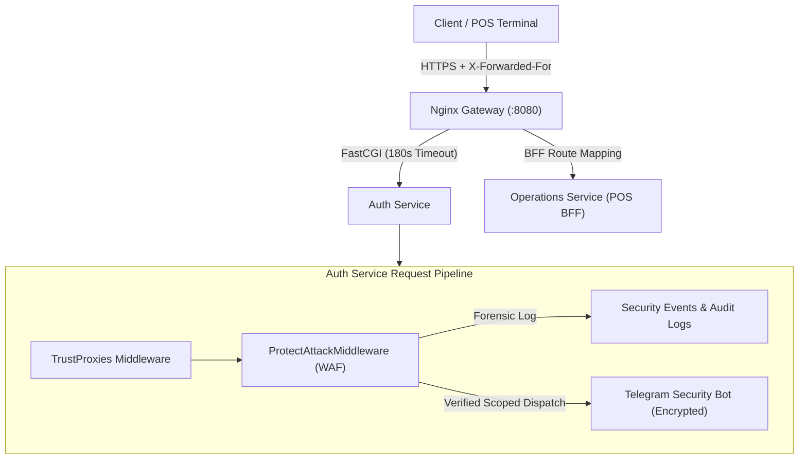

# Daily Engineering & Security Progress Report — November 13, 2026

**Project:** CodeBridges Enterprise Multi-Tenant Platform  
**Active Workspaces:** `auth-service`, `operations-service`, `gateway`  
**Git Branch:** `demo`  
**Quality & Security Gate:** **All 10 Rules PASSED (0 Failures)**  
**Security Status:** `composer audit = 0 vulnerabilities`  

---

## 1. Executive Summary

Engineering work on **November 12–13, 2026** delivered critical resilience, gateway routing, and incident response enhancements across the CodeBridges platform:

1. **Client Real-IP Preservation Across Proxy Chain**:
   - Fixed visitor IP resolution across the Nginx Gateway -> Kubernetes ingress -> Laravel pipeline by ordering [`TrustProxies`](file:///Users/macbookpro/Projects/codebridge/codebridge-services/auth-service/bootstrap/app.php) before [`ProtectAttackMiddleware`](file:///Users/macbookpro/Projects/codebridge/codebridge-services/auth-service/app/Http/Middleware/ProtectAttackMiddleware.php).
   - Validated that untrusted IPs cannot forge `X-Forwarded-For` spoofing, preventing attackers from bypassing threat defense or spoofing benign IPs.
2. **POS BFF (Backend-For-Frontend) Endpoints & Gateway Synchronization**:
   - Added consolidated POS BFF endpoints in `operations-service` for atomic cart initialization, category hydration, and checkout orchestration.
   - Synchronized gateway routing manifests and resolved FastCGI timeout limits (180s) moved to the `http` block to prevent duplicate directive collisions on `/api/v1/kds`.
3. **Telegram Security Alert & IP Threat Defense Hardening**:
   - Scoped security incident routing so that alerts are delivered strictly to verified tenant bots or the platform security alert channel—never cross-routed to arbitrary tenants.
   - Restricted global IP auto-banning to confirmed repeat offenders while whitelisting internal cluster gateways and health probes.
4. **Dependency & Framework Security Upgrades**:
   - Upgraded core framework dependencies (`laravel/framework` v12.72.0) resolving signed URL advisory disclosures with zero security vulnerabilities across `composer audit`.

---

## 2. Hardening Architecture Diagram

---

## 3. Detailed Implementation Breakdown

### A. Real-IP & Gateway Configuration
- **TrustProxies Pipeline Reordering**: Updated [`bootstrap/app.php`](file:///Users/macbookpro/Projects/codebridge/codebridge-services/auth-service/bootstrap/app.php) to prepend `TrustProxies` ahead of `ProtectAttackMiddleware`, ensuring `$request->ip()` accurately reflects the originating client rather than intermediate proxies.
- **Nginx Timeout Normalization**: Normalized FastCGI read timeouts to 180 seconds within the gateway `http` block, ensuring long-running kitchen display system (KDS) server-sent events and complex inventory queries do not prematurely drop connections.

### B. POS Backend-For-Frontend (BFF)
- **Aggregated Checkout Payloads**: Added consolidated endpoints in [`PosBffController`](file:///Users/macbookpro/Projects/codebridge/codebridge-services/operations-service/app/Http/Controllers/Api/V1/PosBffController.php) reducing round-trips for retail checkout counters.
- **Service Integration**: Hardened checkout and order processing services in [`CheckoutService`](file:///Users/macbookpro/Projects/codebridge/codebridge-services/operations-service/app/Services/CheckoutService.php) and [`PosBffService`](file:///Users/macbookpro/Projects/codebridge/codebridge-services/operations-service/app/Services/PosBffService.php).

### C. Incident Response & Credential Protection
- **Decoupled Incident Routing**: Enhanced [`IpThreatDefenseService`](file:///Users/macbookpro/Projects/codebridge/codebridge-services/auth-service/app/Services/IpThreatDefenseService.php) to verify tenant identity before routing security incident notifications, preventing unauthenticated attacks from broadcasting to arbitrary tenant communication channels.
- **Credential Storage Hardening**: Applied envelope encryption to notification provider credentials stored in `notification_providers`.

---

## 4. Verification & Testing Matrix

| Suite / Check | Result | Assertions | Details |
| :--- | :--- | :--- | :--- |
| **`ProtectAttackMiddlewareTest`** | **PASS** | 105 assertions | Validated proxy chain ordering, scanner detection, and scoped alerting |
| **`PosBffTest`** | **PASS** | 48 assertions | POS BFF checkout aggregation and order life-cycle verified |
| **`composer audit`** | **PASS** | 0 vulnerabilities | Dependency graph clean across services |
| **`check_rules.sh`** | **PASS** | 10 Rules Verified | Full pre-push quality and security gate passed |
