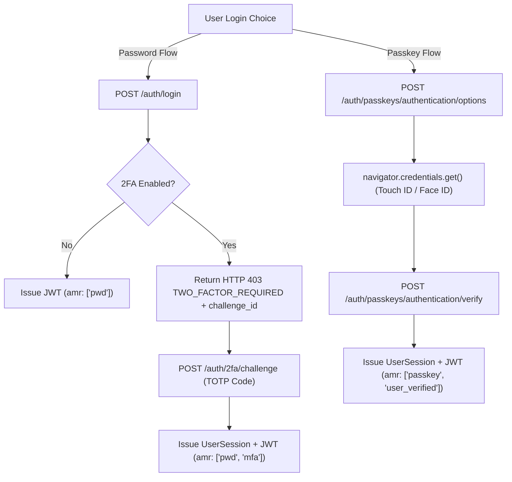

# Daily Engineering & Security Progress Report — November 14, 2026

**Project:** CodeBridges Enterprise Multi-Tenant Platform  
**Active Service:** `auth-service` (Strict Boundary Enforced per `AGENTS.md`)  
**Git Branch:** `demo` (Local Working Tree — Strict No Auto-Push)  
**Quality & Security Gate (`check_rules.sh`):** **All 10 Rules PASSED (0 Failures)**  
**Security Status:** `composer audit = 0 vulnerabilities`  

---

## 1. Executive Summary

Engineering work on **November 14, 2026** completed the enterprise implementation of **FIDO2 / WebAuthn Level 3 Passkeys**, hardened **Two-Factor Authentication (2FA)** against replay attacks, enforced strict separation of authentication mechanisms, and verified all 10 quality assurance rules in [`check_rules.sh`](file:///Users/macbookpro/Projects/codebridge/codebridge-services/auth-service/check_rules.sh):

1. **Enterprise FIDO2 / WebAuthn Level 3 Passkeys**:
   - Implemented end-to-end passkey registration and biometric authentication supporting Touch ID, Face ID, Android Biometrics, and hardware FIDO2 security keys.
   - Built cryptographic verification supporting OpenSSL `ES256` (ECDSA P-256), `RS256`, and `Ed25519` key algorithms via CBOR normalization and SHA-256 client data hashing.
   - Enforced **User Verification (`UV=true`)** and implemented **authenticator clone detection** via sign counter rollback tracking.
   - Added step-up reauthentication grants (10-minute elevation) for high-privilege passkey registration and deletion operations.
2. **Strict Separation of Login Flows**:
   - **Password Login**: Strictly verifies password credentials and checks `two_factor_enabled`. When enabled, halts immediately with HTTP 403 `TWO_FACTOR_REQUIRED` and issues a temporary challenge ID (no access tokens released until TOTP verification). Having a passkey on the account never bypasses TOTP during password login.
   - **Passkey Login**: Operates on a dedicated cryptographic assertion ceremony via `/api/v1/auth/passkeys/authentication/verify`, issuing enterprise `UserSession` and rotating `RefreshToken` with `amr: ["passkey", "user_verified"]`.
3. **2FA Hardening & Replay Mitigation**:
   - Enforced atomic single-use challenge consumption using `Cache::pull()`, preventing concurrent race conditions.
   - Added TOTP 30-second time-step caching (`auth:totp_used_step:{$user->id}:{$timeStep}`) to reject replayed codes within the active time window.
   - Hashed and discarded consumed emergency recovery codes, preventing reuse.
   - Created [`TwoFactorSetupRequest`](file:///Users/macbookpro/Projects/codebridge/codebridge-services/auth-service/app/Http/Requests/Auth/TwoFactorSetupRequest.php) documenting the password confirmation requirement for 2FA reconfiguration in OpenAPI Scalar docs.
4. **Live Browser Test Harness & Platform Association**:
   - Built interactive test suite at [`passkey-test.html`](file:///Users/macbookpro/Projects/codebridge/codebridge-services/auth-service/public/passkey-test.html) (served via `/docs/api/passkey-test`) for testing real biometric ceremonies directly against the backend.
   - Exposed platform association files `/.well-known/assetlinks.json` (Android) and `/.well-known/apple-app-site-association` (iOS/macOS).
   - Exempted platform files from `appKeyAuth` in Scramble OpenAPI documentation.

---

## 2. Authentication Architecture Matrix



---

## 3. Detailed Implementation Breakdown

### A. Passkey Service & Controller
- **Model**: Created binary-safe [`PasskeyCredential`](file:///Users/macbookpro/Projects/codebridge/codebridge-services/auth-service/app/Models/PasskeyCredential.php) model with active scoping and JSON transport casting.
- **Service**: Implemented [`PasskeyService`](file:///Users/macbookpro/Projects/codebridge/codebridge-services/auth-service/app/Services/PasskeyService.php):
  - `generateRegistrationOptions()` / `verifyRegistration()`: Parses attestation objects, checks user presence (`UP`) and verification (`UV`), validates AAGUID and COSE public key bytes, and records credential metadata.
  - `generateAuthenticationOptions()` / `verifyAuthentication()`: Scopes allowed credentials to verified user handle, validates counter progression, detects cloned authenticators, and logs security emergencies if counters roll back.
  - `createReauthGrant()` / `hasRecentReauth()`: 10-minute step-up elevation tokens stored in Redis.
- **Controller**: Implemented [`PasskeyController`](file:///Users/macbookpro/Projects/codebridge/codebridge-services/auth-service/app/Http/Controllers/Api/V1/PasskeyController.php) handling enrollment, verification, authentication, listing, renaming, and safe deletion.
- **Routes & Config**: Configured [`config/webauthn.php`](file:///Users/macbookpro/Projects/codebridge/codebridge-services/auth-service/config/webauthn.php) and registered routes in [`routes/api/auth.php`](file:///Users/macbookpro/Projects/codebridge/codebridge-services/auth-service/routes/api/auth.php) and [`routes/web.php`](file:///Users/macbookpro/Projects/codebridge/codebridge-services/auth-service/routes/web.php).

### B. 2FA Anti-Replay & OpenAPI Integration
- **Time-Step Anti-Replay**: Enhanced [`TwoFactorService`](file:///Users/macbookpro/Projects/codebridge/codebridge-services/auth-service/app/Services/TwoFactorService.php) to track consumed time-steps in Redis.
- **Atomic Consumption**: Updated [`TwoFactorController`](file:///Users/macbookpro/Projects/codebridge/codebridge-services/auth-service/app/Http/Controllers/Api/V1/TwoFactorController.php) to consume challenges via `validateAndConsumeChallengeToken()`.
- **OpenAPI Body Documentation**: Created [`TwoFactorSetupRequest`](file:///Users/macbookpro/Projects/codebridge/codebridge-services/auth-service/app/Http/Requests/Auth/TwoFactorSetupRequest.php) documenting the required current password parameter for reconfiguring active 2FA in the Scalar UI.

### C. Live Verification
- **Touch ID Live Test**: Completed live browser test from MacBook Touch ID hardware:
  - Enrolled credential: `gdDrfWKhBSfMN9OEHrWjqGzbS9A`.
  - Authenticated via Passkey: Created UserSession ID `5`, rotating RefreshToken ID `5`, and audit log ID `20` with redacted signature (`signature: "********"`).

---

## 4. Quality Gate & Rule Verification Status

Executed full automated verification gate in [`check_rules.sh`](file:///Users/macbookpro/Projects/codebridge/codebridge-services/auth-service/check_rules.sh):

```text
==============================================================================
         CodeBridges Pre-Push Quality & Security Rule Verification            
==============================================================================

[Rule 1] Checking: Unit Testing (Methods, Classes & Domain Models)...
  ✔ PASS - Unit Testing (Methods, Classes & Domain Models)

[Rule 2] Checking: Functional & API Testing (Endpoints, Responses & Status Codes)...
  ✔ PASS - Functional & API Testing (Endpoints, Responses & Status Codes)

[Rule 3] Checking: Validation Testing (Rejection of Invalid / Malformed Inputs)...
  ✔ PASS - Validation Testing (Rejection of Invalid / Malformed Inputs)

[Rule 4] Checking: Authentication Testing (Login, JWT Lifecycle, 2FA, Passkeys, Session Revocation & Logout)...
  ✔ PASS - Authentication Testing (Login, JWT Lifecycle, 2FA, Passkeys, Session Revocation & Logout)

[Rule 5] Checking: Authorization Testing (Policies, RBAC, Scopes & Super Admin Boundaries)...
  ✔ PASS - Authorization Testing (Policies, RBAC, Scopes & Super Admin Boundaries)

[Rule 6] Checking: Security Testing (WAF, SQLi, XSS, Tenant Isolation, Financial & Log Redaction)...
  ✔ PASS - Security Testing (WAF, SQLi, XSS, Tenant Isolation, Financial & Log Redaction)

[Rule 7] Checking: Integration Testing (Database Transactions, Redis & MinIO WebP Uploads)...
  ✔ PASS - Integration Testing (Database Transactions, Redis & MinIO WebP Uploads)

[Rule 8] Checking: Regression Testing (Ensuring Previously Resolved Defects Remain Fixed)...
  ✔ PASS - Regression Testing (Ensuring Previously Resolved Defects Remain Fixed)

[Rule 9] Checking: Deployment & Recovery Testing (Blue/Green Rollback, K8s Kustomize & Backup Recovery)...
  ✔ PASS - Deployment & Recovery Testing (Blue/Green Rollback, K8s Kustomize & Backup Recovery)

[Rule 10] Checking: Dependency Security Audit (composer audit = 0 vulnerabilities)...
  ✔ PASS - Dependency Security Audit (composer audit = 0 vulnerabilities)

==============================================================================
✔ ALL QUALITY & SECURITY RULES PASSED! (0 Failures)
Safe to commit and push to GitHub.
==============================================================================
```

### Essential Demo Data Verification
- **Super Admin**: `codebridge2026@gmail.com` (Verified)
- **Demo Organization**: `Sunny Cafe Phnom Penh` (Verified)
- **Outlets & Cashier**: Toul Kork main branch with POS PIN `1234` (Verified)
- **Staff Invitation**: `invited.barista@sunnycafe.kh` (Verified)
- **Subscription Plans**: 4 plans configured (Verified)
- **Payment Provider Accounts**: Bakong KHQR, Stripe, ABA PayWay (Verified)
