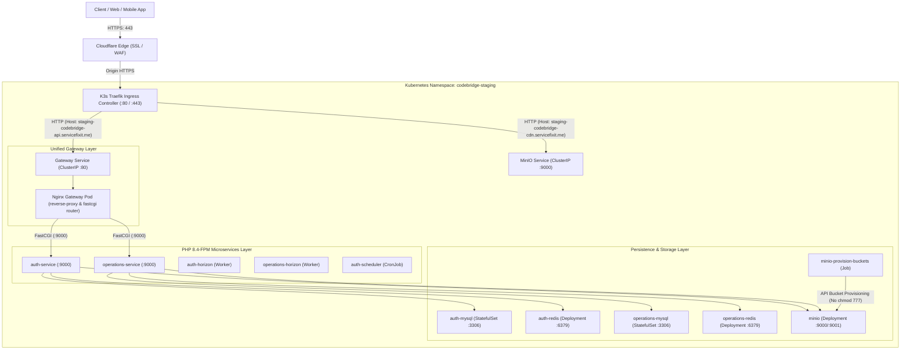

# CodeBridge Staging: Kubernetes (K3s) Deployment Guide

This directory contains the production-grade Kubernetes manifests and deployment automation for the **CodeBridge Staging** environment.

---

## 1. System Architecture



### Why Traefik → Gateway → Microservices?
1. **Traefik Ingress** terminates public TLS and maps domain routes (`staging-codebridge-api.servicefixit.me`) to internal HTTP services.
2. **PHP-FPM** communicates strictly over FastCGI on port 9000, not HTTP. Traefik cannot directly serve Laravel PHP-FPM scripts.
3. The **Nginx Gateway** serves as the central API Router, translating external HTTP requests into FastCGI calls to `auth-service:9000` and `operations-service:9000` while setting `SCRIPT_FILENAME` and tenant request headers.

---

## 2. Single-VPS Port Conflict Notice (Traefik vs. NPM)

When hosting Staging on a single VPS:
- **K3s default**: Bundles Traefik, which binds to host ports `80` and `443`.
- **Docker Compose NPM**: Nginx Proxy Manager also attempts to bind host ports `80` and `443`.

> [!IMPORTANT]
> **Choose one ingress model for your single VPS:**
> 1. **Option A (Recommended for K3s)**: Stop Docker NPM (`docker stop codebridge-staging-npm`), and let K3s Traefik handle host ports 80/443. The manifests in this directory are preconfigured for Traefik Ingress.
> 2. **Option B (Retain Docker NPM)**: If you installed K3s with `--disable traefik`, expose the K8s `gateway` service via NodePort (e.g., port 30080) and configure NPM to forward to `http://127.0.0.1:30080`.

---

## 3. Directory Structure

```
k8s/staging/
├── namespace.yaml           # Defines namespace 'codebridge-staging'
├── configmaps.yaml          # Auth, Operations, and Nginx Gateway routing configs
├── secrets.yaml             # Credentials (gitignored or deployed securely)
├── secrets.example.yaml     # Safe credential template
├── mysql.yaml               # Auth & Operations MySQL 8.4 StatefulSets + PVCs
├── redis.yaml               # Auth & Operations Redis 8 Deployments + PVCs
├── minio.yaml               # MinIO S3 Server + API Bucket Initializer Job
├── migration-jobs.yaml      # Database migration Jobs for Auth & Operations
├── auth.yaml                # Auth Service (PHP-FPM), Horizon Worker, Scheduler
├── operations.yaml          # Operations Service (PHP-FPM), Horizon Worker
├── gateway.yaml             # Unified Nginx Gateway Deployment & Service
├── ingress.yaml             # Traefik Ingress routing API & CDN hostnames
├── kustomization.yaml       # Kustomize manifest assembler
└── deploy.sh                # Automated staging deployment script
```

---

## 4. Setup & Deployment Procedure

### Step 1: Prepare Secrets
Copy the example secrets file and adjust credentials:
```bash
cp k8s/staging/secrets.example.yaml k8s/staging/secrets.yaml
# Edit secrets.yaml with your passwords and APP_KEYs
nano k8s/staging/secrets.yaml
```

### Step 2: Build / Import Docker Images
Ensure the required images are present in your local K3s or registry:
```bash
# If building locally on VPS:
docker build -t codebridge-auth-service:staging ./auth-service
docker build -t codebridge-operations-service:staging ./operations-service

# Import into K3s container runtime:
k3s ctr images import ... # or push to private GHCR registry
```

### Step 3: Run Deployment Script
Run the automated deployment script:
```bash
chmod +x k8s/staging/deploy.sh
./k8s/staging/deploy.sh
```

Or apply manually via Kustomize:
```bash
kubectl apply -k k8s/staging
```

---

## 5. Verification & Health Checks

Check all pods and services in the staging namespace:
```bash
kubectl get pods,svc,ingress -n codebridge-staging
```

Verify health endpoints through the gateway:
```bash
curl -I https://staging-codebridge-api.servicefixit.me/api/v1/health
```

Inspect service logs:
```bash
# Auth Service
kubectl logs -f deployment/auth-service -n codebridge-staging

# Operations Service
kubectl logs -f deployment/operations-service -n codebridge-staging

# Gateway Nginx
kubectl logs -f deployment/gateway -n codebridge-staging

# Horizon Workers
kubectl logs -f deployment/auth-horizon -n codebridge-staging
kubectl logs -f deployment/operations-horizon -n codebridge-staging
```

---

## 6. Rollback & Maintenance

### Rollback a Microservice Deployment
```bash
kubectl rollout undo deployment/auth-service -n codebridge-staging
kubectl rollout undo deployment/operations-service -n codebridge-staging
kubectl rollout undo deployment/gateway -n codebridge-staging
```

### Re-run Database Migrations
```bash
kubectl delete job auth-migration-job operations-migration-job -n codebridge-staging
kubectl apply -f k8s/staging/migration-jobs.yaml
kubectl wait --for=condition=complete job/auth-migration-job -n codebridge-staging --timeout=120s
```

### Complete Teardown (Clean Environment)
```bash
kubectl delete -k k8s/staging
```
*(Note: Persistent Volume Claims retain your database and MinIO storage data unless explicitly deleted).*

